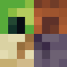
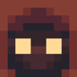
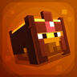
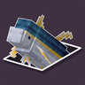
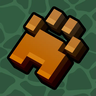
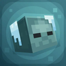

---
navigation:
  title: "Creatures"
  position: 6
  icon: minecraft:egg
---

# Creatures

## Creature families

Choose a creature family to see species, habitats and encounter requirements. Bosses have their own catalog.

- [Wildlife](creatures.wilderness.md)
- [Friends & foes](creatures.friends.md)
- [Aquatic wildlife](adventure.aquatic.md)
- [Creeper variants](creatures.creepers.md)
- [Enderman variants](creatures.endermen.md)
- [Hostile variants](creatures.variants.md)
- [Dungeon guards](creatures.guards.md)
- [Cataclysm creatures](creatures.cataclysm.md)
- [Illagers](creatures.illagers.md)
- [Summons](creatures.summons.md)
- [Boss encounters](adventure.bosses.md)

***

## Other encounters

<EmiSearch query="@create" /> <EmiSearch query="@supplementaries" />

| Mod | Creatures & access |
| --- | --- |
| Supplementaries | Red Merchant and Plunderer have shipped entity definitions. Their encounter conditions are not confirmed. |
| Dangerous | Changes existing enemy equipment and health without adding a new wildlife roster. |
| Create: Deep Seas | Amphistium and Cookiecutter Shark are development creatures. They are not registered in ordinary gameplay. |

***

## Related mods

| Mod or content | Purpose | Item search |
| --- | --- | --- |
|  [Creeper Overhaul](creatures.creepers.md) | Adds biome-specific creeper variants with distinct appearances and behavior. | <EmiSearch query="@creeperoverhaul" /> |
|  [Enderman Overhaul](creatures.endermen.md) | Adds enderman variants with distinctive models, sounds and animations. | <EmiSearch query="@endermanoverhaul" /> |
|  [Friends&Foes (Forge/NeoForge)](creatures.friends.md) | Adds expanded versions of creatures omitted from Minecraft mob votes. | <EmiSearch query="@friendsandfoes" /> |
|  [Hybrid Aquatic](adventure.aquatic.md) | Adds aquatic wildlife across ocean and freshwater habitats. | <EmiSearch query="@hybrid_aquatic" /> |
|  [Spawn](creatures.wilderness.md) | Expands Overworld wilderness with animals, biomes and ambient life. | <EmiSearch query="@spawn" /> |
|  [Variants&Ventures](creatures.variants.md) | Adds new variants of familiar creatures to world encounters. | <EmiSearch query="@variantsandventures" /> |
