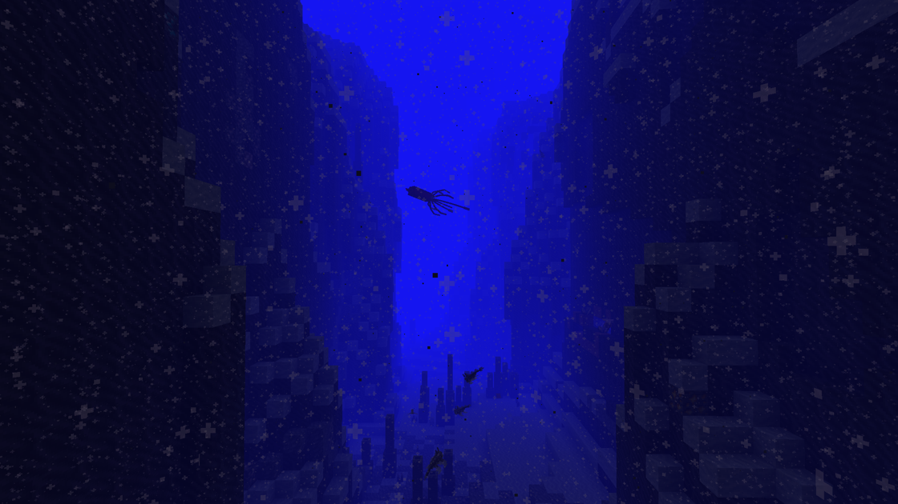

---
navigation:
  title: "Squid & octopuses"
  position: 5
  parent: adventure.aquatic.md
  icon: minecraft:squid_spawn_egg
---

# Squid & octopuses

## Squid & octopuses

A Giant Squid in a trench

| Creature | Habitat |
| --- | --- |
| Arrow Squid | temperate oceans, temperate trenches |
| Colossal Squid | cold trenches, frozen trenches, temperate trenches |
| Cuttlefish | coral reefs, shallow temperate oceans, shallow warm oceans |
| Firefly Squid | coral reefs, lukewarm oceans, lukewarm trenches, warm oceans, warm trenches |
| Giant Squid | cold trenches, lukewarm trenches, temperate trenches, warm trenches |
| Octopus | coral reefs, Red Meadow, shallow lukewarm oceans, shallow temperate oceans |

***

## Related mods

| Mod or content | Purpose | Item search |
| --- | --- | --- |
|  [Hybrid Aquatic](adventure.aquatic.md) | Adds aquatic wildlife across ocean and freshwater habitats. | <EmiSearch query="@hybrid_aquatic" /> |
