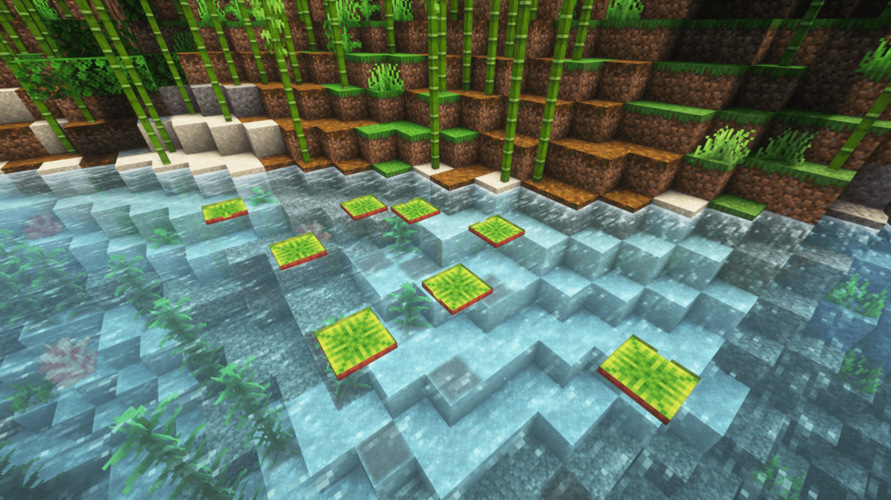

---
navigation:
  title: "Freshwater fish"
  position: 0
  parent: adventure.aquatic.md
  icon: minecraft:cod_spawn_egg
---

# Freshwater fish

## Freshwater fish

<EmiSearch query="@hybrid_aquatic" />

Jungle freshwater habitat

These Hybrid Aquatic species use the habitat groups below. Natural encounters still depend on depth and placement rules.

| Creature | Habitat |
| --- | --- |
| African Butterflyfish | jungles, mangroves, marshes, tropical rivers |
| Betta | mangroves, marshes, swamps |
| Carp | rivers |
| Cichlid | jungles, mangroves, tropical rivers |
| Corydora | jungles, tropical rivers |
| Danio | jungles, mangroves, marshes, tropical rivers |
| Discus | jungles, mangroves, tropical rivers |
| Golden Dorado | jungles, tropical rivers |
| Gourami | jungles, mangroves, marshes, tropical rivers |
| Piranha | jungles, tropical rivers |
| Pleco | jungles, mangroves, marshes, swamps, tropical rivers |
| Pupfish | badlands |
| Shiner | cold rivers, river biomes |
| Sunfish | rivers |
| Tetra | caves, jungles, mangroves, marshes, tropical rivers |
| Tiger Barb | jungles, mangroves, marshes, swamps, tropical rivers |
| Trout | cold rivers, river biomes |

***

## Related mods

| Mod or content | Purpose | Item search |
| --- | --- | --- |
|  [Hybrid Aquatic](adventure.aquatic.md) | Adds aquatic wildlife across ocean and freshwater habitats. | <EmiSearch query="@hybrid_aquatic" /> |
