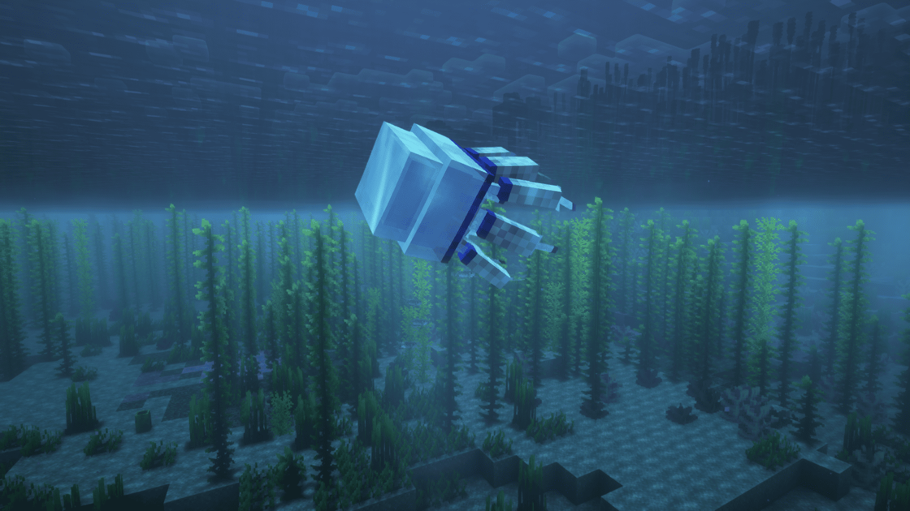

---
navigation:
  title: "Jellyfish"
  position: 4
  parent: adventure.aquatic.md
  icon: hybrid_aquatic:barrel_jellyfish_spawn_egg
---

# Jellyfish

## Jellyfish

Barrel Jellyfish among kelp

| Creature | Habitat |
| --- | --- |
| Barrel Jellyfish | lukewarm oceans, Red Meadow, Seagrass Bed, shallow temperate oceans, shallow warm oceans |
| Big Red Jellyfish | cold trenches, frozen trenches, lukewarm trenches, temperate trenches, warm trenches |
| Blue Jellyfish | cold oceans, temperate oceans |
| Box Jellyfish | coral reefs, lukewarm oceans, mangroves, sandy beaches, shallow warm oceans |
| Cepheidae Jellyfish | lukewarm oceans, Seagrass Bed, shallow temperate oceans, shallow warm oceans |
| Comb Jelly | all trench types, deep reefs, deep oceans |
| Cosmic Jellyfish | cold trenches, deep reefs, frozen trenches, lukewarm trenches, temperate trenches, warm trenches |
| Crown Jellyfish | cold trenches, frozen trenches, lukewarm trenches, temperate trenches, warm trenches |
| Firework Jellyfish | cold trenches, deep reefs, frozen trenches, lukewarm trenches, temperate trenches, warm trenches |
| Lion's Mane Jellyfish | cold oceans, frozen oceans |
| Mauve Stinger | cold trenches, deep reefs, frozen trenches, lukewarm trenches, temperate trenches, warm trenches |
| Moon Jellyfish | coral reefs, Red Meadow, sandy beaches, Seagrass Bed, shallow lukewarm oceans, shallow temperate oceans, shallow warm oceans |
| Nomura Jellyfish | cold oceans, frozen oceans |
| Sea Nettle | lukewarm oceans, shallow warm oceans, temperate oceans |

***

## Related mods

| Mod or content | Purpose | Item search |
| --- | --- | --- |
|  [Hybrid Aquatic](adventure.aquatic.md) | Adds aquatic wildlife across ocean and freshwater habitats. | <EmiSearch query="@hybrid_aquatic" /> |
