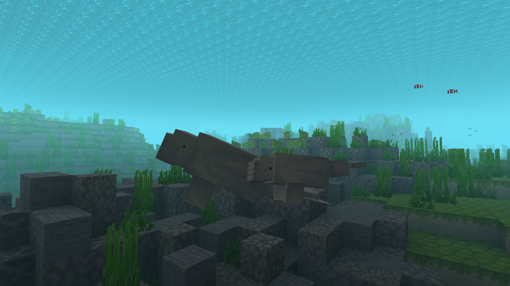

---
navigation:
  title: "Aquatic mammals"
  position: 7
  parent: adventure.aquatic.md
  icon: minecraft:dolphin_spawn_egg
---

# Aquatic mammals

## Aquatic mammals

A Dugong and its young in a Seagrass Bed

| Creature | Habitat |
| --- | --- |
| Dugong | Seagrass Bed |
| Manatee | mangroves, Seagrass Bed, tropical rivers |
| Orca | cold oceans, frozen oceans, temperate oceans |
| Otter | rivers, rocky beaches, sandy beaches |

***

## Related mods

| Mod or content | Purpose | Item search |
| --- | --- | --- |
|  [Hybrid Aquatic](adventure.aquatic.md) | Adds aquatic wildlife across ocean and freshwater habitats. | <EmiSearch query="@hybrid_aquatic" /> |
