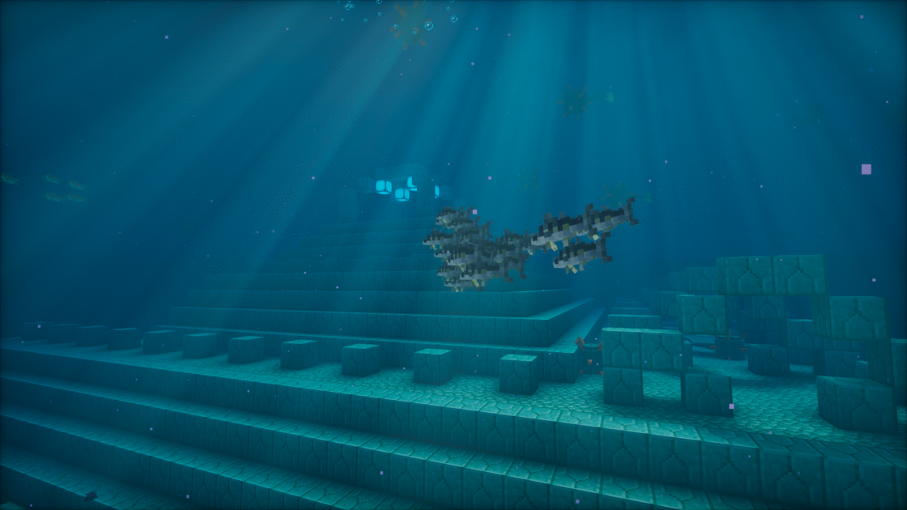

---
navigation:
  title: "Marine fish & rays"
  position: 1
  parent: adventure.aquatic.md
  icon: minecraft:tropical_fish_spawn_egg
---

# Marine fish & rays

## Marine fish & rays

<EmiSearch query="@hybrid_aquatic" />

A school of Mackerel beside an Ocean Monument

These Hybrid Aquatic species use the habitat groups below. Natural encounters still depend on depth and placement rules.

| Creature | Habitat |
| --- | --- |
| Barracuda | lukewarm oceans, shallow temperate oceans, shallow warm oceans |
| Blowfish | coral reefs, Seagrass Bed, shallow warm oceans |
| Boxfish | coral reefs, shallow warm oceans |
| Clownfish | coral reefs |
| Damselfish | coral reefs, lukewarm oceans, shallow warm oceans |
| Flying Fish | lukewarm oceans, shallow warm oceans |
| Garden Eel | Seagrass Bed, shallow lukewarm oceans, shallow warm oceans |
| Herring | shallow cold oceans, shallow temperate oceans |
| Lionfish | coral reefs, Red Meadow |
| Mackerel | cold oceans, temperate oceans |
| Mahi | deep lukewarm oceans, deep warm oceans |
| Manta Ray | lukewarm oceans, temperate oceans, warm oceans |
| Moray Eel | coral reefs, Seagrass Bed |
| Needlefish | lukewarm oceans, Seagrass Bed, shallow temperate oceans |
| Ocean Sunfish | deep lukewarm oceans, deep temperate oceans, deep warm oceans |
| Opah | deep lukewarm oceans, deep temperate oceans, deep warm oceans |
| Parrotfish | coral reefs, shallow warm oceans |
| Seadragon | deep lukewarm oceans, Seagrass Bed, shallow temperate oceans |
| Seahorse | coral reefs, Seagrass Bed |
| Stingray | coral reefs, Red Meadow, Seagrass Bed, shallow lukewarm oceans, shallow warm oceans |
| Stonefish | coral reefs, Seagrass Bed |
| Surgeonfish | coral reefs, Seagrass Bed |
| Trevally | coral reefs, lukewarm oceans, Seagrass Bed, shallow warm oceans |
| Triggerfish | coral reefs, Seagrass Bed, shallow warm oceans |
| Tuna | deep lukewarm oceans, deep temperate oceans, deep warm oceans |
| Wrasse | shallow temperate oceans |

***

## Related mods

| Mod or content | Purpose | Item search |
| --- | --- | --- |
|  [Hybrid Aquatic](adventure.aquatic.md) | Adds aquatic wildlife across ocean and freshwater habitats. | <EmiSearch query="@hybrid_aquatic" /> |
