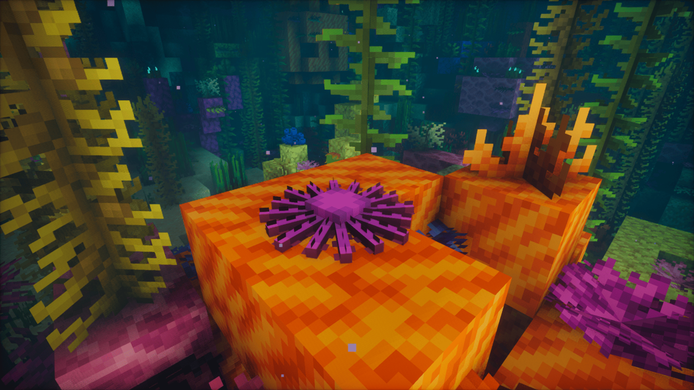

---
navigation:
  title: "Seafloor wildlife"
  position: 6
  parent: adventure.aquatic.md
  icon: hybrid_aquatic:starfish_spawn_egg
---

# Seafloor wildlife

## Seafloor wildlife

Starfish on a coral reef

| Creature | Habitat |
| --- | --- |
| Coconut Crab | sandy beaches |
| Crayfish | cold rivers, rivers, tropical rivers |
| Decorator Crab | coral reefs, Red Meadow |
| Dungeness Crab | sandy beaches |
| Fiddler Crab | mangroves, marshes, swamps |
| Flower Crab | mangroves, marshes, Red Meadow, Seagrass Bed, shallow lukewarm oceans, shallow warm oceans |
| Ghost Crab | sandy beaches |
| Giant Isopod | cold oceans, cold trenches, deep reefs, temperate oceans, temperate trenches, warm trenches |
| Hermit Crab | Red Meadow, sandy beaches, Seagrass Bed, shallow lukewarm oceans |
| Horseshoe Crab | Red Meadow, sandy beaches, Seagrass Bed, shallow lukewarm oceans, shallow warm oceans |
| Lightfoot Crab | rocky beaches |
| Lobster | coral reefs, deep reefs, Red Meadow, Seagrass Bed, shallow lukewarm oceans, shallow warm oceans |
| Scalyfoot Snail | thermal-vent habitats |
| Sea Angel | cold trenches, frozen trenches, temperate trenches |
| Sea Cucumber | all trench types, Red Meadow, deep oceans, oceans |
| Sea Slug | coral reefs, lukewarm oceans, Red Meadow, Seagrass Bed, shallow cold oceans, shallow temperate oceans, shallow warm oceans |
| Sea Urchin | all trench types, Red Meadow, deep oceans, oceans |
| Shrimp | coral reefs, deep reefs, Red Meadow, Seagrass Bed, shallow warm oceans, tropical rivers |
| Spider Crab | cold oceans, cold trenches, deep reefs, temperate oceans, temperate trenches, warm trenches |
| Starfish | all trench types, sandy beaches, deep oceans, oceans |
| Vampire Crab | jungles, tropical rivers |
| Yeti Crab | cold trenches, frozen trenches, thermal-vent habitats |

***

## Related mods

| Mod or content | Purpose | Item search |
| --- | --- | --- |
|  [Hybrid Aquatic](adventure.aquatic.md) | Adds aquatic wildlife across ocean and freshwater habitats. | <EmiSearch query="@hybrid_aquatic" /> |
