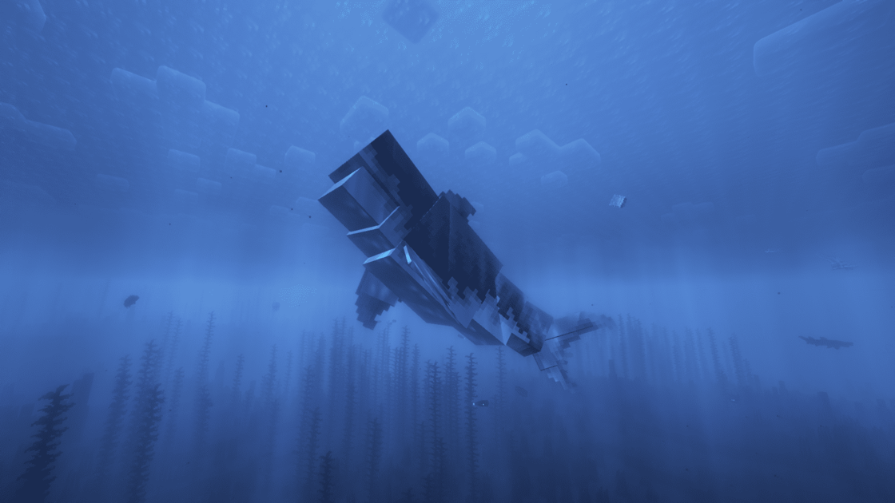

---
navigation:
  title: "Sharks"
  position: 3
  parent: adventure.aquatic.md
  icon: hybrid_aquatic:great_white_shark_spawn_egg
---

# Sharks

## Sharks

Great White Shark

| Creature | Habitat |
| --- | --- |
| Basking Shark | deep cold oceans, deep temperate oceans, frozen oceans |
| Bull Shark | lukewarm oceans, warm oceans |
| Frilled Shark | deep reefs, lukewarm trenches, warm trenches |
| Goblin Shark | cold trenches, lukewarm trenches, temperate trenches, warm trenches |
| Great White Shark | deep lukewarm oceans, deep temperate oceans, deep warm oceans |
| Hammerhead Shark | Seagrass Bed, shallow lukewarm oceans, shallow warm oceans, temperate oceans |
| Hound Shark | shallow lukewarm oceans, shallow temperate oceans |
| Lantern Shark | deep lukewarm oceans, deep reefs, deep temperate oceans, deep warm oceans, lukewarm trenches, temperate trenches, warm trenches |
| Sand Tiger Shark | Seagrass Bed, shallow lukewarm oceans, shallow temperate oceans, shallow warm oceans |
| Sixgill Shark | lukewarm trenches, temperate trenches, warm trenches |
| Sleeper Shark | cold trenches, frozen trenches |
| Thresher Shark | deep lukewarm oceans, deep temperate oceans, deep warm oceans |
| Whale Shark | lukewarm oceans, warm oceans |

***

## Related mods

| Mod or content | Purpose | Item search |
| --- | --- | --- |
|  [Hybrid Aquatic](adventure.aquatic.md) | Adds aquatic wildlife across ocean and freshwater habitats. | <EmiSearch query="@hybrid_aquatic" /> |
