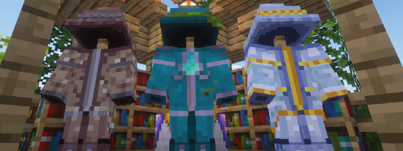

---
navigation:
  title: "Aqua Wizard"
  position: 3
  parent: combat.magic.md
  icon: elemental_wizards_rpg:wand_aqua
item_ids:
  - elemental_wizards_rpg:elemental_chest
  - elemental_wizards_rpg:elemental_feet
  - elemental_wizards_rpg:elemental_head
  - elemental_wizards_rpg:elemental_legs
  - elemental_wizards_rpg:kelp_chest
  - elemental_wizards_rpg:kelp_feet
  - elemental_wizards_rpg:kelp_head
  - elemental_wizards_rpg:kelp_legs
  - elemental_wizards_rpg:netherite_kelp_chest
  - elemental_wizards_rpg:netherite_kelp_feet
  - elemental_wizards_rpg:netherite_kelp_head
  - elemental_wizards_rpg:netherite_kelp_legs
  - elemental_wizards_rpg:ocean_robe_chest
  - elemental_wizards_rpg:ocean_robe_feet
  - elemental_wizards_rpg:ocean_robe_head
  - elemental_wizards_rpg:ocean_robe_legs
  - elemental_wizards_rpg:staff_aqua
  - elemental_wizards_rpg:staff_elemental
  - elemental_wizards_rpg:staff_netherite_aqua
  - elemental_wizards_rpg:unique_staff_1
  - elemental_wizards_rpg:wand_aqua
  - elemental_wizards_rpg:wand_kelp
  - elemental_wizards_rpg:wand_netherite_aqua
---

# Aqua Wizard

 [English](https://www.youtube.com/results?search_query=Minecraft+1.21.1+Elemental+Wizards+RPG+Aqua+Wizard+abilities+equipment+tutorial+English) · [中文](https://www.youtube.com/results?search_query=%E6%88%91%E7%9A%84%E4%B8%96%E7%95%8C+1.21.1+Elemental+Wizards+RPG+%E6%B0%B4%E7%B3%BB%E6%B3%95%E5%B8%88+%E6%8A%80%E8%83%BD+%E8%A3%85%E5%A4%87+%E6%95%99%E7%A8%8B+%E4%B8%AD%E6%96%87)

## Role & first weapon

Aqua Wizards use water wands and staves for damaging spells and support areas.

### What to look for

Water spells scale with Water power. The Kelp Wand names Water power and costs only kelp and a stick, so the first focus needs an ocean visit rather than a mining trip. Read the school line before you bind a book.

The Aqua Wand and the Aqua Staff are the specialist upgrades. The Elemental Staff names Air, Earth and Water power in one item, which suits a player who keeps several elemental books. It also costs a nether star, so it is a late goal rather than a starting focus.

The Kelp Robe supports the school with kelp, wool and prismarine crystals. The Ocean Robe is a later upgrade that uses an epic armor upgrade and a warden upgrade crystal, so it depends on other content. The Elemental Robe covers all three elemental schools and is the general entry.

This class carries support in its own book. Springwater and Healing Rain Cloud are area effects, so bring enough runes for a heal as well as for a damage spell. The tooltip of each spell names its cost, and a spell with no rune cost consumes nothing.

A successful first use looks like this. Hold the Kelp Wand, cast at a hostile and confirm the water spell lands, then cast Springwater among allies and watch the area effect appear. If the second cast fails, the missing piece is usually the healing rune rather than the wand.

### Readiness

These are optional suggestions, not a required sequence or a count of days played.

| Stage | Ready when | Next decision |
| --- | --- | --- |
| Early game | You have kelp, a stick and the rune the wand spell names. | Craft the Kelp Wand and cast once. Add the Elemental Robe pieces as materials allow. |
| Early midgame | You can use a Spell Binding Table with bookshelves and pay the displayed cost. | Bind the Aqua book and equip it with a compatible focus held. |
| Midgame | Prismarine crystals are available and you can compare the Aqua Wand with the Aqua Staff. | Choose between the Kelp Robe and the Aqua robe path by the school bonus each piece gives. |
| Late game | You can obtain a nether star or an epic armor upgrade. | Treat the Elemental Staff and the Ocean Robe as separate goals. Neither one is required for the other. |

### Example starter outfit

An example starter outfit: the class starter weapon with the first armor set in its catalog. It is one craftable option, not the official or best build.

<GameScene zoom="4" interactive={true}>
  <IsometricCamera yaw="135" pitch="15" />
  <Entity id="minecraft:armor_stand" x="0.5" y="0" z="0.5" rotationY="180" data='{NoGravity:1b,Invulnerable:1b,ShowArms:1b,NoBasePlate:1b,ArmorItems:[{id:"elemental_wizards_rpg:elemental_feet",count:1},{id:"elemental_wizards_rpg:elemental_legs",count:1},{id:"elemental_wizards_rpg:elemental_chest",count:1},{id:"elemental_wizards_rpg:elemental_head",count:1}],HandItems:[{id:"elemental_wizards_rpg:wand_kelp",count:1},{}]}' />
</GameScene>

<ItemGrid><ItemIcon id="elemental_wizards_rpg:wand_kelp" /><ItemIcon id="elemental_wizards_rpg:elemental_feet" /><ItemIcon id="elemental_wizards_rpg:elemental_legs" /><ItemIcon id="elemental_wizards_rpg:elemental_chest" /><ItemIcon id="elemental_wizards_rpg:elemental_head" /></ItemGrid>

### Starter equipment

<ItemGrid><ItemIcon id="elemental_wizards_rpg:wand_kelp" /></ItemGrid>

<ItemLink id="elemental_wizards_rpg:wand_kelp" />

<Recipe id="elemental_wizards_rpg:wand_kelp" />

### Book abilities

| Ability | Form |
| --- | --- |
| Bubble Beam | Area |
| Waterballs | Projectile |
| Springwater | Area |
| Hydro Beam | Beam |
| Healing Rain Cloud | Self effect |
| Tidal Wave | Self effect |

***

## Class book
<ItemGrid><ItemIcon id="spell_engine:spell_book" /></ItemGrid>

The Aqua book uses <ItemLink id="spell_engine:spell_book" /> with class-specific ability pools. Select the matching book at the Spell Binding Table.

- [Spell binding & casting](combat.abilities.md) Book creation, costs, equipment slots and casting controls.
- [Runes & weapon spells](combat.magic.md) Casting resources and equipment-provided spells.

***

## Class skills
<ItemGrid><ItemIcon id="elemental_wizards_rpg:wand_aqua" /><ItemIcon id="elemental_wizards_rpg:staff_aqua" /></ItemGrid>

Open <KeyBind id="key.puffish_skills.open" /> to find these class and weapon paths.

| Path | Associated equipment |
| --- | --- |
| Path of Water | <ItemLink id="elemental_wizards_rpg:wand_aqua" /> |

### Weapon paths

| Path | Associated equipment |
| --- | --- |
| Improved Water Whip | <ItemLink id="elemental_wizards_rpg:staff_aqua" /> |

- [Skill development](combat.skills.md) Point budgets, connected nodes, incompatible roots and resetting. Changing equipment does not refund points.

***

## Weapons & armor

<EmiSearch query="@elemental_wizards_rpg" />

Water focuses supply the matching spell power. The shared elemental staves in this list support air, earth and water. Compare their full attributes with the specialist focuses.

### Weapons

| Family | Items | School bonuses or Role |
| --- | --- | --- |
| Water wands | <ItemGrid><ItemIcon id="elemental_wizards_rpg:wand_kelp" /><ItemIcon id="elemental_wizards_rpg:wand_aqua" /><ItemIcon id="elemental_wizards_rpg:wand_netherite_aqua" /></ItemGrid> | Water power |
| Elemental staff | <ItemGrid><ItemIcon id="elemental_wizards_rpg:staff_elemental" /></ItemGrid> | Air, Earth and Water power |
| Water staves | <ItemGrid><ItemIcon id="elemental_wizards_rpg:staff_aqua" /><ItemIcon id="elemental_wizards_rpg:staff_netherite_aqua" /></ItemGrid> | Water power |
| Unique staff | <ItemGrid><ItemIcon id="elemental_wizards_rpg:unique_staff_1" /></ItemGrid> | Earth, Water and Air power |

### Armor sets

| Set reference, chest piece | Pieces, head to feet |
| --- | --- |
| <ItemLink id="elemental_wizards_rpg:elemental_chest" /> | <ItemGrid><ItemIcon id="elemental_wizards_rpg:elemental_head" /><ItemIcon id="elemental_wizards_rpg:elemental_chest" /><ItemIcon id="elemental_wizards_rpg:elemental_legs" /><ItemIcon id="elemental_wizards_rpg:elemental_feet" /></ItemGrid> |
| <ItemLink id="elemental_wizards_rpg:kelp_chest" /> | <ItemGrid><ItemIcon id="elemental_wizards_rpg:kelp_head" /><ItemIcon id="elemental_wizards_rpg:kelp_chest" /><ItemIcon id="elemental_wizards_rpg:kelp_legs" /><ItemIcon id="elemental_wizards_rpg:kelp_feet" /></ItemGrid> |
| <ItemLink id="elemental_wizards_rpg:netherite_kelp_chest" /> | <ItemGrid><ItemIcon id="elemental_wizards_rpg:netherite_kelp_head" /><ItemIcon id="elemental_wizards_rpg:netherite_kelp_chest" /><ItemIcon id="elemental_wizards_rpg:netherite_kelp_legs" /><ItemIcon id="elemental_wizards_rpg:netherite_kelp_feet" /></ItemGrid> |
| <ItemLink id="elemental_wizards_rpg:ocean_robe_chest" /> | <ItemGrid><ItemIcon id="elemental_wizards_rpg:ocean_robe_head" /><ItemIcon id="elemental_wizards_rpg:ocean_robe_chest" /><ItemIcon id="elemental_wizards_rpg:ocean_robe_legs" /><ItemIcon id="elemental_wizards_rpg:ocean_robe_feet" /></ItemGrid> |

***

## Shared equipment

<ItemGrid><ItemIcon id="minecraft:iron_sword" /><ItemIcon id="minecraft:iron_chestplate" /><ItemIcon id="jewelry:copper_ring" /></ItemGrid>- [Weapons & armor](equipment.weapons-armor.md)
- [Accessories](equipment.accessories.md)
- [Combat controls](combat.handling.md)
