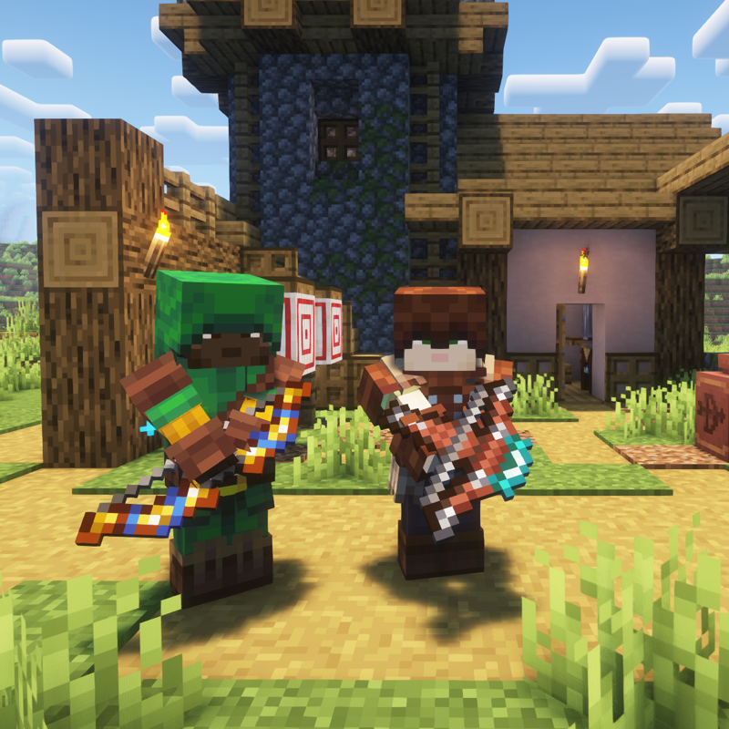

---
navigation:
  title: "Archer"
  position: 4
  parent: combat.martial.md
  icon: archers:composite_longbow
item_ids:
  - archers:archer_armor_chest
  - archers:archer_armor_feet
  - archers:archer_armor_head
  - archers:archer_armor_legs
  - archers:composite_longbow
  - archers:diamond_spear
  - archers:flint_spear
  - archers:golden_spear
  - archers:heavy_crossbow
  - archers:iron_spear
  - archers:mechanic_shortbow
  - archers:netherite_heavy_crossbow
  - archers:netherite_longbow
  - archers:netherite_ranger_armor_chest
  - archers:netherite_ranger_armor_feet
  - archers:netherite_ranger_armor_head
  - archers:netherite_ranger_armor_legs
  - archers:netherite_rapid_crossbow
  - archers:netherite_shortbow
  - archers:netherite_spear
  - archers:ranger_armor_chest
  - archers:ranger_armor_feet
  - archers:ranger_armor_head
  - archers:ranger_armor_legs
  - archers:rapid_crossbow
  - archers:royal_longbow
---

# Archer

 [English](https://www.youtube.com/results?search_query=Minecraft+1.21.1+Archers+RPG+Archer+abilities+equipment+tutorial+English) · [中文](https://www.youtube.com/results?search_query=%E6%88%91%E7%9A%84%E4%B8%96%E7%95%8C+1.21.1+Archers+RPG+%E5%BC%93%E7%AE%AD%E6%89%8B+%E6%8A%80%E8%83%BD+%E8%A3%85%E5%A4%87+%E6%95%99%E7%A8%8B+%E4%B8%AD%E6%96%87)

## Role & first weapon

Archers fight at range with bows and crossbows, with spears as a melee alternative and abilities for prepared shots, area attacks and a companion effect.

### Example starter outfit

An example starter outfit: the class starter weapon with the first armor set in its catalog. It is one craftable option, not the official or best build.

<GameScene zoom="4" interactive={true}>
  <IsometricCamera yaw="135" pitch="15" />
  <Entity id="minecraft:armor_stand" x="0.5" y="0" z="0.5" rotationY="180" data='{NoGravity:1b,Invulnerable:1b,ShowArms:1b,NoBasePlate:1b,ArmorItems:[{id:"archers:archer_armor_feet",count:1},{id:"archers:archer_armor_legs",count:1},{id:"archers:archer_armor_chest",count:1},{id:"archers:archer_armor_head",count:1}],HandItems:[{id:"archers:composite_longbow",count:1},{}]}' />
</GameScene>

<ItemGrid><ItemIcon id="archers:composite_longbow" /><ItemIcon id="archers:archer_armor_feet" /><ItemIcon id="archers:archer_armor_legs" /><ItemIcon id="archers:archer_armor_chest" /><ItemIcon id="archers:archer_armor_head" /></ItemGrid>

### Starter equipment

<ItemGrid><ItemIcon id="archers:composite_longbow" /></ItemGrid>

<ItemLink id="archers:composite_longbow" />

<Recipe id="archers:composite_longbow" />

### Readiness & first fight

Archery skills work with any bow or crossbow you hold, so the damage comes from the ranged weapon and its ammunition rather than from a separate spell attribute. Longbows suit a patient draw, shortbows suit quick shots while you move, and crossbows charge on their own rhythm. Archer and ranger armor carry the ranged bonuses, so read a piece before you break up a set you already wear. A good first fight is one skeleton or zombie dropped before it closes the distance, with one ability used and arrows still in reserve.

The stages below are optional. They describe what you need on hand and what each step unlocks, not how long you have played.

| Stage | Ready when | Suggested action or next decision |
| --- | --- | --- |
| Early game: first shots | A bow or crossbow, a stack of arrows or bolts, and food to recover from a missed shot. | Craft the composite longbow when the materials are at hand, otherwise practise with a vanilla bow. The archery skills accept either. |
| Early midgame: archery manual | A Spell Binding Table with bookshelves beside it, the Archery Manual, and the learning cost its interface shows. | Bind the manual, equip it and keep a ranged weapon in hand. A village Archery Range is one place to find starting equipment. |
| Midgame: armor | Two or more archer or ranger armor pieces, crafted or bought, and enough levels to repair them. | Compare the hover attributes on the pieces you own. Move to ranger armor when its bonuses match the weapon family you settled on. |
| Late game: netherite | Netherite ingots, the smithing template the recipe asks for, and the ranger piece being upgraded. | Upgrade the piece you wear most. Dungeon loot also carries archery equipment, so check a found bow before spending materials. |

### Book abilities

| Ability | Form |
| --- | --- |
| Power Shot | Prepared effect |
| Entangling Roots | Persistent area |
| Barrage | Arrow shot |
| Rain of Arrows | Falling attack |
| Magic Arrow | Projectile |
| Spirit Wolf Pack | Self effect |

***

## Class book
<ItemGrid><ItemIcon id="spell_engine:spell_book" /></ItemGrid>

The Archer book uses <ItemLink id="spell_engine:spell_book" /> with class-specific ability pools. Select the matching book at the Spell Binding Table.

- [Spell binding & casting](combat.abilities.md) Book creation, costs, equipment slots and casting controls.
- [Runes & weapon spells](combat.magic.md) Casting resources and equipment-provided spells.

***

## Class skills
<ItemGrid><ItemIcon id="archers:composite_longbow" /><ItemIcon id="minecraft:bow" /><ItemIcon id="archers:iron_spear" /></ItemGrid>

Open <KeyBind id="key.puffish_skills.open" /> to find these class and weapon paths.

| Path | Associated equipment |
| --- | --- |
| Path of the Archer | <ItemLink id="archers:composite_longbow" /> |

### Weapon paths

| Path | Associated equipment |
| --- | --- |
| Bow Specialisation | <ItemLink id="minecraft:bow" /> |
| Spear Specialisation | <ItemLink id="archers:iron_spear" /> |

- [Skill development](combat.skills.md) Point budgets, connected nodes, incompatible roots and resetting. Changing equipment does not refund points.

***

## Weapons & armor

<EmiSearch query="@archers" />

Bows and crossbows trade drawing speed against projectile damage. Spears provide a melee alternative. Archer and ranger armor supply ranged attributes.

### Weapons

| Family | Items | Role |
| --- | --- | --- |
| <ItemLink id="archers:flint_spear" /> | <ItemGrid><ItemIcon id="archers:flint_spear" /><ItemIcon id="archers:iron_spear" /><ItemIcon id="archers:golden_spear" /><ItemIcon id="archers:diamond_spear" /><ItemIcon id="archers:netherite_spear" /></ItemGrid> | Melee fallback when a mob closes the distance |
| <ItemLink id="archers:composite_longbow" /> | <ItemGrid><ItemIcon id="archers:composite_longbow" /><ItemIcon id="archers:royal_longbow" /><ItemIcon id="archers:netherite_longbow" /></ItemGrid> | Ranged, long draw for a patient shot |
| <ItemLink id="archers:mechanic_shortbow" /> | <ItemGrid><ItemIcon id="archers:mechanic_shortbow" /><ItemIcon id="archers:netherite_shortbow" /></ItemGrid> | Ranged, short draw for shooting while you move |
| <ItemLink id="archers:rapid_crossbow" /> | <ItemGrid><ItemIcon id="archers:rapid_crossbow" /><ItemIcon id="archers:heavy_crossbow" /><ItemIcon id="archers:netherite_rapid_crossbow" /><ItemIcon id="archers:netherite_heavy_crossbow" /></ItemGrid> | Ranged, charged shot you release on command |

### Armor sets

| Set reference, chest piece | Pieces, head to feet |
| --- | --- |
| <ItemLink id="archers:archer_armor_chest" /> | <ItemGrid><ItemIcon id="archers:archer_armor_head" /><ItemIcon id="archers:archer_armor_chest" /><ItemIcon id="archers:archer_armor_legs" /><ItemIcon id="archers:archer_armor_feet" /></ItemGrid> |
| <ItemLink id="archers:ranger_armor_chest" /> | <ItemGrid><ItemIcon id="archers:ranger_armor_head" /><ItemIcon id="archers:ranger_armor_chest" /><ItemIcon id="archers:ranger_armor_legs" /><ItemIcon id="archers:ranger_armor_feet" /></ItemGrid> |
| <ItemLink id="archers:netherite_ranger_armor_chest" /> | <ItemGrid><ItemIcon id="archers:netherite_ranger_armor_head" /><ItemIcon id="archers:netherite_ranger_armor_chest" /><ItemIcon id="archers:netherite_ranger_armor_legs" /><ItemIcon id="archers:netherite_ranger_armor_feet" /></ItemGrid> |

***

## Shared equipment

<ItemGrid><ItemIcon id="minecraft:iron_sword" /><ItemIcon id="minecraft:iron_chestplate" /><ItemIcon id="jewelry:copper_ring" /></ItemGrid>- [Weapons & armor](equipment.weapons-armor.md)
- [Accessories](equipment.accessories.md)
- [Combat controls](combat.handling.md)
