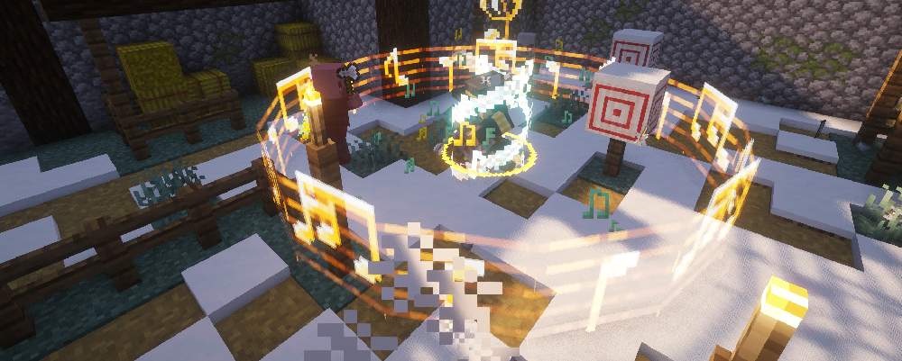

---
navigation:
  title: "Bard"
  position: 8
  parent: combat.magic.md
  icon: bards_rpg:wooden_lute
item_ids:
  - bards_rpg:diamond_harp_crossbow
  - bards_rpg:diamond_lute
  - bards_rpg:diamond_lyre
  - bards_rpg:diamond_rapier
  - bards_rpg:entertainer_garb_chest
  - bards_rpg:entertainer_garb_feet
  - bards_rpg:entertainer_garb_head
  - bards_rpg:entertainer_garb_legs
  - bards_rpg:golden_lyre
  - bards_rpg:golden_rapier
  - bards_rpg:harp_crossbow
  - bards_rpg:iron_rapier
  - bards_rpg:netherite_harp_crossbow
  - bards_rpg:netherite_lute
  - bards_rpg:netherite_lyre
  - bards_rpg:netherite_rapier
  - bards_rpg:netherite_troubadour_garb_chest
  - bards_rpg:netherite_troubadour_garb_feet
  - bards_rpg:netherite_troubadour_garb_head
  - bards_rpg:netherite_troubadour_garb_legs
  - bards_rpg:storyteller_garb_chest
  - bards_rpg:storyteller_garb_feet
  - bards_rpg:storyteller_garb_head
  - bards_rpg:storyteller_garb_legs
  - bards_rpg:troubadour_garb_chest
  - bards_rpg:troubadour_garb_feet
  - bards_rpg:troubadour_garb_head
  - bards_rpg:troubadour_garb_legs
  - bards_rpg:unique_harp_crossbow_0
  - bards_rpg:unique_harp_crossbow_1
  - bards_rpg:unique_lute_0
  - bards_rpg:unique_lute_1
  - bards_rpg:unique_lyre_0
  - bards_rpg:unique_lyre_1
  - bards_rpg:unique_rapier_0
  - bards_rpg:unique_rapier_1
  - bards_rpg:wooden_lute
---

# Bard

 [English](https://www.youtube.com/results?search_query=Minecraft+1.21.1+Bards+RPG+Bard+abilities+equipment+tutorial+English) · [中文](https://www.youtube.com/results?search_query=%E6%88%91%E7%9A%84%E4%B8%96%E7%95%8C+1.21.1+Bards+RPG+%E5%90%9F%E6%B8%B8%E8%AF%97%E4%BA%BA+%E6%8A%80%E8%83%BD+%E8%A3%85%E5%A4%87+%E6%95%99%E7%A8%8B+%E4%B8%AD%E6%96%87)

## Role & first weapon

Bards use lutes and lyres for arcane attacks and support, with rapiers and harp crossbows as other weapon options.

### What to look for

Bard instruments name Arcane power and Healing power, so one held instrument can serve both a damage song and a support song. The Wooden Lute costs birch planks, string and a stick, which makes it the cheapest way to start. The maintained Bard documentation describes the lute as balanced between the two schools and the lyre as the healing-leaning instrument, and the item tooltip shows the actual split for the instrument you hold.

Songs attach to the instrument, not to the class. The article notes that each named instrument can carry a different song, so a second lute is a second song rather than a copy of the first. Read the song line on the tooltip before you trade or craft one.

The Entertainer Garb uses leather, wool and purple dye, which is early and needs no Nether trip. The Troubadour Garb uses rabbit hide, wool and gold, and the Netherite Troubadour Garb is its smithing upgrade. The Storyteller Garb is the later set that depends on other gear. Garb pieces trade physical protection for spell power and movement, so a Bard who expects to be hit should plan around that.

Rapiers and harp crossbows are the physical options. The Iron Rapier costs iron and leather, and the harp crossbow costs a tripwire hook, a stick and string. They need no runes, which makes them a useful fallback when the rune supply for a song runs low.

A successful first use looks like this. Hold the Wooden Lute, play its song at a hostile and see the effect land while the rune count falls, then play a support song near an ally and confirm the buff appears. If the song does nothing, check that the instrument is in the main hand and that the song's rune type is in your pouch.

### Readiness

These checkpoints are optional. The class works at any of them, and a player can stay where they are.

| Stage | Ready when | Next decision |
| --- | --- | --- |
| Early game | You have birch planks, string and a stick for the Wooden Lute, and leather, wool and purple dye for a garb piece. | Play one song and fight one mob with a rapier or the lute swing. |
| Early midgame | A Spell Binding Table with bookshelves is reachable and its cost is payable. | Bind the Bard book and equip it while holding an instrument or weapon. |
| Midgame | Gold and string are available, and rabbit hide can be collected. | Compare the Golden Lyre with the Wooden Lute, and the Troubadour Garb with the Entertainer Garb. |
| Late game | You hold a netherite upgrade smithing template and netherite ingots, or a unique instrument. | Upgrade one Troubadour Garb piece at a time and read the song line on any unique instrument before replacing a working one. |

### Example starter outfit

An example starter outfit: the class starter weapon with the first armor set in its catalog. It is one craftable option, not the official or best build.

<GameScene zoom="4" interactive={true}>
  <IsometricCamera yaw="135" pitch="15" />
  <Entity id="minecraft:armor_stand" x="0.5" y="0" z="0.5" rotationY="180" data='{NoGravity:1b,Invulnerable:1b,ShowArms:1b,NoBasePlate:1b,ArmorItems:[{id:"bards_rpg:entertainer_garb_feet",count:1},{id:"bards_rpg:entertainer_garb_legs",count:1},{id:"bards_rpg:entertainer_garb_chest",count:1},{id:"bards_rpg:entertainer_garb_head",count:1}],HandItems:[{id:"bards_rpg:wooden_lute",count:1},{}]}' />
</GameScene>

<ItemGrid><ItemIcon id="bards_rpg:wooden_lute" /><ItemIcon id="bards_rpg:entertainer_garb_feet" /><ItemIcon id="bards_rpg:entertainer_garb_legs" /><ItemIcon id="bards_rpg:entertainer_garb_chest" /><ItemIcon id="bards_rpg:entertainer_garb_head" /></ItemGrid>

### Starter equipment

<ItemGrid><ItemIcon id="bards_rpg:wooden_lute" /></ItemGrid>

<ItemLink id="bards_rpg:wooden_lute" />

<Recipe id="bards_rpg:wooden_lute" />

### Book abilities

| Ability | Form |
| --- | --- |
| Magical Ballad | Projectile |
| Vicious Mockery | Aimed target |
| Warden's Paean | Aimed target |
| Encore | Area |
| Army's Paeon | Prepared effect |
| Crescendo | Projectile |

***

## Class book
<ItemGrid><ItemIcon id="spell_engine:spell_book" /></ItemGrid>

The Bard book uses <ItemLink id="spell_engine:spell_book" /> with class-specific ability pools. Select the matching book at the Spell Binding Table.

- [Spell binding & casting](combat.abilities.md) Book creation, costs, equipment slots and casting controls.
- [Runes & weapon spells](combat.magic.md) Casting resources and equipment-provided spells.

***

## Class skills
<ItemGrid><ItemIcon id="bards_rpg:wooden_lute" /><ItemIcon id="bards_rpg:harp_crossbow" /><ItemIcon id="bards_rpg:golden_lyre" /><ItemIcon id="bards_rpg:iron_rapier" /></ItemGrid>

Open <KeyBind id="key.puffish_skills.open" /> to find these class and weapon paths.

| Path | Associated equipment |
| --- | --- |
| Path of the Bard | <ItemLink id="bards_rpg:wooden_lute" /> |

### Weapon paths

| Path | Associated equipment |
| --- | --- |
| Harp Crossbow Specialisation | <ItemLink id="bards_rpg:harp_crossbow" /> |
| Improved Lute Songs | <ItemLink id="bards_rpg:wooden_lute" /> |
| Improved Lyre Songs | <ItemLink id="bards_rpg:golden_lyre" /> |
| Rapier Specialisation | <ItemLink id="bards_rpg:iron_rapier" /> |

- [Skill development](combat.skills.md) Point budgets, connected nodes, incompatible roots and resetting. Changing equipment does not refund points.

***

## Weapons & armor

<EmiSearch query="@bards_rpg" />

Lutes and lyres provide instrument spells. Harp crossbows and rapiers add ranged and melee options. Each named instrument can have a different attached song.

### Weapons

| Family | Items | School bonuses or Role |
| --- | --- | --- |
| Rapiers | <ItemGrid><ItemIcon id="bards_rpg:golden_rapier" /><ItemIcon id="bards_rpg:iron_rapier" /><ItemIcon id="bards_rpg:diamond_rapier" /><ItemIcon id="bards_rpg:netherite_rapier" /><ItemIcon id="bards_rpg:unique_rapier_0" /><ItemIcon id="bards_rpg:unique_rapier_1" /></ItemGrid> | Melee, fast attacks |
| Lutes | <ItemGrid><ItemIcon id="bards_rpg:wooden_lute" /><ItemIcon id="bards_rpg:diamond_lute" /><ItemIcon id="bards_rpg:netherite_lute" /><ItemIcon id="bards_rpg:unique_lute_0" /><ItemIcon id="bards_rpg:unique_lute_1" /></ItemGrid> | Arcane power and Healing power |
| Lyres | <ItemGrid><ItemIcon id="bards_rpg:golden_lyre" /><ItemIcon id="bards_rpg:diamond_lyre" /><ItemIcon id="bards_rpg:netherite_lyre" /><ItemIcon id="bards_rpg:unique_lyre_0" /><ItemIcon id="bards_rpg:unique_lyre_1" /></ItemGrid> | Arcane power and Healing power |
| Harp crossbows | <ItemGrid><ItemIcon id="bards_rpg:harp_crossbow" /><ItemIcon id="bards_rpg:diamond_harp_crossbow" /><ItemIcon id="bards_rpg:netherite_harp_crossbow" /><ItemIcon id="bards_rpg:unique_harp_crossbow_0" /><ItemIcon id="bards_rpg:unique_harp_crossbow_1" /></ItemGrid> | Ranged weapon |

### Armor sets

| Set reference, chest piece | Pieces, head to feet |
| --- | --- |
| <ItemLink id="bards_rpg:entertainer_garb_chest" /> | <ItemGrid><ItemIcon id="bards_rpg:entertainer_garb_head" /><ItemIcon id="bards_rpg:entertainer_garb_chest" /><ItemIcon id="bards_rpg:entertainer_garb_legs" /><ItemIcon id="bards_rpg:entertainer_garb_feet" /></ItemGrid> |
| <ItemLink id="bards_rpg:troubadour_garb_chest" /> | <ItemGrid><ItemIcon id="bards_rpg:troubadour_garb_head" /><ItemIcon id="bards_rpg:troubadour_garb_chest" /><ItemIcon id="bards_rpg:troubadour_garb_legs" /><ItemIcon id="bards_rpg:troubadour_garb_feet" /></ItemGrid> |
| <ItemLink id="bards_rpg:netherite_troubadour_garb_chest" /> | <ItemGrid><ItemIcon id="bards_rpg:netherite_troubadour_garb_head" /><ItemIcon id="bards_rpg:netherite_troubadour_garb_chest" /><ItemIcon id="bards_rpg:netherite_troubadour_garb_legs" /><ItemIcon id="bards_rpg:netherite_troubadour_garb_feet" /></ItemGrid> |
| <ItemLink id="bards_rpg:storyteller_garb_chest" /> | <ItemGrid><ItemIcon id="bards_rpg:storyteller_garb_head" /><ItemIcon id="bards_rpg:storyteller_garb_chest" /><ItemIcon id="bards_rpg:storyteller_garb_legs" /><ItemIcon id="bards_rpg:storyteller_garb_feet" /></ItemGrid> |

***

## Shared equipment

<ItemGrid><ItemIcon id="minecraft:iron_sword" /><ItemIcon id="minecraft:iron_chestplate" /><ItemIcon id="jewelry:copper_ring" /></ItemGrid>- [Weapons & armor](equipment.weapons-armor.md)
- [Accessories](equipment.accessories.md)
- [Combat controls](combat.handling.md)
