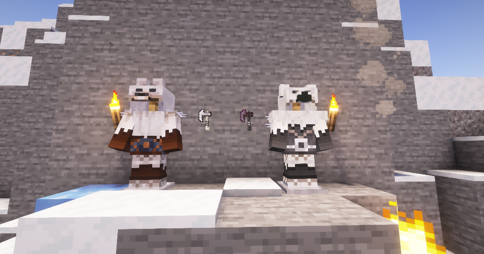

---
navigation:
  title: "Berserker"
  position: 1
  parent: combat.martial.md
  icon: berserker_rpg:iron_berserker_axe
item_ids:
  - berserker_rpg:diamond_berserker_axe
  - berserker_rpg:flint_berserker_axe
  - berserker_rpg:golden_berserker_axe
  - berserker_rpg:iron_berserker_axe
  - berserker_rpg:netherite_berserker_axe
  - berserker_rpg:netherite_northling_chest
  - berserker_rpg:netherite_northling_feet
  - berserker_rpg:netherite_northling_head
  - berserker_rpg:netherite_northling_legs
  - berserker_rpg:northling_chest
  - berserker_rpg:northling_feet
  - berserker_rpg:northling_head
  - berserker_rpg:northling_legs
  - berserker_rpg:stone_berserker_axe
  - berserker_rpg:unique_berserker_axe_1
  - berserker_rpg:unique_berserker_axe_2
  - berserker_rpg:unique_sword_1
  - berserker_rpg:warlord_chest
  - berserker_rpg:warlord_feet
  - berserker_rpg:warlord_head
  - berserker_rpg:warlord_legs
  - berserker_rpg:wildling_chest
  - berserker_rpg:wildling_feet
  - berserker_rpg:wildling_head
  - berserker_rpg:wildling_legs
---

# Berserker

 [English](https://www.youtube.com/results?search_query=Minecraft+1.21.1+Berserker+RPG+Berserker+abilities+equipment+tutorial+English) · [中文](https://www.youtube.com/results?search_query=%E6%88%91%E7%9A%84%E4%B8%96%E7%95%8C+1.21.1+Berserker+RPG+%E7%8B%82%E6%88%98%E5%A3%AB+%E6%8A%80%E8%83%BD+%E8%A3%85%E5%A4%87+%E6%95%99%E7%A8%8B+%E4%B8%AD%E6%96%87)

## Role & first weapon

Berserkers use axes for close combat and rage-based abilities.

### Example starter outfit

An example starter outfit: the class starter weapon with the first armor set in its catalog. It is one craftable option, not the official or best build.

<GameScene zoom="4" interactive={true}>
  <IsometricCamera yaw="135" pitch="15" />
  <Entity id="minecraft:armor_stand" x="0.5" y="0" z="0.5" rotationY="180" data='{NoGravity:1b,Invulnerable:1b,ShowArms:1b,NoBasePlate:1b,ArmorItems:[{id:"berserker_rpg:wildling_feet",count:1},{id:"berserker_rpg:wildling_legs",count:1},{id:"berserker_rpg:wildling_chest",count:1},{id:"berserker_rpg:wildling_head",count:1}],HandItems:[{id:"berserker_rpg:iron_berserker_axe",count:1},{}]}' />
</GameScene>

<ItemGrid><ItemIcon id="berserker_rpg:iron_berserker_axe" /><ItemIcon id="berserker_rpg:wildling_feet" /><ItemIcon id="berserker_rpg:wildling_legs" /><ItemIcon id="berserker_rpg:wildling_chest" /><ItemIcon id="berserker_rpg:wildling_head" /></ItemGrid>

### Starter equipment

<ItemGrid><ItemIcon id="berserker_rpg:iron_berserker_axe" /></ItemGrid>

<ItemLink id="berserker_rpg:iron_berserker_axe" />

<Recipe id="berserker_rpg:iron_berserker_axe" />

### Readiness & first fight

The Berserker is a physical melee class built on the Rage attribute, and the publisher states that the lower your health, the more damage you deal. That makes the axe family and a plan for leaving a fight more important than a perfect set. Wildling and Northling armor carry the rage bonuses and Warlord armor is the fourth family. A good first fight is a mob killed while you are wounded but in control, with an ability ready to break contact.

The stages below are optional. They describe what you need on hand and what each step unlocks, not how long you have played.

| Stage | Ready when | Suggested action or next decision |
| --- | --- | --- |
| Early game: first axe | A berserker axe, food, and a safe place to test the rage bonus. | Craft the iron berserker axe. Fight one mob at a time until you recognise how much health you can spend. |
| Early midgame: book | A Spell Binding Table, the Berserker book, and its learning cost. | Bind the book and keep one defensive or healing option in reserve, since the class rewards low health. |
| Midgame: armor | Wildling or Northling armor pieces. | Complete one family. Read the tooltip for the rage line before replacing a piece. |
| Late game: netherite | Netherite materials and the matching northling piece, or a unique axe from chest loot. | Upgrade northling armor and compare a found unique axe against your crafted one before switching. |

### Book abilities

| Ability | Form |
| --- | --- |
| Wild Rage | Prepared effect |
| Bloody Strike | Area |
| Apprehend | Area |
| Blood Reckoning | Self effect |
| Outrage | Self effect |
| Northerners Guillotine | Aimed target |

***

## Class book
<ItemGrid><ItemIcon id="spell_engine:spell_book" /></ItemGrid>

The Berserker book uses <ItemLink id="spell_engine:spell_book" /> with class-specific ability pools. Select the matching book at the Spell Binding Table.

- [Spell binding & casting](combat.abilities.md) Book creation, costs, equipment slots and casting controls.
- [Runes & weapon spells](combat.magic.md) Casting resources and equipment-provided spells.

***

## Class skills
<ItemGrid><ItemIcon id="berserker_rpg:iron_berserker_axe" /></ItemGrid>

Open <KeyBind id="key.puffish_skills.open" /> to find these class and weapon paths.

| Path | Associated equipment |
| --- | --- |
| Path of the Berserker | <ItemLink id="berserker_rpg:iron_berserker_axe" /> |

### Weapon paths

| Path | Associated equipment |
| --- | --- |
| Berserker Axe Specialisation | <ItemLink id="berserker_rpg:iron_berserker_axe" /> |

- [Skill development](combat.skills.md) Point budgets, connected nodes, incompatible roots and resetting. Changing equipment does not refund points.

***

## Weapons & armor

<EmiSearch query="@berserker_rpg" />

Berserker axes pair melee attacks with rage-based abilities. Armor and named weapons add distinct attributes.

### Weapons

| Family | Items | Role |
| --- | --- | --- |
| <ItemLink id="berserker_rpg:stone_berserker_axe" /> | <ItemGrid><ItemIcon id="berserker_rpg:stone_berserker_axe" /><ItemIcon id="berserker_rpg:iron_berserker_axe" /><ItemIcon id="berserker_rpg:golden_berserker_axe" /><ItemIcon id="berserker_rpg:diamond_berserker_axe" /><ItemIcon id="berserker_rpg:netherite_berserker_axe" /><ItemIcon id="berserker_rpg:unique_berserker_axe_1" /><ItemIcon id="berserker_rpg:unique_berserker_axe_2" /></ItemGrid> | Rage modifier |
| <ItemLink id="berserker_rpg:flint_berserker_axe" /> | <ItemGrid><ItemIcon id="berserker_rpg:flint_berserker_axe" /></ItemGrid> | Starter axe, gathers the materials for the family above |
| <ItemLink id="berserker_rpg:unique_sword_1" /> | <ItemGrid><ItemIcon id="berserker_rpg:unique_sword_1" /></ItemGrid> | Rage modifier, found rather than crafted |

### Armor sets

| Set reference, chest piece | Pieces, head to feet |
| --- | --- |
| <ItemLink id="berserker_rpg:wildling_chest" /> | <ItemGrid><ItemIcon id="berserker_rpg:wildling_head" /><ItemIcon id="berserker_rpg:wildling_chest" /><ItemIcon id="berserker_rpg:wildling_legs" /><ItemIcon id="berserker_rpg:wildling_feet" /></ItemGrid> |
| <ItemLink id="berserker_rpg:northling_chest" /> | <ItemGrid><ItemIcon id="berserker_rpg:northling_head" /><ItemIcon id="berserker_rpg:northling_chest" /><ItemIcon id="berserker_rpg:northling_legs" /><ItemIcon id="berserker_rpg:northling_feet" /></ItemGrid> |
| <ItemLink id="berserker_rpg:netherite_northling_chest" /> | <ItemGrid><ItemIcon id="berserker_rpg:netherite_northling_head" /><ItemIcon id="berserker_rpg:netherite_northling_chest" /><ItemIcon id="berserker_rpg:netherite_northling_legs" /><ItemIcon id="berserker_rpg:netherite_northling_feet" /></ItemGrid> |
| <ItemLink id="berserker_rpg:warlord_chest" /> | <ItemGrid><ItemIcon id="berserker_rpg:warlord_head" /><ItemIcon id="berserker_rpg:warlord_chest" /><ItemIcon id="berserker_rpg:warlord_legs" /><ItemIcon id="berserker_rpg:warlord_feet" /></ItemGrid> |

***

## Shared equipment

<ItemGrid><ItemIcon id="minecraft:iron_sword" /><ItemIcon id="minecraft:iron_chestplate" /><ItemIcon id="jewelry:copper_ring" /></ItemGrid>- [Weapons & armor](equipment.weapons-armor.md)
- [Accessories](equipment.accessories.md)
- [Combat controls](combat.handling.md)
