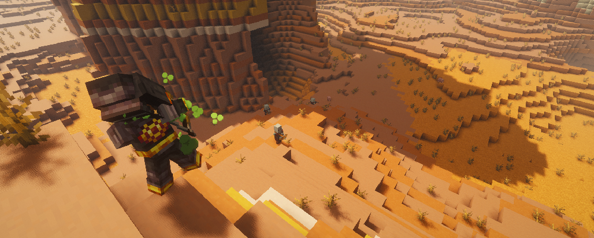

---
navigation:
  title: "Deadeye"
  position: 5
  parent: combat.martial.md
  icon: archers:rapid_crossbow
item_ids:
  - archers_expansion:bounty_hunter_chest
  - archers_expansion:bounty_hunter_feet
  - archers_expansion:bounty_hunter_head
  - archers_expansion:bounty_hunter_legs
  - archers_expansion:deadeye_chest
  - archers_expansion:deadeye_feet
  - archers_expansion:deadeye_head
  - archers_expansion:deadeye_legs
  - archers_expansion:netherite_deadeye_chest
  - archers_expansion:netherite_deadeye_feet
  - archers_expansion:netherite_deadeye_head
  - archers_expansion:netherite_deadeye_legs
---

# Deadeye

 [English](https://www.youtube.com/results?search_query=Minecraft+1.21.1+Archers+Expansion+Deadeye+abilities+equipment+tutorial+English) · [中文](https://www.youtube.com/results?search_query=%E6%88%91%E7%9A%84%E4%B8%96%E7%95%8C+1.21.1+Archers+Expansion+%E7%A5%9E%E5%B0%84%E6%89%8B+%E6%8A%80%E8%83%BD+%E8%A3%85%E5%A4%87+%E6%95%99%E7%A8%8B+%E4%B8%AD%E6%96%87)

## Role & first weapon

Deadeyes use crossbows for physical ranged combat, rapid shots and control.

### Example starter outfit

An example starter outfit: the class starter weapon with the first armor set in its catalog. It is one craftable option, not the official or best build.

<GameScene zoom="4" interactive={true}>
  <IsometricCamera yaw="135" pitch="15" />
  <Entity id="minecraft:armor_stand" x="0.5" y="0" z="0.5" rotationY="180" data='{NoGravity:1b,Invulnerable:1b,ShowArms:1b,NoBasePlate:1b,ArmorItems:[{id:"archers:archer_armor_feet",count:1},{id:"archers:archer_armor_legs",count:1},{id:"archers:archer_armor_chest",count:1},{id:"archers:archer_armor_head",count:1}],HandItems:[{id:"archers:rapid_crossbow",count:1},{}]}' />
</GameScene>

<ItemGrid><ItemIcon id="archers:rapid_crossbow" /><ItemIcon id="archers:archer_armor_feet" /><ItemIcon id="archers:archer_armor_legs" /><ItemIcon id="archers:archer_armor_chest" /><ItemIcon id="archers:archer_armor_head" /></ItemGrid>

### Starter equipment

<ItemGrid><ItemIcon id="archers:rapid_crossbow" /></ItemGrid>

<ItemLink id="archers:rapid_crossbow" />

<Recipe id="archers:rapid_crossbow" />

### Readiness & first fight

Deadeyes stay on the crossbow side of the archery family, and the publisher describes the Deadeye skills as fast and tricky shots with harmful arrows. A crossbow charges once and releases when you choose, so the book's disabling and gas effects fit that rhythm better than a rapid bow. Archer and ranger armor still carry the ranged bonuses, and the Deadeye set adds its own attribute line. A good first fight is two mobs stopped before they reach you, one by a disabling shot and one by plain crossbow damage.

The stages below are optional. They describe what you need on hand and what each step unlocks, not how long you have played.

| Stage | Ready when | Suggested action or next decision |
| --- | --- | --- |
| Early game: first bolts | A crossbow, bolts, and a clear line of sight. | Craft the rapid crossbow if the materials allow, otherwise start with a vanilla crossbow and learn its charge cycle. |
| Early midgame: deadeye book | A Spell Binding Table with bookshelves, the Deadeye book, and its learning cost. | Bind the book, equip it and hold the crossbow. Check each ability's range before you rely on it underground. |
| Midgame: armor | Craftable Deadeye armor pieces, or bounty hunter pieces from the expansion family. | Complete one set rather than mixing a single upgraded piece into plain armor. Compare the tooltip lines. |
| Late game: netherite | Netherite materials, the template, and a deadeye or bounty hunter piece. | Upgrade the netherite deadeye set, or take an Armory upgrade from end game loot if you already own the base set. |

### Book abilities

| Ability | Form |
| --- | --- |
| Fast Shot | Prepared effect |
| Bouncing Arrow | Projectile |
| Disabling Shot | Projectile |
| Choking Gas | Projectile |
| Venom Cask | Class ability |
| Alter Ego | Self effect |

***

## Class book
<ItemGrid><ItemIcon id="spell_engine:spell_book" /></ItemGrid>

The Deadeye book uses <ItemLink id="spell_engine:spell_book" /> with class-specific ability pools. Select the matching book at the Spell Binding Table.

- [Spell binding & casting](combat.abilities.md) Book creation, costs, equipment slots and casting controls.
- [Runes & weapon spells](combat.magic.md) Casting resources and equipment-provided spells.

***

## Class skills
<ItemGrid><ItemIcon id="archers:rapid_crossbow" /><ItemIcon id="minecraft:crossbow" /></ItemGrid>

Open <KeyBind id="key.puffish_skills.open" /> to find these class and weapon paths.

| Path | Associated equipment |
| --- | --- |
| Path of the Deadeye | <ItemLink id="archers:rapid_crossbow" /> |

### Weapon paths

| Path | Associated equipment |
| --- | --- |
| Crossbow Specialisation | <ItemLink id="minecraft:crossbow" /> |

- [Skill development](combat.skills.md) Point budgets, connected nodes, incompatible roots and resetting. Changing equipment does not refund points.

***

## Weapons & armor

<EmiSearch query="@archers" />

Bows and crossbows trade drawing speed against projectile damage. Spears provide a melee alternative. Archer and ranger armor supply ranged attributes.

### Weapons

| Family | Items | Role |
| --- | --- | --- |
| <ItemLink id="archers:rapid_crossbow" /> | <ItemGrid><ItemIcon id="archers:rapid_crossbow" /><ItemIcon id="archers:heavy_crossbow" /><ItemIcon id="archers:netherite_rapid_crossbow" /><ItemIcon id="archers:netherite_heavy_crossbow" /></ItemGrid> | Crossbow family, one charged shot released on command |

### Armor sets

| Set reference, chest piece | Pieces, head to feet |
| --- | --- |
| <ItemLink id="archers:archer_armor_chest" /> | <ItemGrid><ItemIcon id="archers:archer_armor_head" /><ItemIcon id="archers:archer_armor_chest" /><ItemIcon id="archers:archer_armor_legs" /><ItemIcon id="archers:archer_armor_feet" /></ItemGrid> |
| <ItemLink id="archers:ranger_armor_chest" /> | <ItemGrid><ItemIcon id="archers:ranger_armor_head" /><ItemIcon id="archers:ranger_armor_chest" /><ItemIcon id="archers:ranger_armor_legs" /><ItemIcon id="archers:ranger_armor_feet" /></ItemGrid> |
| <ItemLink id="archers:netherite_ranger_armor_chest" /> | <ItemGrid><ItemIcon id="archers:netherite_ranger_armor_head" /><ItemIcon id="archers:netherite_ranger_armor_chest" /><ItemIcon id="archers:netherite_ranger_armor_legs" /><ItemIcon id="archers:netherite_ranger_armor_feet" /></ItemGrid> |

***

## Archers Expansion

<EmiSearch query="@archers_expansion" />

Deadeye, Tundra Hunter and War Archer equipment supports physical, frost and fire ranged builds. Bounty Hunter, Polar Stalker and Sentinel Archer are additional armor families.

### Armor sets

| Set reference, chest piece | Pieces, head to feet |
| --- | --- |
| <ItemLink id="archers_expansion:deadeye_chest" /> | <ItemGrid><ItemIcon id="archers_expansion:deadeye_head" /><ItemIcon id="archers_expansion:deadeye_chest" /><ItemIcon id="archers_expansion:deadeye_legs" /><ItemIcon id="archers_expansion:deadeye_feet" /></ItemGrid> |
| <ItemLink id="archers_expansion:netherite_deadeye_chest" /> | <ItemGrid><ItemIcon id="archers_expansion:netherite_deadeye_head" /><ItemIcon id="archers_expansion:netherite_deadeye_chest" /><ItemIcon id="archers_expansion:netherite_deadeye_legs" /><ItemIcon id="archers_expansion:netherite_deadeye_feet" /></ItemGrid> |
| <ItemLink id="archers_expansion:bounty_hunter_chest" /> | <ItemGrid><ItemIcon id="archers_expansion:bounty_hunter_head" /><ItemIcon id="archers_expansion:bounty_hunter_chest" /><ItemIcon id="archers_expansion:bounty_hunter_legs" /><ItemIcon id="archers_expansion:bounty_hunter_feet" /></ItemGrid> |

***

## Shared equipment

<ItemGrid><ItemIcon id="minecraft:iron_sword" /><ItemIcon id="minecraft:iron_chestplate" /><ItemIcon id="jewelry:copper_ring" /></ItemGrid>- [Weapons & armor](equipment.weapons-armor.md)
- [Accessories](equipment.accessories.md)
- [Combat controls](combat.handling.md)
