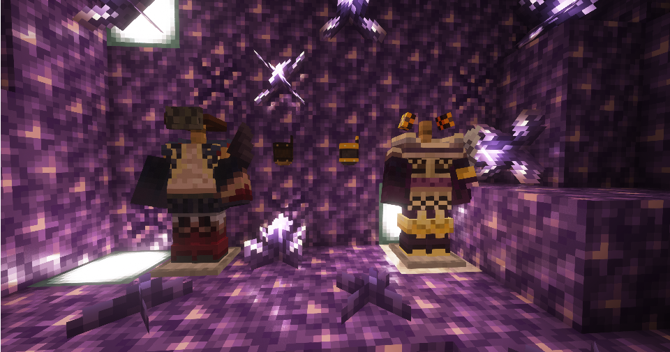

---
navigation:
  title: "Forcemaster"
  position: 3
  parent: combat.martial.md
  icon: forcemaster_rpg:iron_knuckle
item_ids:
  - forcemaster_rpg:aken_chest
  - forcemaster_rpg:aken_feet
  - forcemaster_rpg:aken_head
  - forcemaster_rpg:aken_legs
  - forcemaster_rpg:billporon_chest
  - forcemaster_rpg:billporon_feet
  - forcemaster_rpg:billporon_head
  - forcemaster_rpg:billporon_legs
  - forcemaster_rpg:diamond_knuckle
  - forcemaster_rpg:golden_knuckle
  - forcemaster_rpg:iron_knuckle
  - forcemaster_rpg:netherite_knuckle
  - forcemaster_rpg:oriene_chest
  - forcemaster_rpg:oriene_feet
  - forcemaster_rpg:oriene_head
  - forcemaster_rpg:oriene_legs
  - forcemaster_rpg:phasleb_chest
  - forcemaster_rpg:phasleb_feet
  - forcemaster_rpg:phasleb_head
  - forcemaster_rpg:phasleb_legs
  - forcemaster_rpg:stone_knuckle
  - forcemaster_rpg:unique_knuckle_0
  - forcemaster_rpg:unique_knuckle_1
  - forcemaster_rpg:wooden_knuckle
---

# Forcemaster

 [English](https://www.youtube.com/results?search_query=Minecraft+1.21.1+Forcemaster+RPG+Forcemaster+abilities+equipment+tutorial+English) · [中文](https://www.youtube.com/results?search_query=%E6%88%91%E7%9A%84%E4%B8%96%E7%95%8C+1.21.1+Forcemaster+RPG+%E6%B0%94%E5%8A%9F%E5%B8%88+%E6%8A%80%E8%83%BD+%E8%A3%85%E5%A4%87+%E6%95%99%E7%A8%8B+%E4%B8%AD%E6%96%87)

## Role & first weapon

Forcemasters fight with knuckles, combining arcane melee strikes with ranged effects.

### Example starter outfit

An example starter outfit: the class starter weapon with the first armor set in its catalog. It is one craftable option, not the official or best build.

<GameScene zoom="4" interactive={true}>
  <IsometricCamera yaw="135" pitch="15" />
  <Entity id="minecraft:armor_stand" x="0.5" y="0" z="0.5" rotationY="180" data='{NoGravity:1b,Invulnerable:1b,ShowArms:1b,NoBasePlate:1b,ArmorItems:[{id:"forcemaster_rpg:oriene_feet",count:1},{id:"forcemaster_rpg:oriene_legs",count:1},{id:"forcemaster_rpg:oriene_chest",count:1},{id:"forcemaster_rpg:oriene_head",count:1}],HandItems:[{id:"forcemaster_rpg:iron_knuckle",count:1},{}]}' />
</GameScene>

<ItemGrid><ItemIcon id="forcemaster_rpg:iron_knuckle" /><ItemIcon id="forcemaster_rpg:oriene_feet" /><ItemIcon id="forcemaster_rpg:oriene_legs" /><ItemIcon id="forcemaster_rpg:oriene_chest" /><ItemIcon id="forcemaster_rpg:oriene_head" /></ItemGrid>

### Starter equipment

<ItemGrid><ItemIcon id="forcemaster_rpg:iron_knuckle" /></ItemGrid>

<ItemLink id="forcemaster_rpg:iron_knuckle" />

<Recipe id="forcemaster_rpg:iron_knuckle" />

### Readiness & first fight

Forcemasters fight with knuckles, and the publisher describes the class as a fast attacking fighter that stuns and knocks targets up. Each hit carries arcane force, so the knuckle family and the Arcane power line on the armor matter more than weapon reach. Oriene, Phasleb, Aken and Billporon are the four armor families. A good first fight is one target kept in a short stun while you land repeated hits, rather than a long exchange with several mobs.

The stages below are optional. They describe what you need on hand and what each step unlocks, not how long you have played.

| Stage | Ready when | Suggested action or next decision |
| --- | --- | --- |
| Early game: first knuckles | A knuckle, food, and a single target to test the stun timing. | Craft the iron knuckle. Start with wooden or stone knuckles if iron is short. |
| Early midgame: book | A Spell Binding Table, the Forcemaster book, and its learning cost. | Bind the book and equip it. Hold the knock up ability for the moment a mob winds up. |
| Midgame: armor | Two or more pieces from one forcemaster family. | Compare the Arcane power and protection lines. Complete one family before mixing pieces. |
| Late game: netherite | Netherite materials and a unique knuckle from chest loot. | Upgrade the knuckle you use and compare a found unique against it. |

### Book abilities

| Ability | Form |
| --- | --- |
| Stonehand | Prepared effect |
| Belial Smashing | Melee attack |
| Asalraalaikum | Melee attack |
| Baraqijal Esna | Projectile |
| Sonic Hand | Melee attack |
| Nen Sphere | Class ability |

***

## Class book
<ItemGrid><ItemIcon id="spell_engine:spell_book" /></ItemGrid>

The Forcemaster book uses <ItemLink id="spell_engine:spell_book" /> with class-specific ability pools. Select the matching book at the Spell Binding Table.

- [Spell binding & casting](combat.abilities.md) Book creation, costs, equipment slots and casting controls.
- [Runes & weapon spells](combat.magic.md) Casting resources and equipment-provided spells.

***

## Class skills
<ItemGrid><ItemIcon id="forcemaster_rpg:iron_knuckle" /></ItemGrid>

Open <KeyBind id="key.puffish_skills.open" /> to find these class and weapon paths.

| Path | Associated equipment |
| --- | --- |
| Path of the Forcemaster | <ItemLink id="forcemaster_rpg:iron_knuckle" /> |

### Weapon paths

| Path | Associated equipment |
| --- | --- |
| Knuckle Specialisation | <ItemLink id="forcemaster_rpg:iron_knuckle" /> |

- [Skill development](combat.skills.md) Point budgets, connected nodes, incompatible roots and resetting. Changing equipment does not refund points.

***

## Weapons & armor

<EmiSearch query="@forcemaster_rpg" />

Knuckles provide close combat with arcane class abilities. Compare the complete attribute tooltip when choosing armor.

### Weapons

| Family | Items | Role |
| --- | --- | --- |
| <ItemLink id="forcemaster_rpg:wooden_knuckle" /> | <ItemGrid><ItemIcon id="forcemaster_rpg:wooden_knuckle" /><ItemIcon id="forcemaster_rpg:stone_knuckle" /></ItemGrid> | Protection |
| <ItemLink id="forcemaster_rpg:iron_knuckle" /> | <ItemGrid><ItemIcon id="forcemaster_rpg:iron_knuckle" /><ItemIcon id="forcemaster_rpg:golden_knuckle" /><ItemIcon id="forcemaster_rpg:diamond_knuckle" /><ItemIcon id="forcemaster_rpg:netherite_knuckle" /><ItemIcon id="forcemaster_rpg:unique_knuckle_0" /><ItemIcon id="forcemaster_rpg:unique_knuckle_1" /></ItemGrid> | Arcane power and Protection |

### Armor sets

| Set reference, chest piece | Pieces, head to feet |
| --- | --- |
| <ItemLink id="forcemaster_rpg:oriene_chest" /> | <ItemGrid><ItemIcon id="forcemaster_rpg:oriene_head" /><ItemIcon id="forcemaster_rpg:oriene_chest" /><ItemIcon id="forcemaster_rpg:oriene_legs" /><ItemIcon id="forcemaster_rpg:oriene_feet" /></ItemGrid> |
| <ItemLink id="forcemaster_rpg:phasleb_chest" /> | <ItemGrid><ItemIcon id="forcemaster_rpg:phasleb_head" /><ItemIcon id="forcemaster_rpg:phasleb_chest" /><ItemIcon id="forcemaster_rpg:phasleb_legs" /><ItemIcon id="forcemaster_rpg:phasleb_feet" /></ItemGrid> |
| <ItemLink id="forcemaster_rpg:aken_chest" /> | <ItemGrid><ItemIcon id="forcemaster_rpg:aken_head" /><ItemIcon id="forcemaster_rpg:aken_chest" /><ItemIcon id="forcemaster_rpg:aken_legs" /><ItemIcon id="forcemaster_rpg:aken_feet" /></ItemGrid> |
| <ItemLink id="forcemaster_rpg:billporon_chest" /> | <ItemGrid><ItemIcon id="forcemaster_rpg:billporon_head" /><ItemIcon id="forcemaster_rpg:billporon_chest" /><ItemIcon id="forcemaster_rpg:billporon_legs" /><ItemIcon id="forcemaster_rpg:billporon_feet" /></ItemGrid> |

***

## Shared equipment

<ItemGrid><ItemIcon id="minecraft:iron_sword" /><ItemIcon id="minecraft:iron_chestplate" /><ItemIcon id="jewelry:copper_ring" /></ItemGrid>- [Weapons & armor](equipment.weapons-armor.md)
- [Accessories](equipment.accessories.md)
- [Combat controls](combat.handling.md)
