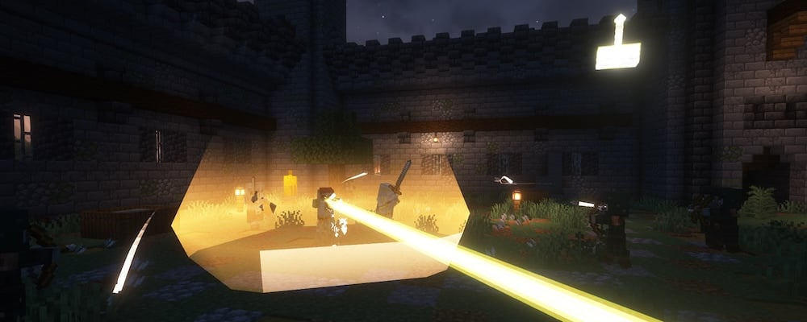

---
navigation:
  title: "Priest"
  position: 6
  parent: combat.magic.md
  icon: paladins:holy_wand
item_ids:
  - paladins:acolyte_wand
  - paladins:diamond_holy_staff
  - paladins:diamond_holy_wand
  - paladins:holy_staff
  - paladins:holy_wand
  - paladins:netherite_holy_staff
  - paladins:netherite_holy_wand
  - paladins:netherite_prior_robe_chest
  - paladins:netherite_prior_robe_feet
  - paladins:netherite_prior_robe_head
  - paladins:netherite_prior_robe_legs
  - paladins:priest_robe_chest
  - paladins:priest_robe_feet
  - paladins:priest_robe_head
  - paladins:priest_robe_legs
  - paladins:prior_robe_chest
  - paladins:prior_robe_feet
  - paladins:prior_robe_head
  - paladins:prior_robe_legs
---

# Priest

 [English](https://www.youtube.com/results?search_query=Minecraft+1.21.1+Paladins+and+Priests+Priest+abilities+equipment+tutorial+English) · [中文](https://www.youtube.com/results?search_query=%E6%88%91%E7%9A%84%E4%B8%96%E7%95%8C+1.21.1+Paladins+and+Priests+%E7%89%A7%E5%B8%88+%E6%8A%80%E8%83%BD+%E8%A3%85%E5%A4%87+%E6%95%99%E7%A8%8B+%E4%B8%AD%E6%96%87)

## Role & first weapon

Priests use holy wands and staves for healing, beams and protection.

### Example starter outfit

The Acolyte Wand with the four Priest Robe pieces is an example starter outfit, not the official default. The model shows appearance and the held wand, not an equipped spell book.

<GameScene zoom="4" interactive={true}>
  <IsometricCamera yaw="135" pitch="15" />
  <Entity id="minecraft:armor_stand" x="0.5" y="0" z="0.5" rotationY="180" data='{NoGravity:1b,Invulnerable:1b,ShowArms:1b,NoBasePlate:1b,ArmorItems:[{id:"paladins:priest_robe_feet",count:1},{id:"paladins:priest_robe_legs",count:1},{id:"paladins:priest_robe_chest",count:1},{id:"paladins:priest_robe_head",count:1}],HandItems:[{id:"paladins:acolyte_wand",count:1},{}]}' />
</GameScene>

<ItemGrid><ItemIcon id="paladins:acolyte_wand" /><ItemIcon id="paladins:priest_robe_head" /><ItemIcon id="paladins:priest_robe_chest" /><ItemIcon id="paladins:priest_robe_legs" /><ItemIcon id="paladins:priest_robe_feet" /></ItemGrid>

### What to look for

Healing spells scale with Healing power. The Acolyte Wand names Healing power and costs a stick and string, so the first healing cast does not wait for gold. The Holy Wand and the Holy Staff are the later steps in the same line, and the publisher recommends holy staves and wands for the Priest book.

The Priest Robe uses chain and wool, which is cheap and early. The Prior Robe uses gold and a ghast tear per piece, so it follows a Nether trip. The Netherite Prior Robe is its smithing upgrade. The publisher describes the holy equipment as boosting both spell damage and healing, so read the full tooltip rather than one line.

A Priest supports others, so the useful question is who is standing near you. Circle of Healing and Lightwell are area and self effects, which means a group fight rewards the class more than a solo duel. Penance and Holy Light are the direct options for a single target.

Runes matter more here than on a melee class because nearly every action costs ammunition. Carry the rune each spell names, keep a spare stack for an emergency heal, and check the pouch before a fight rather than during one.

A successful first use looks like this. Hold the Acolyte Wand, cast Flash Heal on an injured ally and watch the health bar rise while the rune count falls. Then cast Barrier on yourself before a fight and confirm the protection appears. If the heal lands but the barrier does not, compare the rune each spell names.

### Readiness

The hints below are optional. A player can stay in one stage as long as it serves them.

| Stage | Ready when | Next decision |
| --- | --- | --- |
| Early game | You have a stick, string and the rune the wand spell names. | Craft the Acolyte Wand, heal one ally and cast one protection spell. |
| Early midgame | A Spell Binding Table with bookshelves is reachable and its cost is payable. | Bind the Priest book and equip it with a compatible focus held. |
| Midgame | Chain, wool, gold and a ghast tear are available. | Compare the Priest Robe with the Prior Robe, and decide whether the Holy Wand or the Holy Staff fits your casting range. |
| Late game | You hold a netherite upgrade smithing template and netherite ingots. | Upgrade one Prior Robe piece at a time and keep enough runes for both healing and protection. |

### Starter equipment

<ItemGrid><ItemIcon id="paladins:acolyte_wand" /></ItemGrid>

<ItemLink id="paladins:acolyte_wand" />

<Recipe id="paladins:acolyte_wand" />

### Book abilities

| Ability | Form |
| --- | --- |
| Holy Light | Beam |
| Circle of Healing | Area |
| Barrier | Self effect |
| Lightwell | Self effect |
| Levitate | Self effect |
| Penance | Projectile |

The Acolyte Wand is the cheaper healing entry before the Holy Wand.

***

## Class book
<ItemGrid><ItemIcon id="spell_engine:spell_book" /></ItemGrid>

The Priest book uses <ItemLink id="spell_engine:spell_book" /> with class-specific ability pools. Select the matching book at the Spell Binding Table.

- [Spell binding & casting](combat.abilities.md) Book creation, costs, equipment slots and casting controls.
- [Runes & weapon spells](combat.magic.md) Casting resources and equipment-provided spells.

***

## Class skills
<ItemGrid><ItemIcon id="paladins:holy_wand" /><ItemIcon id="paladins:holy_staff" /></ItemGrid>

Open <KeyBind id="key.puffish_skills.open" /> to find these class and weapon paths.

| Path | Associated equipment |
| --- | --- |
| Path of the Light | <ItemLink id="paladins:holy_wand" /> |

### Weapon paths

| Path | Associated equipment |
| --- | --- |
| Holy Staff Specialisation | <ItemLink id="paladins:holy_staff" /> |

- [Skill development](combat.skills.md) Point budgets, connected nodes, incompatible roots and resetting. Changing equipment does not refund points.

***

## Weapons & armor

<EmiSearch query="@paladins" />

Maces, hammers, claymores and shields support close combat. Holy wands and staves support healing spells. Armor combines protection with class attributes.

### Weapons

| Family | Items | School bonuses or Role |
| --- | --- | --- |
| Holy wands | <ItemGrid><ItemIcon id="paladins:acolyte_wand" /><ItemIcon id="paladins:holy_wand" /><ItemIcon id="paladins:diamond_holy_wand" /><ItemIcon id="paladins:netherite_holy_wand" /></ItemGrid> | Healing power |
| Holy staves | <ItemGrid><ItemIcon id="paladins:holy_staff" /><ItemIcon id="paladins:diamond_holy_staff" /><ItemIcon id="paladins:netherite_holy_staff" /></ItemGrid> | Healing power |

### Armor sets

| Set reference, chest piece | Pieces, head to feet |
| --- | --- |
| <ItemLink id="paladins:priest_robe_chest" /> | <ItemGrid><ItemIcon id="paladins:priest_robe_head" /><ItemIcon id="paladins:priest_robe_chest" /><ItemIcon id="paladins:priest_robe_legs" /><ItemIcon id="paladins:priest_robe_feet" /></ItemGrid> |
| <ItemLink id="paladins:prior_robe_chest" /> | <ItemGrid><ItemIcon id="paladins:prior_robe_head" /><ItemIcon id="paladins:prior_robe_chest" /><ItemIcon id="paladins:prior_robe_legs" /><ItemIcon id="paladins:prior_robe_feet" /></ItemGrid> |
| <ItemLink id="paladins:netherite_prior_robe_chest" /> | <ItemGrid><ItemIcon id="paladins:netherite_prior_robe_head" /><ItemIcon id="paladins:netherite_prior_robe_chest" /><ItemIcon id="paladins:netherite_prior_robe_legs" /><ItemIcon id="paladins:netherite_prior_robe_feet" /></ItemGrid> |

***

## Shared equipment

<ItemGrid><ItemIcon id="minecraft:iron_sword" /><ItemIcon id="minecraft:iron_chestplate" /><ItemIcon id="jewelry:copper_ring" /></ItemGrid>- [Weapons & armor](equipment.weapons-armor.md)
- [Accessories](equipment.accessories.md)
- [Combat controls](combat.handling.md)
