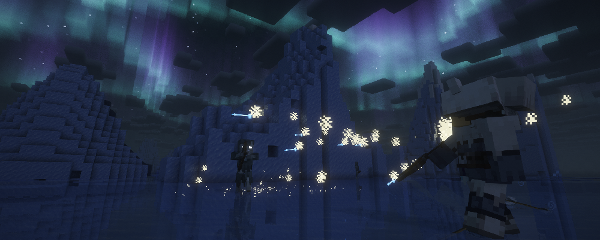

---
navigation:
  title: "Tundra Hunter"
  position: 7
  parent: combat.martial.md
  icon: archers_expansion:tundra_hunter_chest
item_ids:
  - archers_expansion:netherite_tundra_hunter_chest
  - archers_expansion:netherite_tundra_hunter_feet
  - archers_expansion:netherite_tundra_hunter_head
  - archers_expansion:netherite_tundra_hunter_legs
  - archers_expansion:polar_stalker_chest
  - archers_expansion:polar_stalker_feet
  - archers_expansion:polar_stalker_head
  - archers_expansion:polar_stalker_legs
  - archers_expansion:tundra_hunter_chest
  - archers_expansion:tundra_hunter_feet
  - archers_expansion:tundra_hunter_head
  - archers_expansion:tundra_hunter_legs
---

# Tundra Hunter

 [English](https://www.youtube.com/results?search_query=Minecraft+1.21.1+Archers+Expansion+Tundra+Hunter+abilities+equipment+tutorial+English) · [中文](https://www.youtube.com/results?search_query=%E6%88%91%E7%9A%84%E4%B8%96%E7%95%8C+1.21.1+Archers+Expansion+%E5%86%BB%E5%8E%9F%E7%8C%8E%E6%89%8B+%E6%8A%80%E8%83%BD+%E8%A3%85%E5%A4%87+%E6%95%99%E7%A8%8B+%E4%B8%AD%E6%96%87)

## Role & first weapon

Tundra Hunters combine bow attacks with freezing shots and persistent frost areas.

### Example starter outfit

An example starter outfit: the class starter weapon with the first armor set in its catalog. It is one craftable option, not the official or best build.

<GameScene zoom="4" interactive={true}>
  <IsometricCamera yaw="135" pitch="15" />
  <Entity id="minecraft:armor_stand" x="0.5" y="0" z="0.5" rotationY="180" data='{NoGravity:1b,Invulnerable:1b,ShowArms:1b,NoBasePlate:1b,ArmorItems:[{id:"archers:archer_armor_feet",count:1},{id:"archers:archer_armor_legs",count:1},{id:"archers:archer_armor_chest",count:1},{id:"archers:archer_armor_head",count:1}],HandItems:[{id:"archers:composite_longbow",count:1},{}]}' />
</GameScene>

<ItemGrid><ItemIcon id="archers:composite_longbow" /><ItemIcon id="archers:archer_armor_feet" /><ItemIcon id="archers:archer_armor_legs" /><ItemIcon id="archers:archer_armor_chest" /><ItemIcon id="archers:archer_armor_head" /></ItemGrid>

### Starter equipment

<ItemGrid><ItemIcon id="archers:composite_longbow" /></ItemGrid>

<ItemLink id="archers:composite_longbow" />

<Recipe id="archers:composite_longbow" />

### Readiness & first fight

The Tundra Hunter book leans on freezing shots and frost areas, so the bow delivers cold rather than carrying the whole build. A longbow gives an area shot time to land where a group stands, while a shortbow keeps you moving between casts. Tundra Hunter and Polar Stalker armor carry the frost and ranged attributes. A good first fight is a mob held inside your frost area long enough to be finished while it moves slowly.

The stages below are optional. They describe what you need on hand and what each step unlocks, not how long you have played.

| Stage | Ready when | Suggested action or next decision |
| --- | --- | --- |
| Early game: first frost shot | A bow, arrows, and one ability that applies cold. | Start with the composite longbow, then cast into a group rather than a single target so the slow earns its cost. |
| Early midgame: book | A Spell Binding Table, the Tundra Hunter book, and its learning cost. | Bind the book and equip it beside the bow. Keep a melee fallback for mobs that walk out of the frost. |
| Midgame: armor | Tundra Hunter armor pieces, or Polar Stalker pieces as the alternate family. | Choose one family and complete it. Both are ranged sets, so compare the tooltip lines instead of the names. |
| Late game: netherite | Netherite materials and the matching tundra hunter or polar stalker piece. | Upgrade the chest first if you take hits, otherwise the piece whose bonus you rely on most. |

### Book abilities

| Ability | Form |
| --- | --- |
| Frozen Shot | Prepared effect |
| Frozen Pact | Area |
| Arctic Volley | Projectile |
| Enchanted Crystal Arrow | Projectile |
| Polar Bearward | Self effect |
| Frozen Fusillade | Persistent area |

***

## Class book
<ItemGrid><ItemIcon id="spell_engine:spell_book" /></ItemGrid>

The Tundra Hunter book uses <ItemLink id="spell_engine:spell_book" /> with class-specific ability pools. Select the matching book at the Spell Binding Table.

- [Spell binding & casting](combat.abilities.md) Book creation, costs, equipment slots and casting controls.
- [Runes & weapon spells](combat.magic.md) Casting resources and equipment-provided spells.

***

## Class skills
<ItemGrid><ItemIcon id="archers_expansion:tundra_hunter_chest" /><ItemIcon id="minecraft:bow" /></ItemGrid>

Open <KeyBind id="key.puffish_skills.open" /> to find these class and weapon paths.

| Path | Associated equipment |
| --- | --- |
| Path of the Tundra Hunter | <ItemLink id="archers_expansion:tundra_hunter_chest" /> |

### Weapon paths

| Path | Associated equipment |
| --- | --- |
| Bow Specialisation | <ItemLink id="minecraft:bow" /> |

- [Skill development](combat.skills.md) Point budgets, connected nodes, incompatible roots and resetting. Changing equipment does not refund points.

***

## Weapons & armor

<EmiSearch query="@archers" />

Bows and crossbows trade drawing speed against projectile damage. Spears provide a melee alternative. Archer and ranger armor supply ranged attributes.

### Weapons

| Family | Items | Role |
| --- | --- | --- |
| <ItemLink id="archers:composite_longbow" /> | <ItemGrid><ItemIcon id="archers:composite_longbow" /><ItemIcon id="archers:royal_longbow" /><ItemIcon id="archers:netherite_longbow" /></ItemGrid> | Ranged, long draw for casting into a group |
| <ItemLink id="archers:mechanic_shortbow" /> | <ItemGrid><ItemIcon id="archers:mechanic_shortbow" /><ItemIcon id="archers:netherite_shortbow" /></ItemGrid> | Ranged, short draw for moving between casts |
| <ItemLink id="archers:rapid_crossbow" /> | <ItemGrid><ItemIcon id="archers:rapid_crossbow" /><ItemIcon id="archers:heavy_crossbow" /><ItemIcon id="archers:netherite_rapid_crossbow" /><ItemIcon id="archers:netherite_heavy_crossbow" /></ItemGrid> | Ranged, charged shot that holds a frost patch in place |

### Armor sets

| Set reference, chest piece | Pieces, head to feet |
| --- | --- |
| <ItemLink id="archers:archer_armor_chest" /> | <ItemGrid><ItemIcon id="archers:archer_armor_head" /><ItemIcon id="archers:archer_armor_chest" /><ItemIcon id="archers:archer_armor_legs" /><ItemIcon id="archers:archer_armor_feet" /></ItemGrid> |
| <ItemLink id="archers:ranger_armor_chest" /> | <ItemGrid><ItemIcon id="archers:ranger_armor_head" /><ItemIcon id="archers:ranger_armor_chest" /><ItemIcon id="archers:ranger_armor_legs" /><ItemIcon id="archers:ranger_armor_feet" /></ItemGrid> |
| <ItemLink id="archers:netherite_ranger_armor_chest" /> | <ItemGrid><ItemIcon id="archers:netherite_ranger_armor_head" /><ItemIcon id="archers:netherite_ranger_armor_chest" /><ItemIcon id="archers:netherite_ranger_armor_legs" /><ItemIcon id="archers:netherite_ranger_armor_feet" /></ItemGrid> |

***

## Archers Expansion

<EmiSearch query="@archers_expansion" />

Deadeye, Tundra Hunter and War Archer equipment supports physical, frost and fire ranged builds. Bounty Hunter, Polar Stalker and Sentinel Archer are additional armor families.

### Armor sets

| Set reference, chest piece | Pieces, head to feet |
| --- | --- |
| <ItemLink id="archers_expansion:tundra_hunter_chest" /> | <ItemGrid><ItemIcon id="archers_expansion:tundra_hunter_head" /><ItemIcon id="archers_expansion:tundra_hunter_chest" /><ItemIcon id="archers_expansion:tundra_hunter_legs" /><ItemIcon id="archers_expansion:tundra_hunter_feet" /></ItemGrid> |
| <ItemLink id="archers_expansion:netherite_tundra_hunter_chest" /> | <ItemGrid><ItemIcon id="archers_expansion:netherite_tundra_hunter_head" /><ItemIcon id="archers_expansion:netherite_tundra_hunter_chest" /><ItemIcon id="archers_expansion:netherite_tundra_hunter_legs" /><ItemIcon id="archers_expansion:netherite_tundra_hunter_feet" /></ItemGrid> |
| <ItemLink id="archers_expansion:polar_stalker_chest" /> | <ItemGrid><ItemIcon id="archers_expansion:polar_stalker_head" /><ItemIcon id="archers_expansion:polar_stalker_chest" /><ItemIcon id="archers_expansion:polar_stalker_legs" /><ItemIcon id="archers_expansion:polar_stalker_feet" /></ItemGrid> |

***

## Shared equipment

<ItemGrid><ItemIcon id="minecraft:iron_sword" /><ItemIcon id="minecraft:iron_chestplate" /><ItemIcon id="jewelry:copper_ring" /></ItemGrid>- [Weapons & armor](equipment.weapons-armor.md)
- [Accessories](equipment.accessories.md)
- [Combat controls](combat.handling.md)
