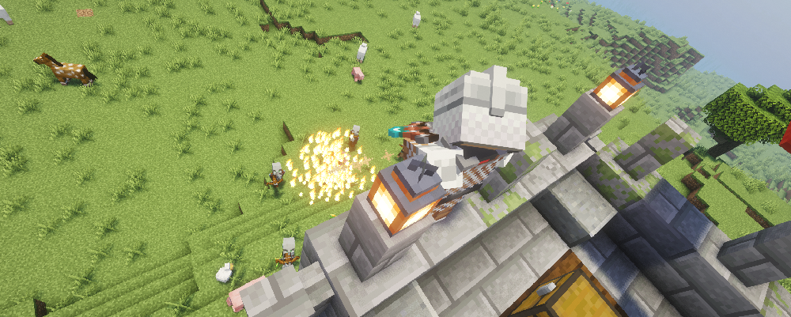

---
navigation:
  title: "War Archer"
  position: 6
  parent: combat.martial.md
  icon: archers_expansion:war_archer_chest
item_ids:
  - archers_expansion:netherite_war_archer_chest
  - archers_expansion:netherite_war_archer_feet
  - archers_expansion:netherite_war_archer_head
  - archers_expansion:netherite_war_archer_legs
  - archers_expansion:sentinel_archer_chest
  - archers_expansion:sentinel_archer_feet
  - archers_expansion:sentinel_archer_head
  - archers_expansion:sentinel_archer_legs
  - archers_expansion:war_archer_chest
  - archers_expansion:war_archer_feet
  - archers_expansion:war_archer_head
  - archers_expansion:war_archer_legs
---

# War Archer

 [English](https://www.youtube.com/results?search_query=Minecraft+1.21.1+Archers+Expansion+War+Archer+abilities+equipment+tutorial+English) · [中文](https://www.youtube.com/results?search_query=%E6%88%91%E7%9A%84%E4%B8%96%E7%95%8C+1.21.1+Archers+Expansion+%E6%88%98%E4%BA%89%E5%BC%93%E6%89%8B+%E6%8A%80%E8%83%BD+%E8%A3%85%E5%A4%87+%E6%95%99%E7%A8%8B+%E4%B8%AD%E6%96%87)

## Role & first weapon

War Archers combine bow attacks with fire ranged techniques and burning areas.

### Example starter outfit

An example starter outfit: the class starter weapon with the first armor set in its catalog. It is one craftable option, not the official or best build.

<GameScene zoom="4" interactive={true}>
  <IsometricCamera yaw="135" pitch="15" />
  <Entity id="minecraft:armor_stand" x="0.5" y="0" z="0.5" rotationY="180" data='{NoGravity:1b,Invulnerable:1b,ShowArms:1b,NoBasePlate:1b,ArmorItems:[{id:"archers:archer_armor_feet",count:1},{id:"archers:archer_armor_legs",count:1},{id:"archers:archer_armor_chest",count:1},{id:"archers:archer_armor_head",count:1}],HandItems:[{id:"archers:composite_longbow",count:1},{}]}' />
</GameScene>

<ItemGrid><ItemIcon id="archers:composite_longbow" /><ItemIcon id="archers:archer_armor_feet" /><ItemIcon id="archers:archer_armor_legs" /><ItemIcon id="archers:archer_armor_chest" /><ItemIcon id="archers:archer_armor_head" /></ItemGrid>

### Starter equipment

<ItemGrid><ItemIcon id="archers:composite_longbow" /></ItemGrid>

<ItemLink id="archers:composite_longbow" />

<Recipe id="archers:composite_longbow" />

### Readiness & first fight

War Archers trade frost slows for burning areas and burst damage, and the publisher describes the War Archer set as the bulky armor option for a safer ranged playstyle. Fire and explosive abilities reward hitting a cluster, so a weapon that reaches a group matters more than a single target bow. Sentinel Archer is the alternate armor family. A good first fight is a group cleared by one burning area and follow up arrows, with no mob left close enough to trade hits.

The stages below are optional. They describe what you need on hand and what each step unlocks, not how long you have played.

| Stage | Ready when | Suggested action or next decision |
| --- | --- | --- |
| Early game: first burning shot | A bow or crossbow, ammunition, and one ability that leaves fire on the ground. | Craft the composite longbow, then aim at the ground a mob is walking into rather than at the mob itself. |
| Early midgame: book | A Spell Binding Table, the War Archer book, and its learning cost. | Bind the book and keep a shot that pins a target for the area ability that follows. |
| Midgame: armor | War Archer armor pieces, or Sentinel Archer pieces as the alternate family. | Take the set you can complete. The publisher calls War Archer armor the bulkier option, so check its protection line. |
| Late game: netherite | Netherite materials and a war archer or sentinel archer piece. | Upgrade the netherite war archer set before chasing a second family. |

### Book abilities

| Ability | Form |
| --- | --- |
| Dual Shot | Arrow shot |
| Smoldering Arrow | Prepared effect |
| Point-Blank Shot | Projectile |
| Pin Down | Projectile |
| Scorched Earth | Persistent area |
| Explosive Barrel | Self effect |

***

## Class book
<ItemGrid><ItemIcon id="spell_engine:spell_book" /></ItemGrid>

The War Archer book uses <ItemLink id="spell_engine:spell_book" /> with class-specific ability pools. Select the matching book at the Spell Binding Table.

- [Spell binding & casting](combat.abilities.md) Book creation, costs, equipment slots and casting controls.
- [Runes & weapon spells](combat.magic.md) Casting resources and equipment-provided spells.

***

## Class skills
<ItemGrid><ItemIcon id="archers_expansion:war_archer_chest" /><ItemIcon id="minecraft:bow" /></ItemGrid>

Open <KeyBind id="key.puffish_skills.open" /> to find these class and weapon paths.

| Path | Associated equipment |
| --- | --- |
| Path of the War Archer | <ItemLink id="archers_expansion:war_archer_chest" /> |

### Weapon paths

| Path | Associated equipment |
| --- | --- |
| Bow Specialisation | <ItemLink id="minecraft:bow" /> |

- [Skill development](combat.skills.md) Point budgets, connected nodes, incompatible roots and resetting. Changing equipment does not refund points.

***

## Weapons & armor

<EmiSearch query="@archers" />

Bows and crossbows trade drawing speed against projectile damage. Spears provide a melee alternative. Archer and ranger armor supply ranged attributes.

### Weapons

| Family | Items | Role |
| --- | --- | --- |
| <ItemLink id="archers:composite_longbow" /> | <ItemGrid><ItemIcon id="archers:composite_longbow" /><ItemIcon id="archers:royal_longbow" /><ItemIcon id="archers:netherite_longbow" /></ItemGrid> | Ranged, long draw for area shots |
| <ItemLink id="archers:mechanic_shortbow" /> | <ItemGrid><ItemIcon id="archers:mechanic_shortbow" /><ItemIcon id="archers:netherite_shortbow" /></ItemGrid> | Ranged, short draw for burst while moving |
| <ItemLink id="archers:rapid_crossbow" /> | <ItemGrid><ItemIcon id="archers:rapid_crossbow" /><ItemIcon id="archers:heavy_crossbow" /><ItemIcon id="archers:netherite_rapid_crossbow" /><ItemIcon id="archers:netherite_heavy_crossbow" /></ItemGrid> | Ranged, charged shot for a burning area |

### Armor sets

| Set reference, chest piece | Pieces, head to feet |
| --- | --- |
| <ItemLink id="archers:archer_armor_chest" /> | <ItemGrid><ItemIcon id="archers:archer_armor_head" /><ItemIcon id="archers:archer_armor_chest" /><ItemIcon id="archers:archer_armor_legs" /><ItemIcon id="archers:archer_armor_feet" /></ItemGrid> |
| <ItemLink id="archers:ranger_armor_chest" /> | <ItemGrid><ItemIcon id="archers:ranger_armor_head" /><ItemIcon id="archers:ranger_armor_chest" /><ItemIcon id="archers:ranger_armor_legs" /><ItemIcon id="archers:ranger_armor_feet" /></ItemGrid> |
| <ItemLink id="archers:netherite_ranger_armor_chest" /> | <ItemGrid><ItemIcon id="archers:netherite_ranger_armor_head" /><ItemIcon id="archers:netherite_ranger_armor_chest" /><ItemIcon id="archers:netherite_ranger_armor_legs" /><ItemIcon id="archers:netherite_ranger_armor_feet" /></ItemGrid> |

***

## Archers Expansion

<EmiSearch query="@archers_expansion" />

Deadeye, Tundra Hunter and War Archer equipment supports physical, frost and fire ranged builds. Bounty Hunter, Polar Stalker and Sentinel Archer are additional armor families.

### Armor sets

| Set reference, chest piece | Pieces, head to feet |
| --- | --- |
| <ItemLink id="archers_expansion:war_archer_chest" /> | <ItemGrid><ItemIcon id="archers_expansion:war_archer_head" /><ItemIcon id="archers_expansion:war_archer_chest" /><ItemIcon id="archers_expansion:war_archer_legs" /><ItemIcon id="archers_expansion:war_archer_feet" /></ItemGrid> |
| <ItemLink id="archers_expansion:netherite_war_archer_chest" /> | <ItemGrid><ItemIcon id="archers_expansion:netherite_war_archer_head" /><ItemIcon id="archers_expansion:netherite_war_archer_chest" /><ItemIcon id="archers_expansion:netherite_war_archer_legs" /><ItemIcon id="archers_expansion:netherite_war_archer_feet" /></ItemGrid> |
| <ItemLink id="archers_expansion:sentinel_archer_chest" /> | <ItemGrid><ItemIcon id="archers_expansion:sentinel_archer_head" /><ItemIcon id="archers_expansion:sentinel_archer_chest" /><ItemIcon id="archers_expansion:sentinel_archer_legs" /><ItemIcon id="archers_expansion:sentinel_archer_feet" /></ItemGrid> |

***

## Shared equipment

<ItemGrid><ItemIcon id="minecraft:iron_sword" /><ItemIcon id="minecraft:iron_chestplate" /><ItemIcon id="jewelry:copper_ring" /></ItemGrid>- [Weapons & armor](equipment.weapons-armor.md)
- [Accessories](equipment.accessories.md)
- [Combat controls](combat.handling.md)
