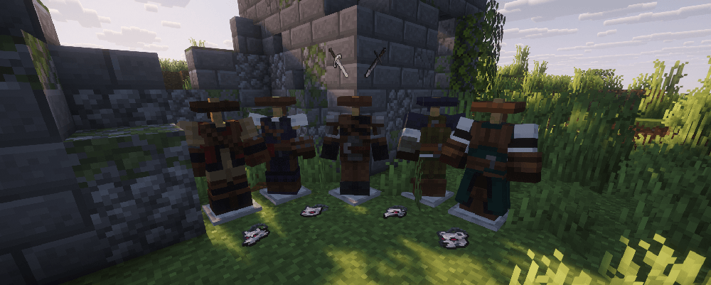

---
navigation:
  title: "Witcher"
  position: 9
  parent: combat.magic.md
  icon: witcher_rpg:iron_witcher_sword
item_ids:
  - witcher_rpg:aerondight_sword
  - witcher_rpg:azure_wrath_sword
  - witcher_rpg:dark_iron_witcher_sword
  - witcher_rpg:dark_steel_witcher_sword
  - witcher_rpg:diamond_witcher_sword
  - witcher_rpg:enhanced_feline_chest
  - witcher_rpg:enhanced_feline_feet
  - witcher_rpg:enhanced_feline_head
  - witcher_rpg:enhanced_feline_legs
  - witcher_rpg:enhanced_griffin_chest
  - witcher_rpg:enhanced_griffin_feet
  - witcher_rpg:enhanced_griffin_head
  - witcher_rpg:enhanced_griffin_legs
  - witcher_rpg:enhanced_ursine_chest
  - witcher_rpg:enhanced_ursine_feet
  - witcher_rpg:enhanced_ursine_head
  - witcher_rpg:enhanced_ursine_legs
  - witcher_rpg:enhanced_wolven_chest
  - witcher_rpg:enhanced_wolven_feet
  - witcher_rpg:enhanced_wolven_head
  - witcher_rpg:enhanced_wolven_legs
  - witcher_rpg:feline_chest
  - witcher_rpg:feline_feet
  - witcher_rpg:feline_head
  - witcher_rpg:feline_legs
  - witcher_rpg:golden_witcher_sword
  - witcher_rpg:grandmaster_feline_chest
  - witcher_rpg:grandmaster_feline_feet
  - witcher_rpg:grandmaster_feline_head
  - witcher_rpg:grandmaster_feline_legs
  - witcher_rpg:grandmaster_griffin_chest
  - witcher_rpg:grandmaster_griffin_feet
  - witcher_rpg:grandmaster_griffin_head
  - witcher_rpg:grandmaster_griffin_legs
  - witcher_rpg:grandmaster_ursine_chest
  - witcher_rpg:grandmaster_ursine_feet
  - witcher_rpg:grandmaster_ursine_head
  - witcher_rpg:grandmaster_ursine_legs
  - witcher_rpg:grandmaster_wolven_chest
  - witcher_rpg:grandmaster_wolven_feet
  - witcher_rpg:grandmaster_wolven_head
  - witcher_rpg:grandmaster_wolven_legs
  - witcher_rpg:griffin_chest
  - witcher_rpg:griffin_feet
  - witcher_rpg:griffin_head
  - witcher_rpg:griffin_legs
  - witcher_rpg:iris_sword
  - witcher_rpg:iron_witcher_sword
  - witcher_rpg:mastercrafted_feline_chest
  - witcher_rpg:mastercrafted_feline_feet
  - witcher_rpg:mastercrafted_feline_head
  - witcher_rpg:mastercrafted_feline_legs
  - witcher_rpg:mastercrafted_griffin_chest
  - witcher_rpg:mastercrafted_griffin_feet
  - witcher_rpg:mastercrafted_griffin_head
  - witcher_rpg:mastercrafted_griffin_legs
  - witcher_rpg:mastercrafted_ursine_chest
  - witcher_rpg:mastercrafted_ursine_feet
  - witcher_rpg:mastercrafted_ursine_head
  - witcher_rpg:mastercrafted_ursine_legs
  - witcher_rpg:mastercrafted_wolven_chest
  - witcher_rpg:mastercrafted_wolven_feet
  - witcher_rpg:mastercrafted_wolven_head
  - witcher_rpg:mastercrafted_wolven_legs
  - witcher_rpg:meteorite_silver_witcher_sword
  - witcher_rpg:meteorite_witcher_sword
  - witcher_rpg:netherite_witcher_sword
  - witcher_rpg:reach_of_the_damned_sword
  - witcher_rpg:silver_witcher_sword
  - witcher_rpg:steel_witcher_sword
  - witcher_rpg:superior_feline_chest
  - witcher_rpg:superior_feline_feet
  - witcher_rpg:superior_feline_head
  - witcher_rpg:superior_feline_legs
  - witcher_rpg:superior_griffin_chest
  - witcher_rpg:superior_griffin_feet
  - witcher_rpg:superior_griffin_head
  - witcher_rpg:superior_griffin_legs
  - witcher_rpg:superior_ursine_chest
  - witcher_rpg:superior_ursine_feet
  - witcher_rpg:superior_ursine_head
  - witcher_rpg:superior_ursine_legs
  - witcher_rpg:superior_wolven_chest
  - witcher_rpg:superior_wolven_feet
  - witcher_rpg:superior_wolven_head
  - witcher_rpg:superior_wolven_legs
  - witcher_rpg:ultimatum_sword
  - witcher_rpg:ursine_chest
  - witcher_rpg:ursine_feet
  - witcher_rpg:ursine_head
  - witcher_rpg:ursine_legs
  - witcher_rpg:winters_blade_sword
  - witcher_rpg:witcher_chest
  - witcher_rpg:witcher_feet
  - witcher_rpg:witcher_head
  - witcher_rpg:witcher_legs
  - witcher_rpg:wolven_chest
  - witcher_rpg:wolven_feet
  - witcher_rpg:wolven_head
  - witcher_rpg:wolven_legs
---

# Witcher

 [English](https://www.youtube.com/results?search_query=Minecraft+1.21.1+Witcher+RPG+Witcher+abilities+equipment+tutorial+English) · [中文](https://www.youtube.com/results?search_query=%E6%88%91%E7%9A%84%E4%B8%96%E7%95%8C+1.21.1+Witcher+RPG+%E7%8C%8E%E9%AD%94%E4%BA%BA+%E6%8A%80%E8%83%BD+%E8%A3%85%E5%A4%87+%E6%95%99%E7%A8%8B+%E4%B8%AD%E6%96%87)

## Role & first weapon

Witchers combine sword fencing with Signs for control and protection.

### Starter equipment

<ItemGrid><ItemIcon id="witcher_rpg:iron_witcher_sword" /></ItemGrid>

<ItemLink id="witcher_rpg:iron_witcher_sword" />

<Recipe id="witcher_rpg:iron_witcher_sword" />

### Example starter outfit

A steel witcher sword with the four basic Witcher armor pieces is one craftable starting outfit, not the official default or a required school. The model shows appearance and the held sword only. School armor and the medallion are separate choices.

<GameScene zoom="4" interactive={true}>
  <IsometricCamera yaw="135" pitch="15" />
  <Entity id="minecraft:armor_stand" x="0.5" y="0" z="0.5" rotationY="180" data='{NoGravity:1b,Invulnerable:1b,ShowArms:1b,NoBasePlate:1b,ArmorItems:[{id:"witcher_rpg:witcher_feet",count:1},{id:"witcher_rpg:witcher_legs",count:1},{id:"witcher_rpg:witcher_chest",count:1},{id:"witcher_rpg:witcher_head",count:1}],HandItems:[{id:"witcher_rpg:iron_witcher_sword",count:1},{}]}' />
</GameScene>

<ItemGrid><ItemIcon id="witcher_rpg:iron_witcher_sword" /><ItemIcon id="witcher_rpg:witcher_head" /><ItemIcon id="witcher_rpg:witcher_chest" /><ItemIcon id="witcher_rpg:witcher_legs" /><ItemIcon id="witcher_rpg:witcher_feet" /></ItemGrid>

### Readiness & first fight

Witchers run on two attributes, Sign intensity and Adrenaline gain. Steel swords are the physical choice against human foes, silver swords carry the sign build and are strong against undead, and sign intensity raises the damage of every sign. Wolven, Feline, Griffin and Ursine are the school families, each with ranks from base up to grandmaster, and a school medallion adds its own effect when it is paired with the matching armor. A good first fight is a sign placed first and two sword hits after it, with the sign landing because you read the mob's approach.

The stages below are optional. They describe what you need on hand and what each step unlocks, not how long you have played.

| Stage | Ready when | Suggested action or next decision |
| --- | --- | --- |
| Early game: first sword | Iron ingots to blast into steel, the sword recipe, and the basic Witcher armor recipe. | Craft the iron witcher sword. Silver is worth carrying once you meet undead, and silver ore sits in the cave depths the publisher lists. |
| Early midgame: first book | A Spell Binding Table with bookshelves, the fencing book or the sign manual, and its learning cost. | Bind one book first. Take the sign manual if you already fight at range, the fencing book if you close in. |
| Midgame: school set | One school armor family at base rank, and the matching school medallion. | Pick the school whose attribute matches your weapon. Upgrade that family step by step rather than starting a second. |
| Late game: grandmaster | The materials each rank recipe asks for up to grandmaster, plus the medallion. | Pair grandmaster armor with its medallion. Named swords such as Aerondight come from end game loot, not from a recipe. |

### Fencing abilities

| Ability | Form |
| --- | --- |
| Fast Attack | Melee attack |
| Witcher Senses | Area |
| Strong Attack | Melee attack |
| Battle Trance | Self effect |
| Rend | Melee attack |
| Whirl | Area |

***

## Signs

<ItemGrid><ItemIcon id="witcher_rpg:wolf_school_medallion" /><ItemIcon id="minecraft:iron_sword" /></ItemGrid>

Witcher signs have their own ability schools and control or protection effects.

| Ability | Form |
| --- | --- |
| Aard | Area |
| Igni | Area |
| Yrden | Persistent area |
| Axii | Aimed target |
| Quen | Self effect |
| Igni Firestream | Area |
| Aard Sweep | Area |
| Yrden Magic Trap | Self effect |
| Axii Puppet | Aimed target |
| Quen Active Shield | Self effect |

***

## Class book
<ItemGrid><ItemIcon id="spell_engine:spell_book" /></ItemGrid>

The Fencing and Signs books use <ItemLink id="spell_engine:spell_book" /> with class-specific ability pools. Select the matching book at the Spell Binding Table.

- [Spell binding & casting](combat.abilities.md) Book creation, costs, equipment slots and casting controls.
- [Runes & weapon spells](combat.magic.md) Casting resources and equipment-provided spells.

***

## Class skills
<ItemGrid><ItemIcon id="witcher_rpg:iron_witcher_sword" /><ItemIcon id="witcher_rpg:wolf_school_medallion" /></ItemGrid>

Open <KeyBind id="key.puffish_skills.open" /> to find these class and weapon paths.

| Path | Associated equipment |
| --- | --- |
| Witcher fencing | <ItemLink id="witcher_rpg:iron_witcher_sword" /> |
| Witcher signs | <ItemLink id="witcher_rpg:wolf_school_medallion" /> |

### Weapon paths

| Path | Associated equipment |
| --- | --- |
| Witcher Sword Specialisation | <ItemLink id="witcher_rpg:iron_witcher_sword" /> |

- [Skill development](combat.skills.md) Point budgets, connected nodes, incompatible roots and resetting. Changing equipment does not refund points.

***

## Weapons & armor

<EmiSearch query="@witcher_rpg" />

Witcher swords support fencing. School armor supports different attributes, with base, enhanced, superior, mastercrafted and grandmaster variants. Arsenal enables the named relic swords shown here.

### Weapons

| Family | Items | Role |
| --- | --- | --- |
| <ItemLink id="witcher_rpg:iron_witcher_sword" /> | <ItemGrid><ItemIcon id="witcher_rpg:iron_witcher_sword" /><ItemIcon id="witcher_rpg:golden_witcher_sword" /><ItemIcon id="witcher_rpg:diamond_witcher_sword" /><ItemIcon id="witcher_rpg:netherite_witcher_sword" /><ItemIcon id="witcher_rpg:dark_steel_witcher_sword" /><ItemIcon id="witcher_rpg:meteorite_silver_witcher_sword" /></ItemGrid> | Sign intensity and Adrenaline gain |
| <ItemLink id="witcher_rpg:steel_witcher_sword" /> | <ItemGrid><ItemIcon id="witcher_rpg:steel_witcher_sword" /><ItemIcon id="witcher_rpg:dark_iron_witcher_sword" /></ItemGrid> | Adrenaline gain, physical choice against human foes |
| <ItemLink id="witcher_rpg:silver_witcher_sword" /> | <ItemGrid><ItemIcon id="witcher_rpg:silver_witcher_sword" /><ItemIcon id="witcher_rpg:meteorite_witcher_sword" /></ItemGrid> | Sign intensity, strong against undead |
| <ItemLink id="witcher_rpg:winters_blade_sword" /> | <ItemGrid><ItemIcon id="witcher_rpg:winters_blade_sword" /></ItemGrid> | Melee critical damage and Adrenaline gain |
| <ItemLink id="witcher_rpg:ultimatum_sword" /> | <ItemGrid><ItemIcon id="witcher_rpg:ultimatum_sword" /></ItemGrid> | Melee critical damage and Adrenaline gain |
| <ItemLink id="witcher_rpg:azure_wrath_sword" /> | <ItemGrid><ItemIcon id="witcher_rpg:azure_wrath_sword" /><ItemIcon id="witcher_rpg:reach_of_the_damned_sword" /></ItemGrid> | Sign intensity and Adrenaline gain |
| <ItemLink id="witcher_rpg:aerondight_sword" /> | <ItemGrid><ItemIcon id="witcher_rpg:aerondight_sword" /></ItemGrid> | Adrenaline gain and Sign intensity, found as loot |
| <ItemLink id="witcher_rpg:iris_sword" /> | <ItemGrid><ItemIcon id="witcher_rpg:iris_sword" /></ItemGrid> | Adrenaline gain, found as loot |

### Armor sets

| Set reference, chest piece | Pieces, head to feet |
| --- | --- |
| <ItemLink id="witcher_rpg:witcher_chest" /> | <ItemGrid><ItemIcon id="witcher_rpg:witcher_head" /><ItemIcon id="witcher_rpg:witcher_chest" /><ItemIcon id="witcher_rpg:witcher_legs" /><ItemIcon id="witcher_rpg:witcher_feet" /></ItemGrid> |
| <ItemLink id="witcher_rpg:feline_chest" /> | <ItemGrid><ItemIcon id="witcher_rpg:feline_head" /><ItemIcon id="witcher_rpg:feline_chest" /><ItemIcon id="witcher_rpg:feline_legs" /><ItemIcon id="witcher_rpg:feline_feet" /></ItemGrid> |
| <ItemLink id="witcher_rpg:enhanced_feline_chest" /> | <ItemGrid><ItemIcon id="witcher_rpg:enhanced_feline_head" /><ItemIcon id="witcher_rpg:enhanced_feline_chest" /><ItemIcon id="witcher_rpg:enhanced_feline_legs" /><ItemIcon id="witcher_rpg:enhanced_feline_feet" /></ItemGrid> |
| <ItemLink id="witcher_rpg:superior_feline_chest" /> | <ItemGrid><ItemIcon id="witcher_rpg:superior_feline_head" /><ItemIcon id="witcher_rpg:superior_feline_chest" /><ItemIcon id="witcher_rpg:superior_feline_legs" /><ItemIcon id="witcher_rpg:superior_feline_feet" /></ItemGrid> |
| <ItemLink id="witcher_rpg:mastercrafted_feline_chest" /> | <ItemGrid><ItemIcon id="witcher_rpg:mastercrafted_feline_head" /><ItemIcon id="witcher_rpg:mastercrafted_feline_chest" /><ItemIcon id="witcher_rpg:mastercrafted_feline_legs" /><ItemIcon id="witcher_rpg:mastercrafted_feline_feet" /></ItemGrid> |
| <ItemLink id="witcher_rpg:grandmaster_feline_chest" /> | <ItemGrid><ItemIcon id="witcher_rpg:grandmaster_feline_head" /><ItemIcon id="witcher_rpg:grandmaster_feline_chest" /><ItemIcon id="witcher_rpg:grandmaster_feline_legs" /><ItemIcon id="witcher_rpg:grandmaster_feline_feet" /></ItemGrid> |
| <ItemLink id="witcher_rpg:griffin_chest" /> | <ItemGrid><ItemIcon id="witcher_rpg:griffin_head" /><ItemIcon id="witcher_rpg:griffin_chest" /><ItemIcon id="witcher_rpg:griffin_legs" /><ItemIcon id="witcher_rpg:griffin_feet" /></ItemGrid> |
| <ItemLink id="witcher_rpg:enhanced_griffin_chest" /> | <ItemGrid><ItemIcon id="witcher_rpg:enhanced_griffin_head" /><ItemIcon id="witcher_rpg:enhanced_griffin_chest" /><ItemIcon id="witcher_rpg:enhanced_griffin_legs" /><ItemIcon id="witcher_rpg:enhanced_griffin_feet" /></ItemGrid> |
| <ItemLink id="witcher_rpg:superior_griffin_chest" /> | <ItemGrid><ItemIcon id="witcher_rpg:superior_griffin_head" /><ItemIcon id="witcher_rpg:superior_griffin_chest" /><ItemIcon id="witcher_rpg:superior_griffin_legs" /><ItemIcon id="witcher_rpg:superior_griffin_feet" /></ItemGrid> |
| <ItemLink id="witcher_rpg:mastercrafted_griffin_chest" /> | <ItemGrid><ItemIcon id="witcher_rpg:mastercrafted_griffin_head" /><ItemIcon id="witcher_rpg:mastercrafted_griffin_chest" /><ItemIcon id="witcher_rpg:mastercrafted_griffin_legs" /><ItemIcon id="witcher_rpg:mastercrafted_griffin_feet" /></ItemGrid> |
| <ItemLink id="witcher_rpg:grandmaster_griffin_chest" /> | <ItemGrid><ItemIcon id="witcher_rpg:grandmaster_griffin_head" /><ItemIcon id="witcher_rpg:grandmaster_griffin_chest" /><ItemIcon id="witcher_rpg:grandmaster_griffin_legs" /><ItemIcon id="witcher_rpg:grandmaster_griffin_feet" /></ItemGrid> |
| <ItemLink id="witcher_rpg:wolven_chest" /> | <ItemGrid><ItemIcon id="witcher_rpg:wolven_head" /><ItemIcon id="witcher_rpg:wolven_chest" /><ItemIcon id="witcher_rpg:wolven_legs" /><ItemIcon id="witcher_rpg:wolven_feet" /></ItemGrid> |
| <ItemLink id="witcher_rpg:enhanced_wolven_chest" /> | <ItemGrid><ItemIcon id="witcher_rpg:enhanced_wolven_head" /><ItemIcon id="witcher_rpg:enhanced_wolven_chest" /><ItemIcon id="witcher_rpg:enhanced_wolven_legs" /><ItemIcon id="witcher_rpg:enhanced_wolven_feet" /></ItemGrid> |
| <ItemLink id="witcher_rpg:superior_wolven_chest" /> | <ItemGrid><ItemIcon id="witcher_rpg:superior_wolven_head" /><ItemIcon id="witcher_rpg:superior_wolven_chest" /><ItemIcon id="witcher_rpg:superior_wolven_legs" /><ItemIcon id="witcher_rpg:superior_wolven_feet" /></ItemGrid> |
| <ItemLink id="witcher_rpg:mastercrafted_wolven_chest" /> | <ItemGrid><ItemIcon id="witcher_rpg:mastercrafted_wolven_head" /><ItemIcon id="witcher_rpg:mastercrafted_wolven_chest" /><ItemIcon id="witcher_rpg:mastercrafted_wolven_legs" /><ItemIcon id="witcher_rpg:mastercrafted_wolven_feet" /></ItemGrid> |
| <ItemLink id="witcher_rpg:grandmaster_wolven_chest" /> | <ItemGrid><ItemIcon id="witcher_rpg:grandmaster_wolven_head" /><ItemIcon id="witcher_rpg:grandmaster_wolven_chest" /><ItemIcon id="witcher_rpg:grandmaster_wolven_legs" /><ItemIcon id="witcher_rpg:grandmaster_wolven_feet" /></ItemGrid> |
| <ItemLink id="witcher_rpg:ursine_chest" /> | <ItemGrid><ItemIcon id="witcher_rpg:ursine_head" /><ItemIcon id="witcher_rpg:ursine_chest" /><ItemIcon id="witcher_rpg:ursine_legs" /><ItemIcon id="witcher_rpg:ursine_feet" /></ItemGrid> |
| <ItemLink id="witcher_rpg:enhanced_ursine_chest" /> | <ItemGrid><ItemIcon id="witcher_rpg:enhanced_ursine_head" /><ItemIcon id="witcher_rpg:enhanced_ursine_chest" /><ItemIcon id="witcher_rpg:enhanced_ursine_legs" /><ItemIcon id="witcher_rpg:enhanced_ursine_feet" /></ItemGrid> |
| <ItemLink id="witcher_rpg:superior_ursine_chest" /> | <ItemGrid><ItemIcon id="witcher_rpg:superior_ursine_head" /><ItemIcon id="witcher_rpg:superior_ursine_chest" /><ItemIcon id="witcher_rpg:superior_ursine_legs" /><ItemIcon id="witcher_rpg:superior_ursine_feet" /></ItemGrid> |
| <ItemLink id="witcher_rpg:mastercrafted_ursine_chest" /> | <ItemGrid><ItemIcon id="witcher_rpg:mastercrafted_ursine_head" /><ItemIcon id="witcher_rpg:mastercrafted_ursine_chest" /><ItemIcon id="witcher_rpg:mastercrafted_ursine_legs" /><ItemIcon id="witcher_rpg:mastercrafted_ursine_feet" /></ItemGrid> |
| <ItemLink id="witcher_rpg:grandmaster_ursine_chest" /> | <ItemGrid><ItemIcon id="witcher_rpg:grandmaster_ursine_head" /><ItemIcon id="witcher_rpg:grandmaster_ursine_chest" /><ItemIcon id="witcher_rpg:grandmaster_ursine_legs" /><ItemIcon id="witcher_rpg:grandmaster_ursine_feet" /></ItemGrid> |

***

## Shared equipment

<ItemGrid><ItemIcon id="minecraft:iron_sword" /><ItemIcon id="minecraft:iron_chestplate" /><ItemIcon id="jewelry:copper_ring" /></ItemGrid>- [Weapons & armor](equipment.weapons-armor.md)
- [Accessories](equipment.accessories.md)
- [Combat controls](combat.handling.md)
