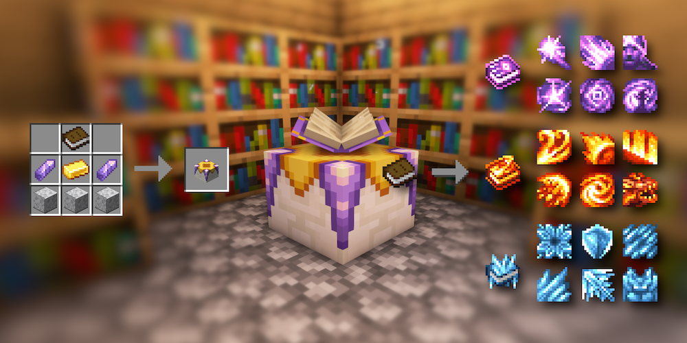

---
navigation:
  title: "Spells & abilities"
  position: 7
  parent: reference.skills.md
  icon: minecraft:enchanted_book
item_ids:
  - spell_engine:spell_binding
  - spell_engine:spell_book
  - spell_engine:spell_scroll
---

# Spells & abilities

 [English](https://www.youtube.com/results?search_query=Minecraft+1.21.1+Spell+Engine+RPG+Series+spell+binding+table+spell+book+tutorial) · [中文](https://www.youtube.com/results?search_query=Minecraft+1.21.1+Spell+Engine+RPG+Series+%E6%B3%95%E6%9C%AF%E7%BB%91%E5%AE%9A%E5%8F%B0+%E8%81%8C%E4%B8%9A%E4%B9%A6+%E7%BB%91%E5%AE%9A+%E6%95%99%E7%A8%8B)

## Prepare a class book

<EmiSearch query="@spell_engine" />

<ItemGrid><ItemIcon id="spell_engine:spell_binding" /></ItemGrid>

<ItemLink id="spell_engine:spell_binding" />

<Recipe id="spell_engine:spell_binding_table" />

A weapon's built-in ability is separate from the spells a class book teaches.

1. Put a normal <ItemLink id="minecraft:book" /> in the table, select the matching class book and pay the displayed experience levels. Witcher offers separate Fencing and Signs books.
2. Put the class book back with <ItemLink id="minecraft:lapis_lazuli" /> and pick abilities that meet the shown level, lapis cost and bookshelf power. Add valid nearby <ItemLink id="minecraft:bookshelf" /> when power is short, and watch for tier conflicts or the book's slot limit.
3. Equip the configured book in its spell-book slot and hold a compatible weapon or focus. The held item filters which spells you can use.

Class books are configured versions of <ItemLink id="spell_engine:spell_book" />, not separate craftable items. A <ItemLink id="spell_engine:spell_scroll" /> carries one spell, so read the next section before spending it.

***

## Use a spell scroll

<ItemGrid><ItemIcon id="spell_engine:spell_scroll" /><ItemIcon id="spell_engine:spell_book" /></ItemGrid>

A scroll uses a single spell found as loot or adds it to a compatible book, and it is not a universal unlock for every class.

- To try its spell alone, equip the scroll in the supported spell-book slot instead of your book and hold a compatible weapon. A separate scroll slot only works if it is enabled, so do not assume every accessory slot accepts one.
- To keep the spell, put the receiving class book in the table's book slot and the scroll in the material slot instead of lapis. Select the offered spell and confirm that the book's pool accepts it before applying.
- If no offer appears, check that the spell belongs to that pool, then inspect existing spells, tier conflicts and remaining capacity. More ordinary experience cannot fix an incompatible book.

Applying the offered spell consumes the scroll and charges the displayed experience-level cost. This transfer does not require lapis. Use the table's current offer rather than assuming scroll binding costs the same as learning with lapis.

***

## Cast an ability

<ItemGrid><ItemIcon id="spell_engine:spell_book" /><ItemIcon id="minecraft:book" /></ItemGrid>

Read its tooltip for school, target, casting time, resource cost and cooldown, and keep required ammunition or runes ready. A learned spell can stay unavailable with an incompatible weapon, and the casting bar shows a cast still in progress.

The first spell action is set in Key Binds, currently <KeyBind id="keybindings.spell_engine.spell_hotbar_1" />, and you can change it there when it shows as unbound.

- [Magic & support](combat.magic.md) Weapon spells, songs, rune types and pouch crafting.
- [Combat controls](combat.handling.md) Attacks, rolls and control conflicts.

***

## Gear & skill points

<ItemGrid><ItemIcon id="spell_engine:spell_book" /><ItemIcon id="skill_tree_rpgs:orb_of_oblivion" /></ItemGrid>

Match the ability's attribute to your equipment. Fire power strengthens Fire spells and not Frost spells, and healing uses healing power. Melee and ranged techniques can use different attributes even within one class. Armor protection and school bonuses do different jobs, and relic triggers are not freely castable class spells.

Binding spends ordinary experience levels. Class points and weapon points develop their own connected trees and do not replace binding, and changing equipment does not refund points.

- [Character skills](combat.skills.md) Open with <KeyBind id="key.puffish_skills.open" />, read incompatible roots and check resets.
- [Weapons & armor](equipment.weapons-armor.md) Class equipment and shared named sets.
- [Accessories](equipment.accessories.md) Jewelry, relics and accepted slots.

***

## Starter focuses

The Novice Wand is a low-cost Fire starting point, not an Arcane or Frost substitute. The Acolyte Wand starts healing with sticks and string. Other starters and complete ability inventories belong to their class articles.

<ItemGrid><ItemIcon id="wizards:wand_novice" /></ItemGrid>

<ItemLink id="wizards:wand_novice" />

<Recipe id="wizards:wand_novice" />

<ItemGrid><ItemIcon id="paladins:acolyte_wand" /></ItemGrid>

<ItemLink id="paladins:acolyte_wand" />

<Recipe id="paladins:acolyte_wand" />

- [Martial classes](combat.martial.md) Ranged and melee class articles.
- [Magic & support classes](combat.magic.md) Magic and support class articles.

***

## When an ability does not work

<ItemGrid><ItemIcon id="spell_engine:spell_book" /><ItemIcon id="runes:arcane_stone" /></ItemGrid>

| Symptom | Check first |
| --- | --- |
| Spell missing from the hotbar | Is the book equipped, does it hold the spell, and does the held weapon allow it? |
| Action shows but will not cast | Runes or ammunition, cooldown, target and range, then the key binding. |
| Damage or healing feels low | The ability's attribute against the held weapon and armor. A higher armor value is not spell power. |

Change one thing, then repeat a low-risk cast. A working setup shows the intended ability and produces its described attack, healing or protection effect.
