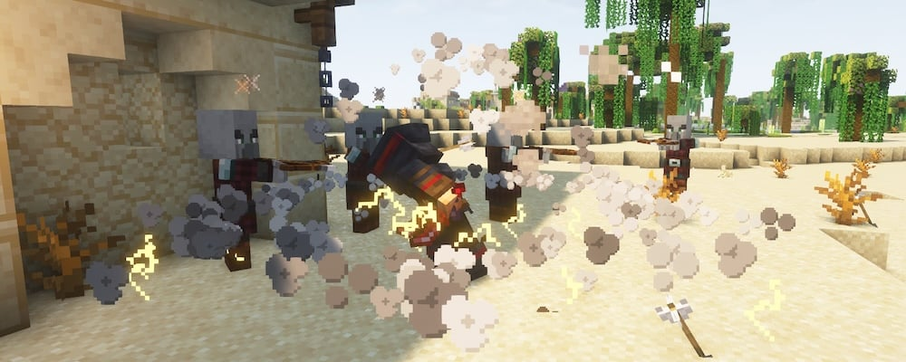
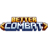

---
navigation:
  title: "Weapons & dodging"
  position: 0
  parent: reference.skills.md
  icon: minecraft:feather
---

# Weapons & dodging

 [English](https://www.youtube.com/results?search_query=Minecraft+1.21.1+Better+Combat+Combat+Roll+weapon+attacks+tutorial) · [中文](https://www.youtube.com/results?search_query=Minecraft+1.21.1+Better+Combat+Combat+Roll+%E6%AD%A6%E5%99%A8%E6%94%BB%E5%87%BB+%E7%BF%BB%E6%BB%9A+%E6%95%99%E7%A8%8B)

## Attacks & weapon types

## Weapon families at a glance

| Family | Example | What changes |
| --- | --- | --- |
| Sword or axe | <ItemGrid><ItemIcon id="minecraft:iron_sword" /><ItemIcon id="minecraft:iron_axe" /><ItemIcon id="rogues:iron_dagger" /></ItemGrid> | Fast single handed patterns with short reach. |
| Claymore or great hammer | <ItemGrid><ItemIcon id="paladins:iron_claymore" /><ItemIcon id="paladins:iron_great_hammer" /></ItemGrid> | Slower swings that commit both hands. |
| Bow | <ItemGrid><ItemIcon id="minecraft:bow" /><ItemIcon id="archers:composite_longbow" /></ItemGrid> | Draw and release, harder hit at full draw. |
| Crossbow | <ItemGrid><ItemIcon id="minecraft:crossbow" /></ItemGrid> | Load first, then fire when the shot suits you. |
| Staff or wand | <ItemGrid><ItemIcon id="wizards:staff_arcane" /><ItemIcon id="wizards:wand_arcane" /></ItemGrid> | Casts weapon spells instead of swinging. |

***

Better Combat gives supported weapons attack patterns and animations. Compare reach, attack speed, damage and any two-handed requirement. Bows and crossbows also differ in drawing or loading behavior.

Attack with <KeyBind id="key.attack" /> and use items with <KeyBind id="key.use" />.

***

## Rolls & spells

<ItemGrid><ItemIcon id="minecraft:iron_sword" /><ItemIcon id="wizards:staff_arcane" /><ItemIcon id="spell_engine:spell_book" /></ItemGrid>

Roll with <KeyBind id="keybinds.combat_roll.roll" />. Combat Roll supplies the dodge action and rolls in whatever direction you are moving. The roll has a short cooldown that the HUD shows, and it adds exhaustion, so repeated rolls shorten the time before you need food. A roll is unavailable while you use an item, jump or swim.

Invulnerability during a roll is off by default in this selection, so treat a roll as repositioning rather than a guaranteed dodge. Critical Strike supplies melee critical attributes, and neither a weapon animation nor a roll promises invulnerability.

Spell actions use the Spell Engine hotbar. Assign its controls in Key Binds if an action is unbound. The recipe browser uses separate settings, so a shared key can need attention in both interfaces.

- [Spells & abilities](combat.abilities.md) Book binding and spell-hotbar requirements.
- [All controls](help.controls.md)
- [Skill development](combat.skills.md) Spend class and weapon points on connected branches.

***

## Related mods

| Mod or content | Purpose | Item search |
| --- | --- | --- |
|  [Better Combat](combat.handling.md) | Reworks melee attacks with weapon animations and a more fluid combat system. | No separate item search |
|  [Combat Roll](combat.handling.md) | Adds a dodge roll with related attributes and enchantments. | No separate item search |
|  [Critical Strike](combat.handling.md) | Adds chance-based critical hits to melee and ranged attacks. | No separate item search |
