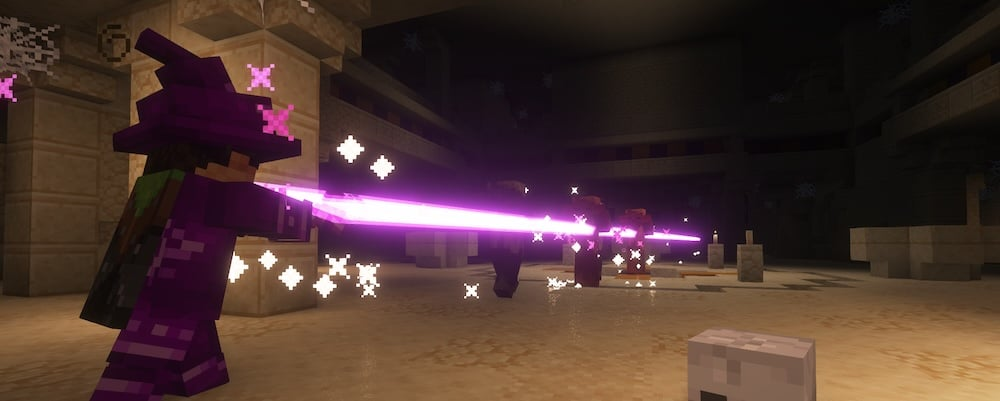

---
navigation:
  title: "Magic & support classes"
  position: 6
  parent: reference.skills.md
  icon: minecraft:blaze_rod
---

# Magic & support classes

 [English](https://www.youtube.com/results?search_query=Minecraft+1.21.1+RPG+Series+Runes+rune+pouch+Wizards+casting+tutorial) · [中文](https://www.youtube.com/results?search_query=Minecraft+1.21.1+RPG+Series+Runes+%E7%AC%A6%E6%96%87%E8%A2%8B+%E6%B3%95%E5%B8%88+%E6%96%BD%E6%B3%95+%E6%95%99%E7%A8%8B)

## Spellcasters & support

| Class | Playstyle |
| --- | --- |
| [Arcane Wizard](class.arcane.md) | Arcane projectiles and beams. |
| [Fire Wizard](class.fire.md) | Fire attacks and persistent burning areas. |
| [Frost Wizard](class.frost.md) | Frost attacks and protection. |
| [Aqua Wizard](class.aqua.md) | Water damage and healing areas. |
| [Terra Wizard](class.terra.md) | Earth attacks and protective ground effects. |
| [Wind Wizard](class.wind.md) | Air attacks and tornado areas. |
| [Paladin](class.paladin.md) | Melee, healing and protection. |
| [Priest](class.priest.md) | Healing beams and group protection. |
| [Bard](class.bard.md) | Instrument attacks and support songs. |
| [Witcher](class.witcher.md) | Sword techniques and control or protection signs. |

Each class article contains its starter recipe, books, complete class-book ability list and equipment. Witcher Fencing and Signs are separate books within the same class.

- [Spells & abilities](combat.abilities.md) Shared binding procedure, scrolls and casting controls.
- [Character skills](combat.skills.md) Separate class and weapon point budgets.

***

## Weapon spells & songs

<ItemGrid>
  <ItemIcon id="wizards:staff_arcane" />
  <ItemIcon id="elemental_wizards_rpg:staff_aqua" />
  <ItemIcon id="paladins:holy_staff" />
  <ItemIcon id="bards_rpg:wooden_lute" />
  <ItemIcon id="bards_rpg:diamond_lyre" />
</ItemGrid>

Wands, staves and instruments can carry active weapon spells without learning them from a class book. Arcane, fire, frost, water, earth and air focuses have school-specific attacks. Holy focuses support healing spells. Named Bard instruments carry different songs. Inspect the held item tooltip for its full set and casting conditions. Class articles separately catalog the abilities learned through books.

***

## Runes & pouches

Items are grouped by role or matching attributes. Hover an item for its name, values and slot requirements.

Rune crafting workstation

<ItemGrid>
  <ItemIcon id="runes:crafting_altar" />
</ItemGrid>

Equipped rune storage

<ItemGrid>
  <ItemIcon id="runes:small_rune_pouch" />
  <ItemIcon id="runes:medium_rune_pouch" />
  <ItemIcon id="runes:large_rune_pouch" />
</ItemGrid>

Casting resource

<ItemGrid>
  <ItemIcon id="runes:arcane_stone" />
  <ItemIcon id="runes:fire_stone" />
  <ItemIcon id="runes:frost_stone" />
  <ItemIcon id="runes:healing_stone" />
  <ItemIcon id="runes:lightning_stone" />
  <ItemIcon id="runes:soul_stone" />
</ItemGrid>

Runes are ammunition, not a way to learn spells. Read the selected spell's cost before crafting a supply. Only spells with a rune cost consume them. A pouch saves carrying space but does not create runes or remove their cost.

1. Start with the rune named by your spell. For a Fire starter, combine a suitable stone base with coal using the shapeless recipe. This makes 2 Fire Runes. Use the recipe browser for other schools and alternative ingredients.
2. When you have a Rune Crafting Altar, open it and put the stone base and matching reagent into its two ingredient slots. Take the rune output. The same coal recipe makes 8 Fire Runes here, so the altar improves supply without being required for the first cast.
3. Make a Rune Pouch using the recipe below. In the inventory, hold the pouch on the cursor and right-click a rune stack to load it. Inspect the pouch contents, then place it in the supported quiver accessory slot. Casting can draw the required rune from an equipped pouch.
4. Test one affordable spell with a valid target before leaving base. If the game reports a missing rune, check the exact rune type and quantity, the pouch contents and whether the pouch is equipped. Loose runes in your inventory are also a starting option.

Lightning and Soul Runes are catalog entries, not supplies you must collect for every caster. Follow the cost of the spell you actually use. Rune-pouch recipes require Bundle API, which this selection includes.

<Recipe id="runes:pouch/small_rune_pouch" />

***

## Related mods

| Mod or content | Purpose | Item search |
| --- | --- | --- |
|  [Bard (RPG Series Plus)](combat.magic.md) | Adds a bard class that supports allies through songs and ballads. | <EmiSearch query="@bards_rpg" /> |
|  [Elemental Wizards (RPG Series Plus)](combat.magic.md) | Expands Wizards with earth, water and wind spellcasting subclasses. | <EmiSearch query="@elemental_wizards_rpg" /> |
|  [Paladins & Priests (RPG Series)](combat.magic.md) | Adds paladin and priest classes focused on protection and healing. | <EmiSearch query="@paladins" /> |
|  [Runes](combat.magic.md) | Adds craftable runes consumed as ammunition for spells. | <EmiSearch query="@runes" /> |
|  [Witcher (RPG Series Plus)](combat.magic.md) | Adds a monster-hunting witcher class and associated combat abilities. | <EmiSearch query="@witcher_rpg" /> |
|  [Wizards (RPG Series)](combat.magic.md) | Adds wizard combat using arcane, fire and frost spells. | <EmiSearch query="@wizards" /> |
