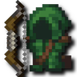
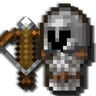
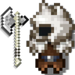
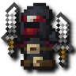

---
navigation:
  title: "Martial classes"
  position: 5
  parent: reference.skills.md
  icon: minecraft:bow
---

# Martial classes

 [English](https://www.youtube.com/results?search_query=Minecraft+1.21.1+RPG+Series+Archers+Rogues+Warriors+martial+class+tutorial) · [中文](https://www.youtube.com/results?search_query=Minecraft+1.21.1+RPG+Series+%E5%BC%93%E7%AE%AD%E6%89%8B+%E7%9B%97%E8%B4%BC+%E6%88%98%E5%A3%AB+%E6%AD%A6%E6%8A%80+%E8%81%8C%E4%B8%9A+%E6%95%99%E7%A8%8B)

## Melee & ranged

<ItemGrid><ItemIcon id="archers:composite_longbow" /><ItemIcon id="archers:rapid_crossbow" /><ItemIcon id="rogues:iron_dagger" /><ItemIcon id="berserker_rpg:iron_berserker_axe" /></ItemGrid>

| Class | Playstyle |
| --- | --- |
| [Archer](class.archer.md) | Prepared shots and area arrows. |
| [Deadeye](class.deadeye.md) | Rapid ranged attacks and disabling shots. |
| [Tundra Hunter](class.tundra-hunter.md) | Frost shots and freezing areas. |
| [War Archer](class.war-archer.md) | Fire arrows and burning ground. |
| [Rogue](class.rogue.md) | Close attacks, traps and mobility. |
| [Warrior](class.warrior.md) | Charges and defensive melee techniques. |
| [Berserker](class.berserker.md) | Rage effects and heavy strikes. |
| [Forcemaster](class.forcemaster.md) | Arcane strikes with knuckles. |

Class articles contain starter recipes, supported books, every class-book ability and class equipment. Archer expansion paths can start with a bow before specialist armor.

***

## Attacks & abilities

Ordinary weapon attacks, weapon-provided abilities, equipped class-book abilities and skill-tree modifiers are separate. Martial techniques can require a bound class book too. Bind the matching book, equip it and hold a compatible weapon.

- [Spells & abilities](combat.abilities.md) Shared book preparation and casting requirements.
- [Weapons & dodging](combat.handling.md) Attack patterns and rolling.
- [Weapons & armor](equipment.weapons-armor.md) Shared named equipment.
- [Character skills](combat.skills.md) Class and weapon branches.

***

## Related mods

| Mod or content | Purpose | Item search |
| --- | --- | --- |
|  [Archers (RPG Series)](combat.martial.md) | Adds an archer combat class built around bows and ranged abilities. | <EmiSearch query="@archers" /> |
|  [Archers Expansion (RPG Series Plus)](combat.martial.md) | Adds archer subclasses with cold, status-inflicting and explosive arrow abilities. | <EmiSearch query="@archers_expansion" /> |
|  [Berserker (RPG Series Plus)](combat.martial.md) | Adds an axe-wielding berserker whose rage increases damage at low health. | <EmiSearch query="@berserker_rpg" /> |
|  [Forcemaster (RPG Series Plus)](combat.martial.md) | Adds a knuckle-wielding martial class that strengthens attacks with arcane force. | <EmiSearch query="@forcemaster_rpg" /> |
|  [Rogues & Warriors (RPG Series)](combat.martial.md) | Adds rogue and warrior classes with distinct melee combat abilities. | <EmiSearch query="@rogues" /> |
