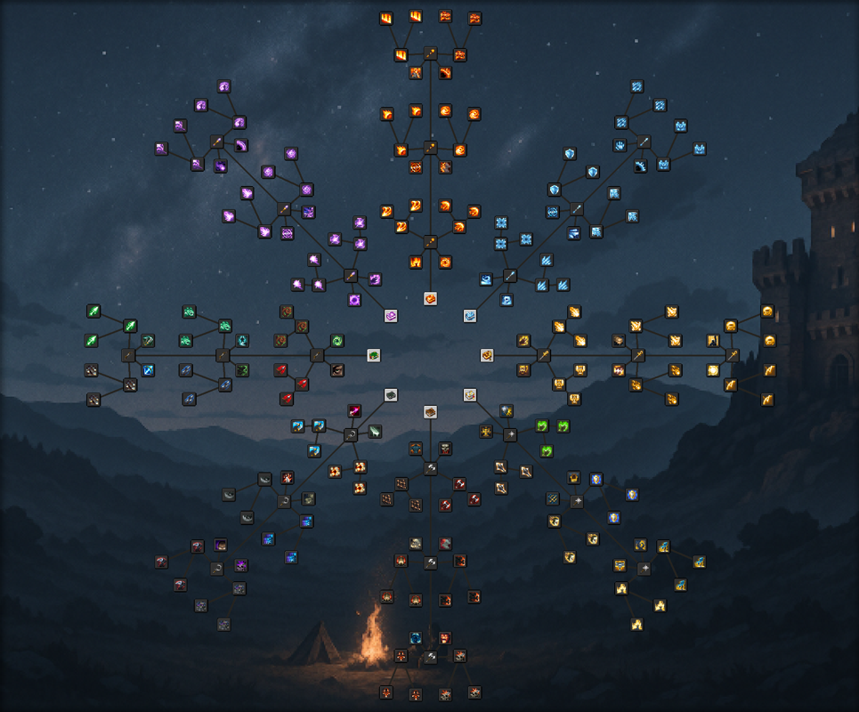
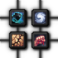
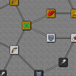
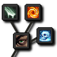

---
navigation:
  title: "Character skills"
  position: 8
  parent: reference.skills.md
  icon: minecraft:experience_bottle
---

# Character skills

 [English](https://www.youtube.com/results?search_query=Minecraft+1.21.1+Pufferfish+Skills+RPG+Series+Skill+Tree+class+weapon+points+tutorial) · [中文](https://www.youtube.com/results?search_query=Minecraft+1.21.1+Pufferfish+Skills+RPG+Series+%E6%8A%80%E8%83%BD%E6%A0%91+%E8%81%8C%E4%B8%9A+%E6%AD%A6%E5%99%A8+%E6%8A%80%E8%83%BD%E7%82%B9+%E6%95%99%E7%A8%8B)

## Skill development

Open skills with <KeyBind id="key.puffish_skills.open" />. Pufferfish’s Skills supplies the screen and progression engine, and Skill Tree and More RPG Classes Skill Tree supply the class and weapon branches.

Kills earn tree experience through the supplied definitions, with anti-farming limits and nearby team sharing. Read a connected node before spending points on it. Class points, weapon points and ordinary experience levels are separate resources, and only the first two buy tree nodes.

1. Try a class weapon and its abilities, then open Class Skills and read its root before spending a class point. Exclusive roots prevent combining every class path.
2. Open Weapon Skills separately and spend weapon points on the branch for the weapon you actually use. A class choice and a weapon branch are related decisions, not the same purchase.
3. After a spell modifier, equip the matching book or weapon and use the named ability. Passive nodes instead describe the event that triggers them.

Arcane class modifiers develop the class-book spells, while the staff branch develops the staff itself. Buying one does not buy the other or bind a missing spell.

***

## Class paths

<ItemGrid><ItemIcon id="archers:composite_longbow" /><ItemIcon id="rogues:iron_dagger" /><ItemIcon id="wizards:wand_arcane" /><ItemIcon id="wizards:wand_frost" /><ItemIcon id="paladins:iron_mace" /><ItemIcon id="bards_rpg:wooden_lute" /></ItemGrid>

| Playstyle | Class paths |
| --- | --- |
| Archery | Path of the Archer [Archer](class.archer.md), Path of the Deadeye [Deadeye](class.deadeye.md), Path of the Tundra Hunter [Tundra Hunter](class.tundra-hunter.md), Path of the War Archer [War Archer](class.war-archer.md) |
| Close combat | Path of the Warrior [Warrior](class.warrior.md), Path of the Paladin [Paladin](class.paladin.md), Path of the Rogue [Rogue](class.rogue.md), Path of the Berserker [Berserker](class.berserker.md), Witcher fencing and signs [Witcher](class.witcher.md) |
| Wizardry | Path of Arcane [Arcane Wizard](class.arcane.md), Path of the Forcemaster [Forcemaster](class.forcemaster.md) |
| Elemental wizardry | Path of Fire [Fire Wizard](class.fire.md), Path of Frost [Frost Wizard](class.frost.md), Path of Air [Wind Wizard](class.wind.md), Path of Earth [Terra Wizard](class.terra.md), Path of Water [Aqua Wizard](class.aqua.md) |
| Support and hybrid | Path of the Light [Priest](class.priest.md), Path of the Bard [Bard](class.bard.md) |

***

## Weapon development
<ItemGrid><ItemIcon id="wizards:staff_arcane" /><ItemIcon id="wizards:staff_fire" /><ItemIcon id="wizards:staff_frost" /><ItemIcon id="paladins:holy_staff" /><ItemIcon id="elemental_wizards_rpg:staff_aqua" /><ItemIcon id="elemental_wizards_rpg:staff_terra" /></ItemGrid>

| Weapon family | Weapons and focuses |
| --- | --- |
| Staffs and focuses | <ItemLink id="wizards:staff_arcane" />, <ItemLink id="wizards:staff_fire" />, <ItemLink id="wizards:staff_frost" />, <ItemLink id="paladins:holy_staff" />, <ItemLink id="elemental_wizards_rpg:staff_aqua" />, <ItemLink id="elemental_wizards_rpg:staff_terra" />, <ItemLink id="elemental_wizards_rpg:staff_wind" /> |
| Bows and crossbows | <ItemLink id="minecraft:bow" />, <ItemLink id="minecraft:crossbow" />, <ItemLink id="bards_rpg:harp_crossbow" /> |
| Swords and daggers | <ItemLink id="minecraft:iron_sword" />, <ItemLink id="paladins:iron_claymore" />, <ItemLink id="rogues:iron_dagger" />, <ItemLink id="bards_rpg:iron_rapier" />, <ItemLink id="witcher_rpg:iron_witcher_sword" /> |
| Axes and hammers | <ItemLink id="minecraft:iron_axe" />, <ItemLink id="rogues:iron_double_axe" />, <ItemLink id="berserker_rpg:iron_berserker_axe" />, <ItemLink id="paladins:iron_great_hammer" />, <ItemLink id="paladins:iron_mace" /> |
| Instruments | <ItemLink id="bards_rpg:wooden_lute" />, <ItemLink id="bards_rpg:golden_lyre" /> |
| Other specialisations | <ItemLink id="rogues:iron_glaive" />, <ItemLink id="rogues:iron_sickle" />, <ItemLink id="archers:iron_spear" />, <ItemLink id="forcemaster_rpg:iron_knuckle" /> |

Each weapon has its own specialisation branch in Weapon Skills, and an improved branch is named after the ability it changes.

***

## Reset & refinement

<EmiSearch query="@skill_tree_rpgs" />

<ItemGrid><ItemIcon id="skill_tree_rpgs:orb_of_oblivion" /></ItemGrid>

<ItemLink id="skill_tree_rpgs:orb_of_oblivion" />

<Recipe id="skill_tree_rpgs:orb_of_oblivion" />

Improved-spell nodes modify named abilities rather than adding an unrelated class spell, so check the current point budget and incompatible roots first.

- [Martial abilities](combat.martial.md) Ranged shots, close combat and class techniques.
- [Spells & abilities](combat.abilities.md) Spell binding, scrolls and casting controls.
- [Magic & support](combat.magic.md) Weapon spells, songs, runes and pouches.
- [Weapons & armor](equipment.weapons-armor.md) Choose a weapon family and compare every supported variant.

***

## Build goals & blocked nodes

<ItemGrid><ItemIcon id="skill_tree_rpgs:orb_of_oblivion" /><ItemIcon id="spell_engine:spell_book" /></ItemGrid>

A blocked node can mean a missing connection, too few points in that category, an incompatible root or a reached spending limit.

To change direction, use an Orb of Oblivion and read its tooltip first, then reopen the tree to confirm the refunded points. Replacing a weapon or equipping another book does not reset the tree.

***

## Related mods

| Mod or content | Purpose | Item search |
| --- | --- | --- |
|  [More RPG Classes - Skill Tree (RPG Series Plus)](combat.skills.md) | Adds class skill-tree support for the additional More RPG Classes professions. | No separate item search |
|  [Pufferfish's Skills](combat.skills.md) | Provides a configurable skill system and skill-tree interface. | No separate item search |
|  [Skill Tree (RPG Series)](combat.skills.md) | Adds class-oriented skill trees for RPG Series characters. | <EmiSearch query="@skill_tree_rpgs" /> |
