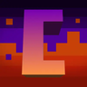

---
navigation:
  title: "Cataclysm creatures"
  position: 7
  parent: adventure.creatures.md
  icon: minecraft:spider_spawn_egg
---

# Cataclysm creatures

## L_Ender's Cataclysm

<EmiSearch query="@cataclysm" />

Find these creatures around the corresponding ruins and boss structures. Some companion encounters remain unconfirmed.

| Creature | Encounter |
| --- | --- |
| Ender Golem | End Ruined Citadel. |
| Endermaptera | End Ruined Citadel. |
| Ignited Revenant | Nether Burning Arena and fortress encounters. |
| Ignited Berserker | Nether Burning Arena and fortress encounters. |
| The Watcher | Overworld Ancient Factory. |
| The Prowler | Overworld Ancient Factory. |
| Deepling | Overworld deep oceans and Sunken City. |
| Deepling Brute | Overworld deep oceans and Sunken City. |
| Deepling Angler | Overworld deep oceans and Sunken City. |
| Deepling Priest | Overworld deep oceans and Sunken City. |
| Deepling Warlock | Overworld deep oceans and Sunken City. |
| Coralssus | Overworld deep oceans and Sunken City. |
| Amethyst Crab | Overworld lush caves and Amethyst Nest. |
| Koboleton | Overworld deserts and Cursed Pyramid. |
| Kobolediator | Overworld deserts and Cursed Pyramid. |
| Wadjet | Overworld deserts and Cursed Pyramid. |
| Draugr | Overworld Frosted Prison and snowy ruins. |
| Royal Draugr | Overworld Frosted Prison and snowy ruins. |
| Elite Draugr | Overworld Frosted Prison and snowy ruins. |
| Aptrgangr | Overworld Frosted Prison and snowy ruins. |
| Hippocamtus | Overworld Acropolis encounter family. Individual placement needs confirmation. |
| Cindaria | Overworld Acropolis encounter family. Individual placement needs confirmation. |
| Clawdian | Overworld Acropolis encounter family. Individual placement needs confirmation. |
| Urchinkin | Overworld Acropolis encounter family. Individual placement needs confirmation. |
| Drowned Host | Overworld Acropolis encounter family. Individual placement needs confirmation. |
| Symbiocto | Overworld Acropolis encounter family. Individual placement needs confirmation. |
| Coral Golem | Released living creatures. Exact natural or companion access not fully confirmed. |
| Lionfish | Released living creatures. Exact natural or companion access not fully confirmed. |
| Modern Remnant | Released living creatures. Exact natural or companion access not fully confirmed. |
| Netherite Ministrosity | Released living creatures. Exact natural or companion access not fully confirmed. |
| The Baby Leviathan | Released living creatures. Exact natural or companion access not fully confirmed. |

- [Named bosses & access](adventure.bosses.md)

***

## Related mods

| Mod or content | Purpose | Item search |
| --- | --- | --- |
|  [L_Ender's Cataclysm](adventure.bosses.md) | Adds dangerous dungeons, challenging bosses and powerful equipment rewards. | <EmiSearch query="@cataclysm" /> |
