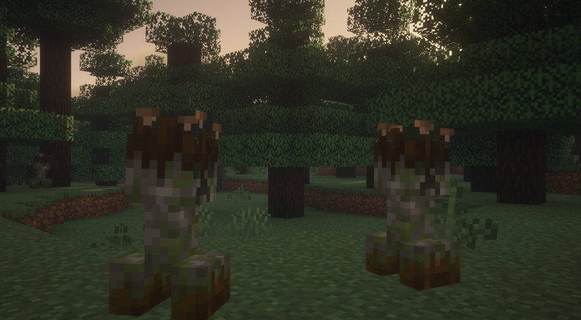

---
navigation:
  title: "Creeper variants"
  position: 3
  parent: adventure.creatures.md
  icon: minecraft:creeper_spawn_egg
---

# Creeper variants

## Creeper Overhaul

<EmiSearch query="@creeperoverhaul" /> <EmiSearch query="@spawn" />

Spruce Creeper

The image shows one species. The other entries have their own appearance.

| Creature | Encounter |
| --- | --- |
| Badlands Creeper | Overworld: badlands biomes. |
| Bamboo Creeper | Overworld: jungle biomes. |
| Beach Creeper | Overworld: beach biomes. |
| Birch Creeper | Overworld: birch forest biomes. |
| Cave Creeper | Spawns in eligible Overworld biomes used by the mod’s creeper spawn rules. |
| Dark Oak Creeper | Overworld: dark forest biomes. |
| Desert Creeper | Overworld: desert biomes. |
| Dripstone Creeper | Overworld: cave biomes. |
| Hills Creeper | Overworld: hill biomes. |
| Jungle Creeper | Overworld: jungle biomes. |
| Mushroom Creeper | Overworld: mushroom biomes. |
| Ocean Creeper | Overworld: ocean biomes. |
| Savannah Creeper | Overworld: savanna biomes. |
| Snowy Creeper | Overworld: snowy biomes. |
| Spruce Creeper | Overworld: taiga biomes. |
| Swamp Creeper | Overworld: swamp biomes. |

***

## Related mods

| Mod or content | Purpose | Item search |
| --- | --- | --- |
|  [Creeper Overhaul](creatures.creepers.md) | Adds biome-specific creeper variants with distinct appearances and behavior. | <EmiSearch query="@creeperoverhaul" /> |
