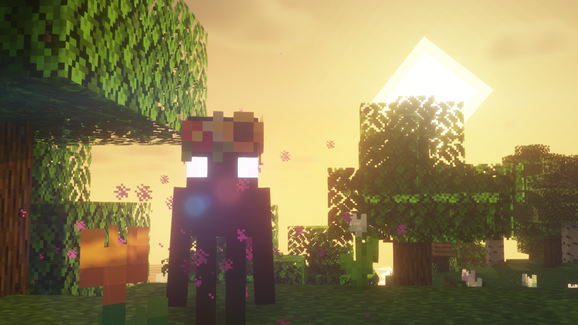

---
navigation:
  title: "Enderman variants"
  position: 4
  parent: adventure.creatures.md
  icon: minecraft:enderman_spawn_egg
---

# Enderman variants

## Enderman Overhaul

<EmiSearch query="@endermanoverhaul" /> <EmiSearch query="@spawn" />

Flower Fields Enderman

The image shows one species. The other entries have their own appearance.

| Creature | Encounter |
| --- | --- |
| Axolotl Pet Enderman | Summoned with an Ancient Pearl rather than found as wild animals. |
| Badlands Enderman | Overworld: badlands biomes. |
| Cave Enderman | Uses broad Overworld spawn tags. Its name does not limit it to caves. |
| Coral Enderman | Overworld: Warm Ocean biomes. |
| Crimson Forest Enderman | Nether: crimson forest biomes. |
| Dark Oak Enderman | Overworld: dark forest biomes. |
| Desert Enderman | Overworld: desert biomes. |
| End Enderman | End: biomes. |
| End Islands Enderman | End: outer islands. |
| Flower Fields Enderman | Overworld: flower forest biomes. |
| Hammerhead Pet Enderman | Summoned with an Ancient Pearl rather than found as wild animals. |
| Ice Spikes Enderman | Overworld: ice spikes biomes. |
| Mushroom Fields Enderman | Overworld: mushroom fields biomes. |
| Nether Wastes Enderman | Nether: Nether Wastes. |
| Pet Enderman | Summoned with an Ancient Pearl rather than found as wild animals. |
| Savanna Enderman | Overworld: savanna biomes. |
| Snowy Enderman | Overworld: snowy biomes. |
| Soulsand Valley Enderman | Nether: soul sand valley biomes. |
| Swamp Enderman | Overworld: swamp biomes. |
| Warped Forest Enderman | Nether: warped forest biomes. |
| Windswept Hills Enderman | Overworld: windswept hills biomes. |
| Scarab | Registered secondary creature. Encounter conditions not confirmed. |
| Spirit | Registered secondary creature. Encounter conditions not confirmed. |

***

## Related mods

| Mod or content | Purpose | Item search |
| --- | --- | --- |
|  [Enderman Overhaul](creatures.endermen.md) | Adds enderman variants with distinctive models, sounds and animations. | <EmiSearch query="@endermanoverhaul" /> |
