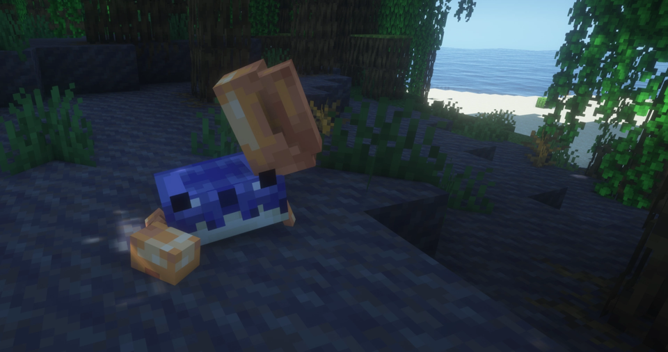

---
navigation:
  title: "Friends & foes"
  position: 1
  parent: adventure.creatures.md
  icon: minecraft:allay_spawn_egg
---

# Friends & foes

## Friends&Foes

Waving Crab

| Creature | Encounter |
| --- | --- |
| Copper Golem | Built from copper block, lightning rod and carved pumpkin. |
| Tuff Golem | Built from tuff, wool and carved pumpkin. Also in strongholds. |
| Crab | Overworld mangrove swamps and beaches. Breed with kelp. |
| Glare | Overworld lush caves. |
| Iceologer | Overworld snowy biomes and Iceologer Cabins. |
| Illusioner | Overworld taiga shacks and training grounds. |
| Moobloom | Overworld flower forests, cherry groves, meadows and sunflower plains. |
| Rascal | Overworld mineshafts. Play hide and seek for a reward. |
| Mauler | Overworld desert, badlands and savanna variants. |

- [Named bosses & access](adventure.bosses.md)

***

## Related mods

| Mod or content | Purpose | Item search |
| --- | --- | --- |
|  [Friends&Foes (Forge/NeoForge)](creatures.friends.md) | Adds expanded versions of creatures omitted from Minecraft mob votes. | <EmiSearch query="@friendsandfoes" /> |
