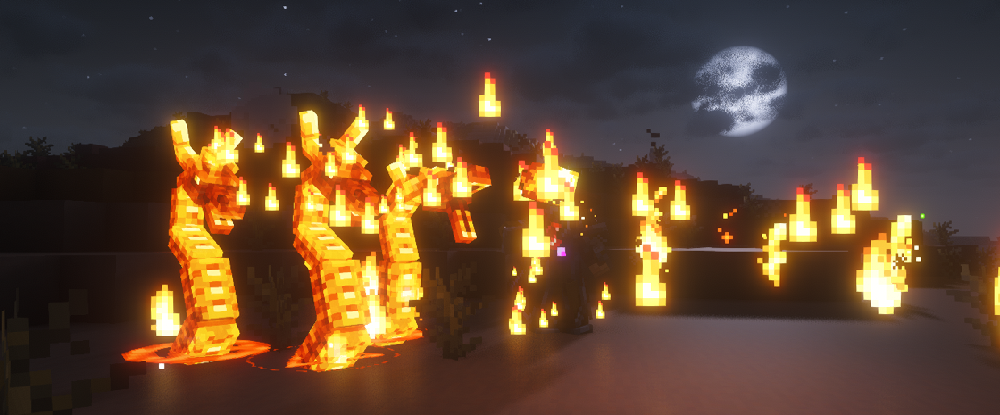

---
navigation:
  title: "Summons"
  position: 9
  parent: adventure.creatures.md
  icon: minecraft:blaze_spawn_egg
---

# Summons

## Summoned creatures

Fire spell effects

| Mod | Creatures & access |
| --- | --- |
| Archers | Summon a Spirit Wolf through its spell. |
| Archers Expansion | Polar Bear and Alter Ego are spell summons rather than naturally spawning wildlife. |
| Elemental Wizards | Summon an Earth Golem through its spell. |
| Wizards | Summon a Fire Hydra or Frost Elemental through its spell. |

***

## Related mods

| Mod or content | Purpose | Item search |
| --- | --- | --- |
|  [Archers (RPG Series)](combat.martial.md) | Adds an archer combat class built around bows and ranged abilities. | <EmiSearch query="@archers" /> |
|  [Archers Expansion (RPG Series Plus)](combat.martial.md) | Adds archer subclasses with cold, status-inflicting and explosive arrow abilities. | <EmiSearch query="@archers_expansion" /> |
|  [Elemental Wizards (RPG Series Plus)](combat.magic.md) | Expands Wizards with earth, water and wind spellcasting subclasses. | <EmiSearch query="@elemental_wizards_rpg" /> |
|  [Wizards (RPG Series)](combat.magic.md) | Adds wizard combat using arcane, fire and frost spells. | <EmiSearch query="@wizards" /> |
