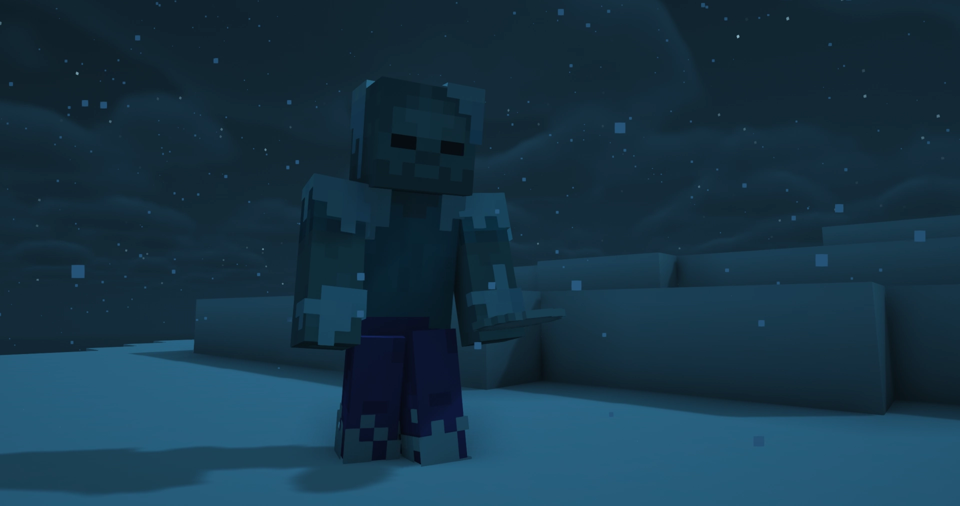

---
navigation:
  title: "Hostile variants"
  position: 5
  parent: adventure.creatures.md
  icon: minecraft:zombie_spawn_egg
---

# Hostile variants

## Variants&Ventures

<EmiSearch query="@variantsandventures" />

Gelid (Frozen Zombie)

| Creature | Encounter |
| --- | --- |
| Gelid | Overworld cold biomes. Freezing attacks. |
| Thicket | Overworld jungles. Poisonous attacks. |
| Verdant | Overworld jungles. Poison arrows. |
| Murk | Overworld warm oceans. Underwater skeleton. |

***

## Related mods

| Mod or content | Purpose | Item search |
| --- | --- | --- |
|  [Variants&Ventures](creatures.variants.md) | Adds new variants of familiar creatures to world encounters. | <EmiSearch query="@variantsandventures" /> |
