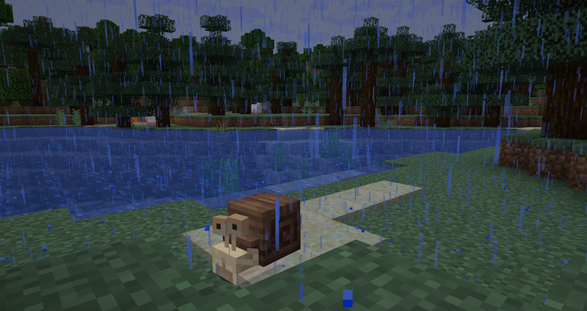

---
navigation:
  title: "Wildlife"
  position: 0
  parent: adventure.creatures.md
  icon: minecraft:fox_spawn_egg
---

# Wildlife

## Spawn

<EmiSearch query="@spawn" />

Snail

| Creature | Encounter |
| --- | --- |
| Angler Fish | Deep water fish that attracts prey with a lure. Overworld: deep cold and frozen oceans. It fits in a bucket. |
| Tuna | A breedable fish found in cold and deep Overworld oceans. Adults do not fit in a bucket. |
| Seahorse | Overworld: warm reefs and Seagrass Meadow. Its appearance varies with the habitat. |
| Snail | A forest snail that produces mucus when wet. |
| Hamster | Overworld: open grasslands. Tame it with sunflower seeds. |
| Ant | Anthills. Ants hatched from pupae follow their owner. Natural spawn conditions are not confirmed. |
| Clam | Overworld: beaches and oceans. Collect it by hand or with a Casting Net. |
| Sea Cow | Overworld: Seagrass Meadow. Milk it with a bucket. |
| Flukeshroom | Overworld: Mushroom Fields. Collect its soup with a bowl. |
| Octopus | A rare Overworld ocean creature. Catch it with a Casting Net. |
| Herring | A schooling fish found in Overworld oceans. |
| Pilot Fish | Swims around larger creatures. Its natural location is not confirmed. |
| Blenny | Tide pools. It is easily startled. Natural spawn conditions are not confirmed. |
| Bluefish | Overworld: cold oceans. It can enter a frenzy when nearby creatures are hurt. |
| Sunfish | Overworld: cold and lukewarm oceans. Adults do not fit in a bucket. |
| Stickbug | A mimic creature. Its encounter conditions are not confirmed. |
| Barracuda | Overworld: deep warm and lukewarm oceans. Catch it with a Casting Net. |
| Coastal Crab | Overworld: coasts. It shoots bubbles and fits in a bucket. |
| Spider Crab | A hostile crab in cold Overworld oceans. It climbs walls and shoots frozen bubbles. |
| Stranded | Attacks hostile creatures that bump into it. Waxing changes its state. Its natural location is not confirmed. |
| Barbed | Overworld: warmer oceans. It only attacks players who are in water. |
| Iguana | Tropical Islands. It uses sunlight to cook items. Natural spawn conditions are not confirmed. |
| Marine Iguana | Sea stacks. Help a young iguana shed to gain its trust. Natural spawn conditions are not confirmed. |
| Seal | Overworld: Cold Islands and frozen oceans. Offer live fish for a ride. |
| Booby | Sandy Islands. It performs mating dances. Natural spawn conditions are not confirmed. |
| Dodo | Dodo Islands. It is defenseless and shoots harmless seeds at hostile creatures. Natural spawn conditions are not confirmed. |
| Firekeeper | A hostile creature made from molten rock and sunstone. Its natural location is not confirmed. |

***

## Related mods

| Mod or content | Purpose | Item search |
| --- | --- | --- |
|  [Spawn](creatures.wilderness.md) | Expands Overworld wilderness with animals, biomes and ambient life. | <EmiSearch query="@spawn" /> |
