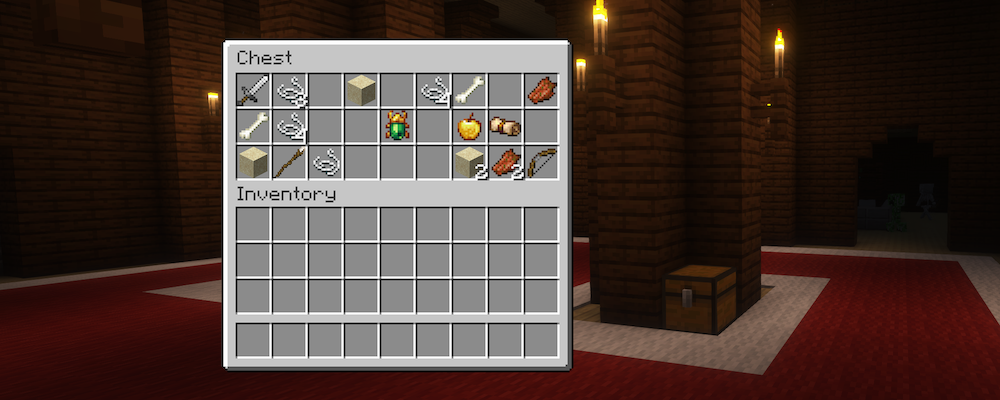
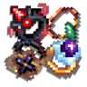
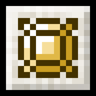
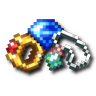

---
navigation:
  title: "Accessories"
  position: 3
  parent: reference.skills.md
  icon: minecraft:emerald
---

# Accessories

 [English](https://www.youtube.com/results?search_query=Minecraft+1.21.1+RPG+Series+Jewelry+Relics+Curios+accessories+tutorial) · [中文](https://www.youtube.com/results?search_query=Minecraft+1.21.1+RPG+Series+Jewelry+Relics+Curios+%E7%8F%A0%E5%AE%9D+%E9%81%97%E7%89%A9+%E9%A5%B0%E5%93%81+%E6%95%99%E7%A8%8B)

## Equipping accessories

<ItemGrid><ItemIcon id="jewelry:jewelers_kit" /></ItemGrid>

Open the Curios accessory interface and place each item in its accepted slot. Jewelry modifies attributes. Relics can grant passive, triggered or activated effects, so read the activation condition and cooldown. A ring, a necklace and a relic are not interchangeable slots.

<ItemLink id="jewelry:jewelers_kit" />

<Recipe id="jewelry:jewelers_kit" />

***

## Starter jewelry

A copper ring is an early protection accessory. An iron ring is another craftable protection option. Equip either in an allowed ring slot, then compare its tooltip with the attributes your abilities use. A ring does not unlock class spells.

<ItemGrid>
  <ItemIcon id="jewelry:copper_ring" />
</ItemGrid>

<ItemLink id="jewelry:copper_ring" />

<Recipe id="jewelry:copper_ring" />

<ItemGrid>
  <ItemIcon id="jewelry:iron_ring" />
</ItemGrid>

<ItemLink id="jewelry:iron_ring" />

<Recipe id="jewelry:iron_ring" />

***

## Jewelry

Items are grouped by role or matching attributes. Hover an item for its name, values and slot requirements.

<EmiSearch query="@jewelry" />

Rings, necklaces, gem and netherite variants, and named uniques supply the attributes listed below.

### Rings

| Attribute | Items |
| --- | --- |
| Healing power and Lightning power | <ItemGrid><ItemIcon id="jewelry:citrine_ring" /><ItemIcon id="jewelry:netherite_citrine_ring" /></ItemGrid> |
| Protection | <ItemGrid><ItemIcon id="jewelry:copper_ring" /><ItemIcon id="jewelry:iron_ring" /></ItemGrid> |
| Melee critical chance | <ItemGrid><ItemIcon id="jewelry:diamond_ring" /></ItemGrid> |
| Equipment-specific effect | <ItemGrid><ItemIcon id="jewelry:gold_ring" /></ItemGrid> |
| Ranged damage | <ItemGrid><ItemIcon id="jewelry:jade_ring" /><ItemIcon id="jewelry:netherite_jade_ring" /></ItemGrid> |
| Melee damage | <ItemGrid><ItemIcon id="jewelry:netherite_ruby_ring" /><ItemIcon id="jewelry:ruby_ring" /><ItemIcon id="jewelry:unique_attack_ring" /></ItemGrid> |
| Maximum health | <ItemGrid><ItemIcon id="jewelry:netherite_sapphire_ring" /><ItemIcon id="jewelry:sapphire_ring" /></ItemGrid> |
| Frost power and Soul power | <ItemGrid><ItemIcon id="jewelry:netherite_tanzanite_ring" /><ItemIcon id="jewelry:tanzanite_ring" /></ItemGrid> |
| Arcane power and Fire power | <ItemGrid><ItemIcon id="jewelry:netherite_topaz_ring" /><ItemIcon id="jewelry:topaz_ring" /></ItemGrid> |
| Arcane power and Spell critical chance and Spell haste | <ItemGrid><ItemIcon id="jewelry:unique_arcane_ring" /></ItemGrid> |
| Ranged damage and Ranged haste | <ItemGrid><ItemIcon id="jewelry:unique_archer_ring" /></ItemGrid> |
| Melee critical chance and Melee critical damage | <ItemGrid><ItemIcon id="jewelry:unique_crit_ring" /></ItemGrid> |
| Attack speed and Melee damage and Roll recharge | <ItemGrid><ItemIcon id="jewelry:unique_dex_ring" /></ItemGrid> |
| Fire power and Spell critical chance and Spell critical damage | <ItemGrid><ItemIcon id="jewelry:unique_fire_ring" /></ItemGrid> |
| Frost power and Spell haste and Spell critical damage | <ItemGrid><ItemIcon id="jewelry:unique_frost_ring" /></ItemGrid> |
| Healing power and Spell haste | <ItemGrid><ItemIcon id="jewelry:unique_healing_ring" /></ItemGrid> |
| Spell critical chance and Spell haste | <ItemGrid><ItemIcon id="jewelry:unique_spell_ring" /></ItemGrid> |
| Maximum health and Armor toughness | <ItemGrid><ItemIcon id="jewelry:unique_tank_ring" /></ItemGrid> |

### Necklaces

| Attribute | Items |
| --- | --- |
| Healing power and Lightning power | <ItemGrid><ItemIcon id="jewelry:citrine_necklace" /><ItemIcon id="jewelry:netherite_citrine_necklace" /></ItemGrid> |
| Melee critical damage | <ItemGrid><ItemIcon id="jewelry:diamond_necklace" /></ItemGrid> |
| Equipment-specific effect | <ItemGrid><ItemIcon id="jewelry:emerald_necklace" /></ItemGrid> |
| Ranged damage | <ItemGrid><ItemIcon id="jewelry:jade_necklace" /><ItemIcon id="jewelry:netherite_jade_necklace" /></ItemGrid> |
| Melee damage | <ItemGrid><ItemIcon id="jewelry:netherite_ruby_necklace" /><ItemIcon id="jewelry:ruby_necklace" /><ItemIcon id="jewelry:unique_attack_necklace" /></ItemGrid> |
| Maximum health | <ItemGrid><ItemIcon id="jewelry:netherite_sapphire_necklace" /><ItemIcon id="jewelry:sapphire_necklace" /></ItemGrid> |
| Frost power and Soul power | <ItemGrid><ItemIcon id="jewelry:netherite_tanzanite_necklace" /><ItemIcon id="jewelry:tanzanite_necklace" /></ItemGrid> |
| Arcane power and Fire power | <ItemGrid><ItemIcon id="jewelry:netherite_topaz_necklace" /><ItemIcon id="jewelry:topaz_necklace" /></ItemGrid> |
| Arcane power and Spell critical chance and Spell haste | <ItemGrid><ItemIcon id="jewelry:unique_arcane_necklace" /></ItemGrid> |
| Ranged damage and Extra roll capacity and Ranged haste | <ItemGrid><ItemIcon id="jewelry:unique_archer_necklace" /></ItemGrid> |
| Melee critical chance and Melee critical damage | <ItemGrid><ItemIcon id="jewelry:unique_crit_necklace" /></ItemGrid> |
| Attack speed and Melee damage and Extra roll capacity | <ItemGrid><ItemIcon id="jewelry:unique_dex_necklace" /></ItemGrid> |
| Fire power and Spell critical chance and Spell critical damage | <ItemGrid><ItemIcon id="jewelry:unique_fire_necklace" /></ItemGrid> |
| Frost power and Spell haste and Spell critical damage | <ItemGrid><ItemIcon id="jewelry:unique_frost_necklace" /></ItemGrid> |
| Healing power and Spell haste | <ItemGrid><ItemIcon id="jewelry:unique_healing_necklace" /></ItemGrid> |
| Spell critical damage | <ItemGrid><ItemIcon id="jewelry:unique_spell_necklace" /></ItemGrid> |
| Maximum health and Armor toughness | <ItemGrid><ItemIcon id="jewelry:unique_tank_necklace" /></ItemGrid> |

***

## Additional Jewelry

<EmiSearch query="@additional_rpg_jewelry" />

Additional Jewelry expands elemental, Rage and Witcher builds. Witcher-specific jewelry is supported alongside Witcher.

### Rings

| Attribute | Items |
| --- | --- |
| Air power and Water power | <ItemGrid><ItemIcon id="additional_rpg_jewelry:aquamarine_ring" /><ItemIcon id="additional_rpg_jewelry:netherite_aquamarine_ring" /></ItemGrid> |
| Maximum health | <ItemGrid><ItemIcon id="additional_rpg_jewelry:cactea_ring" /></ItemGrid> |
| Adrenaline modifier and Melee damage and Roll recharge | <ItemGrid><ItemIcon id="additional_rpg_jewelry:dark_steel_jade_ring" /></ItemGrid> |
| Earth power | <ItemGrid><ItemIcon id="additional_rpg_jewelry:malachite_ring" /><ItemIcon id="additional_rpg_jewelry:netherite_malachite_ring" /></ItemGrid> |
| Adrenaline modifier and Sign intensity | <ItemGrid><ItemIcon id="additional_rpg_jewelry:meteorite_silver_sapphire_ring" /><ItemIcon id="additional_rpg_jewelry:silver_sapphire_ring" /></ItemGrid> |
| Melee critical damage and Rage modifier | <ItemGrid><ItemIcon id="additional_rpg_jewelry:netherite_rage_ring" /><ItemIcon id="additional_rpg_jewelry:rage_ring" /><ItemIcon id="additional_rpg_jewelry:unique_rage_ring" /></ItemGrid> |
| Equipment-specific effect | <ItemGrid><ItemIcon id="additional_rpg_jewelry:spell_vampire_ring" /></ItemGrid> |
| Melee damage and Adrenaline modifier | <ItemGrid><ItemIcon id="additional_rpg_jewelry:steel_jade_ring" /></ItemGrid> |
| Melee damage and Life steal | <ItemGrid><ItemIcon id="additional_rpg_jewelry:vampire_ring" /></ItemGrid> |
| Earth power and Spell critical chance and Spell critical damage | <ItemGrid><ItemIcon id="additional_rpg_jewelry:unique_earth_ring" /></ItemGrid> |
| Spell critical chance and Spell haste | <ItemGrid><ItemIcon id="additional_rpg_jewelry:unique_forest_ring" /></ItemGrid> |
| Water power and Spell critical damage and Spell haste | <ItemGrid><ItemIcon id="additional_rpg_jewelry:unique_ocean_ring" /></ItemGrid> |
| Air power and Spell critical chance and Spell haste | <ItemGrid><ItemIcon id="additional_rpg_jewelry:unique_sky_ring" /></ItemGrid> |
| Adrenaline modifier and Melee damage and Sign intensity | <ItemGrid><ItemIcon id="additional_rpg_jewelry:unique_witcher_ring" /></ItemGrid> |

### Necklaces

| Attribute | Items |
| --- | --- |
| Air power and Water power | <ItemGrid><ItemIcon id="additional_rpg_jewelry:aquamarine_necklace" /><ItemIcon id="additional_rpg_jewelry:netherite_aquamarine_necklace" /></ItemGrid> |
| Adrenaline modifier and Melee damage and Roll recharge | <ItemGrid><ItemIcon id="additional_rpg_jewelry:dark_steel_jade_necklace" /></ItemGrid> |
| Maximum health | <ItemGrid><ItemIcon id="additional_rpg_jewelry:dripstone_necklace" /></ItemGrid> |
| Earth power | <ItemGrid><ItemIcon id="additional_rpg_jewelry:malachite_necklace" /><ItemIcon id="additional_rpg_jewelry:netherite_malachite_necklace" /></ItemGrid> |
| Adrenaline modifier and Sign intensity | <ItemGrid><ItemIcon id="additional_rpg_jewelry:meteorite_silver_sapphire_necklace" /><ItemIcon id="additional_rpg_jewelry:silver_sapphire_necklace" /></ItemGrid> |
| Melee critical damage and Rage modifier | <ItemGrid><ItemIcon id="additional_rpg_jewelry:netherite_rage_necklace" /><ItemIcon id="additional_rpg_jewelry:rage_necklace" /><ItemIcon id="additional_rpg_jewelry:unique_rage_necklace" /></ItemGrid> |
| Equipment-specific effect | <ItemGrid><ItemIcon id="additional_rpg_jewelry:spell_vampire_necklace" /></ItemGrid> |
| Melee damage and Adrenaline modifier | <ItemGrid><ItemIcon id="additional_rpg_jewelry:steel_jade_necklace" /></ItemGrid> |
| Melee damage and Life steal | <ItemGrid><ItemIcon id="additional_rpg_jewelry:vampire_necklace" /></ItemGrid> |
| Earth power and Spell critical chance and Spell critical damage | <ItemGrid><ItemIcon id="additional_rpg_jewelry:unique_earth_necklace" /></ItemGrid> |
| Spell critical chance and Spell haste | <ItemGrid><ItemIcon id="additional_rpg_jewelry:unique_forest_necklace" /></ItemGrid> |
| Water power and Spell critical damage and Spell haste | <ItemGrid><ItemIcon id="additional_rpg_jewelry:unique_ocean_necklace" /></ItemGrid> |
| Air power and Spell critical chance and Spell haste | <ItemGrid><ItemIcon id="additional_rpg_jewelry:unique_sky_necklace" /></ItemGrid> |
| Adrenaline modifier and Melee damage and Sign intensity | <ItemGrid><ItemIcon id="additional_rpg_jewelry:unique_witcher_necklace" /></ItemGrid> |

***

## Relics

<EmiSearch query="@relics_rpgs" />

Relic families distinguish passive bonuses, effects that trigger on events and effects activated by use. The tooltip supplies the actual condition.

### Lesser relics

| Attribute | Items |
| --- | --- |
| Evasion chance | <ItemGrid><ItemIcon id="relics_rpgs:lesser_evasion" /></ItemGrid> |
| Melee critical chance | <ItemGrid><ItemIcon id="relics_rpgs:lesser_melee_crit_chance" /></ItemGrid> |
| Melee critical damage | <ItemGrid><ItemIcon id="relics_rpgs:lesser_melee_crit_damage" /></ItemGrid> |
| Triggered ability | <ItemGrid><ItemIcon id="relics_rpgs:lesser_proc_arcane_fire" /><ItemIcon id="relics_rpgs:lesser_proc_crit_damage" /><ItemIcon id="relics_rpgs:lesser_proc_frost_healing" /><ItemIcon id="relics_rpgs:lesser_proc_spell_crit" /><ItemIcon id="relics_rpgs:lesser_use_damage" /><ItemIcon id="relics_rpgs:lesser_use_dex" /><ItemIcon id="relics_rpgs:lesser_use_health" /><ItemIcon id="relics_rpgs:lesser_use_ranged" /><ItemIcon id="relics_rpgs:lesser_use_spell_haste" /><ItemIcon id="relics_rpgs:lesser_use_spell_power" /></ItemGrid> |
| Extra roll capacity | <ItemGrid><ItemIcon id="relics_rpgs:lesser_roll" /></ItemGrid> |

### Medium relics

| Attribute | Items |
| --- | --- |
| Triggered ability | <ItemGrid><ItemIcon id="relics_rpgs:medium_proc_arcane_power" /><ItemIcon id="relics_rpgs:medium_proc_attack_damage" /><ItemIcon id="relics_rpgs:medium_proc_attack_speed" /><ItemIcon id="relics_rpgs:medium_proc_defense" /><ItemIcon id="relics_rpgs:medium_proc_evasion" /><ItemIcon id="relics_rpgs:medium_proc_fire_power" /><ItemIcon id="relics_rpgs:medium_proc_frost_power" /><ItemIcon id="relics_rpgs:medium_proc_healing_power" /><ItemIcon id="relics_rpgs:medium_proc_ranged_damage" /><ItemIcon id="relics_rpgs:medium_proc_spell_haste" /><ItemIcon id="relics_rpgs:medium_proc_spell_power" /></ItemGrid> |

### Greater relics

| Attribute | Items |
| --- | --- |
| Healing received | <ItemGrid><ItemIcon id="relics_rpgs:greater_healing_taken" /></ItemGrid> |
| Triggered ability | <ItemGrid><ItemIcon id="relics_rpgs:greater_perk_defense_block" /><ItemIcon id="relics_rpgs:greater_perk_evasion_attack" /><ItemIcon id="relics_rpgs:greater_perk_heal_danger" /><ItemIcon id="relics_rpgs:greater_perk_melee_stun" /><ItemIcon id="relics_rpgs:greater_perk_ranged_levitate" /><ItemIcon id="relics_rpgs:greater_perk_roll_damage" /><ItemIcon id="relics_rpgs:greater_perk_shield_reset" /><ItemIcon id="relics_rpgs:greater_perk_spell_stun" /><ItemIcon id="relics_rpgs:greater_proc_physical_trance" /><ItemIcon id="relics_rpgs:greater_proc_spell_trance" /></ItemGrid> |
| Equipment-specific effect | <ItemGrid><ItemIcon id="relics_rpgs:greater_perk_heal_cleanse" /><ItemIcon id="relics_rpgs:greater_proc_defense_danger" /></ItemGrid> |

### Superior relics

| Attribute | Items |
| --- | --- |
| Triggered ability | <ItemGrid><ItemIcon id="relics_rpgs:superior_use_area_attack_damage" /><ItemIcon id="relics_rpgs:superior_use_area_defense_health" /><ItemIcon id="relics_rpgs:superior_use_zone_healing_taken" /><ItemIcon id="relics_rpgs:superior_use_zone_spell_power" /></ItemGrid> |

### Jewel relics

| Attribute | Items |
| --- | --- |
| Healing power and Lightning power | <ItemGrid><ItemIcon id="relics_rpgs:jewel_figurine_citrine" /></ItemGrid> |
| Ranged damage | <ItemGrid><ItemIcon id="relics_rpgs:jewel_figurine_jade" /></ItemGrid> |
| Melee damage | <ItemGrid><ItemIcon id="relics_rpgs:jewel_figurine_ruby" /></ItemGrid> |
| Maximum health | <ItemGrid><ItemIcon id="relics_rpgs:jewel_figurine_sapphire" /></ItemGrid> |
| Frost power and Soul power | <ItemGrid><ItemIcon id="relics_rpgs:jewel_figurine_tanzanite" /></ItemGrid> |
| Arcane power and Fire power | <ItemGrid><ItemIcon id="relics_rpgs:jewel_figurine_topaz" /></ItemGrid> |

***

## More Relics

<EmiSearch query="@more_relics" />

More Relics adds further elemental, Rage and other class-build effects. Read each tooltip for activation and cooldown.

### Lesser relics

| Attribute | Items |
| --- | --- |
| Triggered ability | <ItemGrid><ItemIcon id="more_relics:lesser_proc_air_water" /><ItemIcon id="more_relics:lesser_proc_earth_nature" /><ItemIcon id="more_relics:lesser_use_rage" /></ItemGrid> |

### Medium relics

| Attribute | Items |
| --- | --- |
| Triggered ability | <ItemGrid><ItemIcon id="more_relics:medium_proc_lifesteal" /><ItemIcon id="more_relics:medium_proc_rage" /><ItemIcon id="more_relics:medium_use_air_power" /><ItemIcon id="more_relics:medium_use_earth_power" /><ItemIcon id="more_relics:medium_use_nature_power" /><ItemIcon id="more_relics:medium_use_water_power" /></ItemGrid> |

### Greater relics

| Attribute | Items |
| --- | --- |
| Triggered ability | <ItemGrid><ItemIcon id="more_relics:greater_frozen_heart" /><ItemIcon id="more_relics:greater_kircheis_shard" /><ItemIcon id="more_relics:greater_liandrys_torment" /><ItemIcon id="more_relics:greater_madreds_bloodrazor" /><ItemIcon id="more_relics:greater_proc_rage" /><ItemIcon id="more_relics:greater_sunfire_cape" /></ItemGrid> |

### Superior relics

| Attribute | Items |
| --- | --- |
| Triggered ability | <ItemGrid><ItemIcon id="more_relics:superior_guardian_angel" /><ItemIcon id="more_relics:superior_mejais_soulstealer" /><ItemIcon id="more_relics:superior_mikaels_blessing" /><ItemIcon id="more_relics:superior_shurelyas_battlesong" /><ItemIcon id="more_relics:superior_zhonyas_hourglass" /></ItemGrid> |

### Jewel relics

| Attribute | Items |
| --- | --- |
| Air power and Water power | <ItemGrid><ItemIcon id="more_relics:jewel_figurine_aquamarine" /></ItemGrid> |
| Rage modifier and Melee damage | <ItemGrid><ItemIcon id="more_relics:jewel_figurine_chain" /></ItemGrid> |
| Earth power | <ItemGrid><ItemIcon id="more_relics:jewel_figurine_malachite" /></ItemGrid> |

***

## Cataclysm accessories

<EmiSearch query="@cataclysm" />

These custom equipment items use their own effects and slot rules. Check the full tooltip before replacing jewelry or a relic.

| Attribute | Items |
| --- | --- |
| Equipment-specific effect | <ItemGrid><ItemIcon id="cataclysm:belt_of_beginner" /><ItemIcon id="cataclysm:belt_of_monstrosity" /><ItemIcon id="cataclysm:blazing_grips" /><ItemIcon id="cataclysm:chitin_claw" /><ItemIcon id="cataclysm:ring_of_grudged" /><ItemIcon id="cataclysm:berserker_soul_amulet" /><ItemIcon id="cataclysm:vitality_ankh" /><ItemIcon id="cataclysm:unbreakable_skull" /><ItemIcon id="cataclysm:sturdy_boots" /><ItemIcon id="cataclysm:sandstorm_in_a_bottle" /><ItemIcon id="cataclysm:sticky_gloves" /><ItemIcon id="cataclysm:remnant_skull" /><ItemIcon id="cataclysm:necklace_of_the_desert" /></ItemGrid> |

***
## Build comparison

<ItemGrid><ItemIcon id="jewelry:copper_ring" /><ItemIcon id="relics_rpgs:lesser_evasion" /><ItemIcon id="cataclysm:belt_of_beginner" /></ItemGrid>

Compare the attribute used by your ability, its trigger condition and the slot it occupies. Rarity alone does not establish a better build.

- [Weapons & armor](equipment.weapons-armor.md) Choose a weapon family and compare every supported variant.
- [Spells & abilities](combat.abilities.md) Spell binding, scrolls and casting controls.
- [Magic & support](combat.magic.md) Weapon spells, songs, runes and pouches.
- [Skill development](combat.skills.md) Spend class and weapon points on connected branches.

***

## Related mods

| Mod or content | Purpose | Item search |
| --- | --- | --- |
|  [Additional Jewelry (RPG Series Plus)](equipment.accessories.md) | Adds jewelry for the additional More RPG Classes professions. | <EmiSearch query="@additional_rpg_jewelry" /> |
|  [Curios API](equipment.accessories.md) | Provides expandable equipment slots for wearable accessories. | No separate item search |
|  [Jewelry (RPG Series)](equipment.accessories.md) | Adds mineable gems and craftable jewelry that improves combat attributes. | <EmiSearch query="@jewelry" /> |
|  [More Relics (RPG Series Plus)](equipment.accessories.md) | Adds Relics accessories for the additional More RPG Classes professions. | <EmiSearch query="@more_relics" /> |
|  [Relics (RPG Series)](equipment.accessories.md) | Adds combat-enhancing trinkets for RPG Series character builds. | <EmiSearch query="@relics_rpgs" /> |
