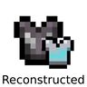
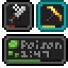
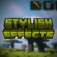

---
navigation:
  title: "Armor & status"
  position: 4
  parent: reference.skills.md
  icon: minecraft:potion
---

# Armor & status

 [English](https://www.youtube.com/results?search_query=Minecraft+1.21.1+Detail+Armor+Bar+Reconstructed+Status+Effect+Bars+Reforged+tutorial) · [中文](https://www.youtube.com/results?search_query=Minecraft+1.21.1+Detail+Armor+Bar+Reconstructed+Status+Effect+Bars+Reforged+%E6%8A%A4%E7%94%B2+%E7%8A%B6%E6%80%81%E6%95%88%E6%9E%9C+%E6%98%BE%E7%A4%BA+%E6%95%99%E7%A8%8B)

## Display information

<ItemGrid><ItemIcon id="minecraft:iron_chestplate" /><ItemIcon id="minecraft:potion" /></ItemGrid>

| Display | What it shows |
| --- | --- |
| Detail Armor Bar Reconstructed | Additional armor-protection information in the armor bar. |
| Status Effect Bars Reforged | Remaining status-effect durations. |
| Stylish Effects | A compact, configurable presentation of status effects. |

These are information displays. They do not grant equipment slots or combat bonuses.

***

## Related mods

| Mod or content | Purpose | Item search |
| --- | --- | --- |
|  [Detail Armor Bar Reconstructed](equipment.display.md) | Shows additional armor information in the armor status bar. | No separate item search |
|  [Status Effect Bars Reforged](equipment.display.md) | Shows remaining status-effect duration with customizable bars. | No separate item search |
|  [Stylish Effects](equipment.display.md) | Reorganizes status-effect displays into compact, configurable interface layouts. | No separate item search |
