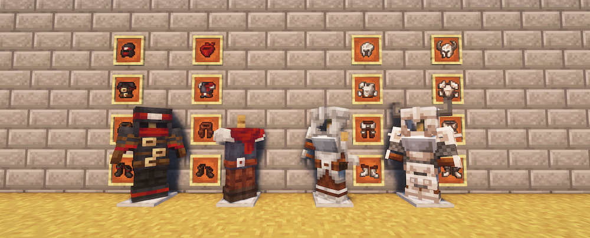
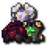
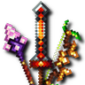

---
navigation:
  title: "Weapons & armor"
  position: 2
  parent: reference.skills.md
  icon: minecraft:trident
---

# Weapons & armor

 [English](https://www.youtube.com/results?search_query=Minecraft+1.21.1+RPG+Series+Armory+Arsenal+equipment+set+bonuses+tutorial) · [中文](https://www.youtube.com/results?search_query=Minecraft+1.21.1+RPG+Series+Armory+Arsenal+%E6%AD%A6%E5%99%A8+%E6%8A%A4%E7%94%B2+%E5%A5%97%E8%A3%85+%E6%95%99%E7%A8%8B)

## Equipment families

Class pages contain starter recipes and class-specific weapons and armor. This reference keeps shared named sets, Arsenal weapons and Cataclysm equipment. Compare spell-school bonuses and item effects, not only damage or material.

- [Martial class equipment](combat.martial.md)
- [Magic & support equipment](combat.magic.md)

***

## Armory sets

<EmiSearch query="@armory_rpgs" />

Named armor sets add build-specific attributes and set effects. Read the set requirement in the tooltip before mixing pieces.

Each group shows every piece of one supported set, ordered head, chest, legs and feet.

| Set, chest reference | Pieces, head to feet |
| --- | --- |
| <ItemLink id="armory_rpgs:astral_robe_chest" /> | <ItemGrid><ItemIcon id="armory_rpgs:astral_robe_head" /><ItemIcon id="armory_rpgs:astral_robe_chest" /><ItemIcon id="armory_rpgs:astral_robe_legs" /><ItemIcon id="armory_rpgs:astral_robe_feet" /></ItemGrid> |
| <ItemLink id="armory_rpgs:scarlet_robe_chest" /> | <ItemGrid><ItemIcon id="armory_rpgs:scarlet_robe_head" /><ItemIcon id="armory_rpgs:scarlet_robe_chest" /><ItemIcon id="armory_rpgs:scarlet_robe_legs" /><ItemIcon id="armory_rpgs:scarlet_robe_feet" /></ItemGrid> |
| <ItemLink id="armory_rpgs:glacier_robe_chest" /> | <ItemGrid><ItemIcon id="armory_rpgs:glacier_robe_head" /><ItemIcon id="armory_rpgs:glacier_robe_chest" /><ItemIcon id="armory_rpgs:glacier_robe_legs" /><ItemIcon id="armory_rpgs:glacier_robe_feet" /></ItemGrid> |
| <ItemLink id="armory_rpgs:avatar_robe_chest" /> | <ItemGrid><ItemIcon id="armory_rpgs:avatar_robe_head" /><ItemIcon id="armory_rpgs:avatar_robe_chest" /><ItemIcon id="armory_rpgs:avatar_robe_legs" /><ItemIcon id="armory_rpgs:avatar_robe_feet" /></ItemGrid> |
| <ItemLink id="armory_rpgs:justicar_armor_chest" /> | <ItemGrid><ItemIcon id="armory_rpgs:justicar_armor_head" /><ItemIcon id="armory_rpgs:justicar_armor_chest" /><ItemIcon id="armory_rpgs:justicar_armor_legs" /><ItemIcon id="armory_rpgs:justicar_armor_feet" /></ItemGrid> |
| <ItemLink id="armory_rpgs:destroyer_armor_chest" /> | <ItemGrid><ItemIcon id="armory_rpgs:destroyer_armor_head" /><ItemIcon id="armory_rpgs:destroyer_armor_chest" /><ItemIcon id="armory_rpgs:destroyer_armor_legs" /><ItemIcon id="armory_rpgs:destroyer_armor_feet" /></ItemGrid> |
| <ItemLink id="armory_rpgs:deathmantle_armor_chest" /> | <ItemGrid><ItemIcon id="armory_rpgs:deathmantle_armor_head" /><ItemIcon id="armory_rpgs:deathmantle_armor_chest" /><ItemIcon id="armory_rpgs:deathmantle_armor_legs" /><ItemIcon id="armory_rpgs:deathmantle_armor_feet" /></ItemGrid> |
| <ItemLink id="armory_rpgs:strider_armor_chest" /> | <ItemGrid><ItemIcon id="armory_rpgs:strider_armor_head" /><ItemIcon id="armory_rpgs:strider_armor_chest" /><ItemIcon id="armory_rpgs:strider_armor_legs" /><ItemIcon id="armory_rpgs:strider_armor_feet" /></ItemGrid> |
| <ItemLink id="armory_rpgs:tempest_robe_chest" /> | <ItemGrid><ItemIcon id="armory_rpgs:tempest_robe_head" /><ItemIcon id="armory_rpgs:tempest_robe_chest" /><ItemIcon id="armory_rpgs:tempest_robe_legs" /><ItemIcon id="armory_rpgs:tempest_robe_feet" /></ItemGrid> |
| <ItemLink id="armory_rpgs:smouldering_robe_chest" /> | <ItemGrid><ItemIcon id="armory_rpgs:smouldering_robe_head" /><ItemIcon id="armory_rpgs:smouldering_robe_chest" /><ItemIcon id="armory_rpgs:smouldering_robe_legs" /><ItemIcon id="armory_rpgs:smouldering_robe_feet" /></ItemGrid> |
| <ItemLink id="armory_rpgs:rimeweave_robe_chest" /> | <ItemGrid><ItemIcon id="armory_rpgs:rimeweave_robe_head" /><ItemIcon id="armory_rpgs:rimeweave_robe_chest" /><ItemIcon id="armory_rpgs:rimeweave_robe_legs" /><ItemIcon id="armory_rpgs:rimeweave_robe_feet" /></ItemGrid> |
| <ItemLink id="armory_rpgs:absolution_robe_chest" /> | <ItemGrid><ItemIcon id="armory_rpgs:absolution_robe_head" /><ItemIcon id="armory_rpgs:absolution_robe_chest" /><ItemIcon id="armory_rpgs:absolution_robe_legs" /><ItemIcon id="armory_rpgs:absolution_robe_feet" /></ItemGrid> |
| <ItemLink id="armory_rpgs:lightbringer_armor_chest" /> | <ItemGrid><ItemIcon id="armory_rpgs:lightbringer_armor_head" /><ItemIcon id="armory_rpgs:lightbringer_armor_chest" /><ItemIcon id="armory_rpgs:lightbringer_armor_legs" /><ItemIcon id="armory_rpgs:lightbringer_armor_feet" /></ItemGrid> |
| <ItemLink id="armory_rpgs:onslaught_armor_chest" /> | <ItemGrid><ItemIcon id="armory_rpgs:onslaught_armor_head" /><ItemIcon id="armory_rpgs:onslaught_armor_chest" /><ItemIcon id="armory_rpgs:onslaught_armor_legs" /><ItemIcon id="armory_rpgs:onslaught_armor_feet" /></ItemGrid> |
| <ItemLink id="armory_rpgs:slayer_armor_chest" /> | <ItemGrid><ItemIcon id="armory_rpgs:slayer_armor_head" /><ItemIcon id="armory_rpgs:slayer_armor_chest" /><ItemIcon id="armory_rpgs:slayer_armor_legs" /><ItemIcon id="armory_rpgs:slayer_armor_feet" /></ItemGrid> |
| <ItemLink id="armory_rpgs:riftstalker_armor_chest" /> | <ItemGrid><ItemIcon id="armory_rpgs:riftstalker_armor_head" /><ItemIcon id="armory_rpgs:riftstalker_armor_chest" /><ItemIcon id="armory_rpgs:riftstalker_armor_legs" /><ItemIcon id="armory_rpgs:riftstalker_armor_feet" /></ItemGrid> |

***

## Arsenal weapons

<EmiSearch query="@arsenal" />

Named weapons span melee, ranged, shields and spell focuses. Compare each weapon effect and its conditions, not only the material tier.

| Family | Items | Role and attributes |
| --- | --- | --- |
| Claymores | <ItemGrid><ItemIcon id="arsenal:unique_claymore_1" /><ItemIcon id="arsenal:unique_claymore_2" /><ItemIcon id="arsenal:unique_claymore_sw" /></ItemGrid> | Melee weapon or focus |
| Damage staves | <ItemGrid><ItemIcon id="arsenal:unique_staff_damage_1" /><ItemIcon id="arsenal:unique_staff_damage_5" /><ItemIcon id="arsenal:unique_staff_damage_6" /></ItemGrid> | Arcane power and Frost power |
| Damage staves | <ItemGrid><ItemIcon id="arsenal:unique_staff_damage_2" /><ItemIcon id="arsenal:unique_staff_damage_3" /></ItemGrid> | Arcane power and Fire power |
| Damage staves | <ItemGrid><ItemIcon id="arsenal:unique_staff_damage_4" /></ItemGrid> | Fire power and Frost power |
| Damage staves | <ItemGrid><ItemIcon id="arsenal:unique_staff_damage_sw" /></ItemGrid> | Arcane power and Fire power and Frost power |
| Healing staves | <ItemGrid><ItemIcon id="arsenal:unique_staff_heal_1" /></ItemGrid> | Healing power and Arcane power |
| Healing staves | <ItemGrid><ItemIcon id="arsenal:unique_staff_heal_2" /><ItemIcon id="arsenal:unique_staff_heal_sw" /></ItemGrid> | Healing power |
| Spears | <ItemGrid><ItemIcon id="arsenal:unique_spear_1" /><ItemIcon id="arsenal:unique_spear_2" /><ItemIcon id="arsenal:unique_spear_sw" /></ItemGrid> | Melee weapon or focus |
| Daggers | <ItemGrid><ItemIcon id="arsenal:unique_dagger_1" /><ItemIcon id="arsenal:unique_dagger_2" /><ItemIcon id="arsenal:unique_dagger_sw" /></ItemGrid> | Melee weapon or focus |
| Sickles | <ItemGrid><ItemIcon id="arsenal:unique_sickle_1" /><ItemIcon id="arsenal:unique_sickle_2" /><ItemIcon id="arsenal:unique_sickle_sw" /></ItemGrid> | Melee weapon or focus |
| Longswords | <ItemGrid><ItemIcon id="arsenal:unique_longsword_sw" /></ItemGrid> | Melee weapon or focus |
| Double axes | <ItemGrid><ItemIcon id="arsenal:unique_double_axe_1" /><ItemIcon id="arsenal:unique_double_axe_2" /><ItemIcon id="arsenal:unique_double_axe_sw" /></ItemGrid> | Melee weapon or focus |
| Glaives | <ItemGrid><ItemIcon id="arsenal:unique_glaive_1" /><ItemIcon id="arsenal:unique_glaive_2" /><ItemIcon id="arsenal:unique_glaive_sw" /></ItemGrid> | Melee weapon or focus |
| Hammers | <ItemGrid><ItemIcon id="arsenal:unique_hammer_1" /><ItemIcon id="arsenal:unique_hammer_2" /><ItemIcon id="arsenal:unique_hammer_sw" /></ItemGrid> | Melee weapon or focus |
| Maces | <ItemGrid><ItemIcon id="arsenal:unique_mace_1" /><ItemIcon id="arsenal:unique_mace_2" /><ItemIcon id="arsenal:unique_mace_sw" /></ItemGrid> | Melee weapon or focus |
| Longbows | <ItemGrid><ItemIcon id="arsenal:unique_longbow_1" /><ItemIcon id="arsenal:unique_longbow_2" /><ItemIcon id="arsenal:unique_longbow_sw" /></ItemGrid> | Ranged weapon |
| Heavy crossbows | <ItemGrid><ItemIcon id="arsenal:unique_heavy_crossbow_1" /><ItemIcon id="arsenal:unique_heavy_crossbow_2" /><ItemIcon id="arsenal:unique_heavy_crossbow_sw" /></ItemGrid> | Ranged weapon |
| Shields | <ItemGrid><ItemIcon id="arsenal:unique_shield_1" /><ItemIcon id="arsenal:unique_shield_2" /><ItemIcon id="arsenal:unique_shield_sw" /></ItemGrid> | Armor toughness and Maximum health |

***

## Cataclysm equipment

<EmiSearch query="@cataclysm" />

Named melee weapons, shields, ranged weapons, weapon-tools and armor have their own effects. They are not automatically class spell focuses. This catalog covers combat equipment, not summoning tools or crafting materials.

Items are grouped by role or matching attributes. Hover an item for its name, values and slot requirements.

| Equipment family | Items |
| --- | --- |
| Polearms & blades | <ItemGrid><ItemIcon id="cataclysm:coral_spear" /><ItemIcon id="cataclysm:coral_bardiche" /><ItemIcon id="cataclysm:athame" /><ItemIcon id="cataclysm:khopesh" /><ItemIcon id="cataclysm:black_steel_sword" /><ItemIcon id="cataclysm:the_incinerator" /><ItemIcon id="cataclysm:soul_render" /><ItemIcon id="cataclysm:ancient_spear" /></ItemGrid> |
| Tools & combat tools | <ItemGrid><ItemIcon id="cataclysm:black_steel_shovel" /><ItemIcon id="cataclysm:black_steel_pickaxe" /><ItemIcon id="cataclysm:black_steel_axe" /><ItemIcon id="cataclysm:black_steel_hoe" /><ItemIcon id="cataclysm:meat_shredder" /><ItemIcon id="cataclysm:void_forge" /><ItemIcon id="cataclysm:infernal_forge" /></ItemGrid> |
| Shields | <ItemGrid><ItemIcon id="cataclysm:black_steel_targe" /><ItemIcon id="cataclysm:azure_sea_shield" /><ItemIcon id="cataclysm:bulwark_of_the_flame" /></ItemGrid> |
| Gauntlets & claws | <ItemGrid><ItemIcon id="cataclysm:gauntlet_of_guard" /><ItemIcon id="cataclysm:gauntlet_of_bulwark" /><ItemIcon id="cataclysm:gauntlet_of_maelstrom" /><ItemIcon id="cataclysm:tidal_claws" /></ItemGrid> |
| Bows & launchers | <ItemGrid><ItemIcon id="cataclysm:cursed_bow" /><ItemIcon id="cataclysm:wrath_of_the_desert" /><ItemIcon id="cataclysm:laser_gatling" /><ItemIcon id="cataclysm:wither_assault_shoulder_weapon" /><ItemIcon id="cataclysm:void_assault_shoulder_weapon" /></ItemGrid> |
| Other named weapons | <ItemGrid><ItemIcon id="cataclysm:the_annihilator" /><ItemIcon id="cataclysm:astrape" /><ItemIcon id="cataclysm:ceraunus" /><ItemIcon id="cataclysm:brontes" /><ItemIcon id="cataclysm:the_immolator" /></ItemGrid> |
| Ammunition & components | <ItemGrid><ItemIcon id="cataclysm:void_scatter_arrow" /><ItemIcon id="cataclysm:void_core" /></ItemGrid> |
| Bone reptile armor | <ItemGrid><ItemIcon id="cataclysm:bone_reptile_helmet" /><ItemIcon id="cataclysm:bone_reptile_chestplate" /></ItemGrid> |
| Ignitium armor | <ItemGrid><ItemIcon id="cataclysm:ignitium_helmet" /><ItemIcon id="cataclysm:ignitium_chestplate" /><ItemIcon id="cataclysm:ignitium_elytra_chestplate" /><ItemIcon id="cataclysm:ignitium_leggings" /><ItemIcon id="cataclysm:ignitium_boots" /></ItemGrid> |
| Cursium armor | <ItemGrid><ItemIcon id="cataclysm:cursium_helmet" /><ItemIcon id="cataclysm:cursium_chestplate" /><ItemIcon id="cataclysm:cursium_leggings" /><ItemIcon id="cataclysm:cursium_boots" /></ItemGrid> |
| Other armor | <ItemGrid><ItemIcon id="cataclysm:monstrous_helm" /><ItemIcon id="cataclysm:bloom_stone_pauldrons" /></ItemGrid> |

- [Boss encounters](adventure.bosses.md)

***

## Compatibility families

<ItemGrid><ItemIcon id="minecraft:iron_sword" /><ItemIcon id="archers:composite_longbow" /></ItemGrid>

Better Nether ruby weapons, Better End crystal and aeternium weapons, and Aether weapons are not available in this selection. Their packaged illustrations do not make them obtainable equipment. Arsenal-linked unique weapons are included because Arsenal is loaded.

- [Martial abilities](combat.martial.md) Ranged shots, close combat and class techniques.
- [Spells & abilities](combat.abilities.md) Spell binding, scrolls and casting controls.
- [Magic & support](combat.magic.md) Weapon spells, songs, runes and pouches.
- [Accessories](equipment.accessories.md) Equip jewelry and relics in their supported slots.

***

## Related mods

| Mod or content | Purpose | Item search |
| --- | --- | --- |
|  [Armory (RPG Series)](equipment.weapons-armor.md) | Adds class-oriented armor sets with set bonuses. | <EmiSearch query="@armory_rpgs" /> |
|  [Arsenal (RPG Series)](equipment.weapons-armor.md) | Adds legendary weapons obtained through encounters rather than crafting. | <EmiSearch query="@arsenal" /> |
