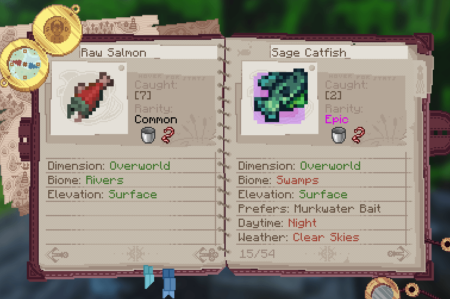
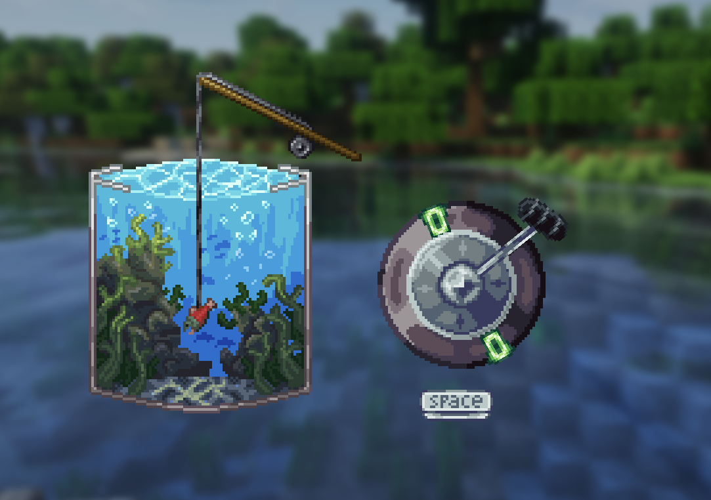
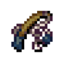
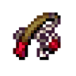

---
navigation:
  title: "Fishing habitats"
  position: 4
  parent: reference.food.md
  icon: minecraft:salmon
---

# Fishing habitats

## Habitat families

<EmiSearch query="@hybrid_aquatic" /> <EmiSearch query="@starcatcher" />

Species entries and catch requirements

<ItemGrid><ItemIcon id="starcatcher:starcatcher_guide" /><ItemIcon id="starcatcher:fish_radar" /></ItemGrid>

A habitat is the first filter, and it is a relationship between three things, the water you stand at, the terrain around it and the species the guide allows there. The markers below identify terrain, not fish. Match the marker, then confirm the species in the guide.

| Habitat | Terrain marker | Catches to expect |
| --- | --- | --- |
| Cold freshwater | <ItemGrid><ItemIcon id="minecraft:ice" /></ItemGrid> Birch Taiga, Windswept Spires, winter islands | Frostjaw Trout, Wintery Pike |
| Warm freshwater | <ItemGrid><ItemIcon id="minecraft:cactus" /></ItemGrid> Desert, badlands, savanna, Granite Cliffs | Sandtail, Scorchfish, Mirage Carp, Agave Bream, Cactifish, Oasis Sturgeon |
| Cherry landscapes | <ItemGrid><ItemIcon id="minecraft:cherry_sapling" /></ItemGrid> Sakura Grove, Sakura Valley, Snowy Cherry Grove, Spring Skylands | Blossomfish, Pink Koi |
| Flowering landscapes | <ItemGrid><ItemIcon id="minecraft:poppy" /></ItemGrid> Flower forests, Cloud Forest, Moonlight landscapes | Petal Bass |
| Open grassland | <ItemGrid><ItemIcon id="minecraft:sunflower" /></ItemGrid> Prairie and open grassland equivalents | Sunflower Carp |
| Dark forest | <ItemGrid><ItemIcon id="minecraft:dark_oak_sapling" /></ItemGrid> Dark forest and Moonlight groves | Enchanted forest entries |
| Ice formations | <ItemGrid><ItemIcon id="minecraft:packed_ice" /></ItemGrid> Frozen cliffs, Glacial Chasm, Emerald Peaks | Aurora and other ice-spike entries |
| Lush caves | <ItemGrid><ItemIcon id="minecraft:moss_block" /></ItemGrid> Lush caves, fungal caves, Underground Jungle | Lush Pike, Mossfin, Shadowfin |
| Geological caves | <ItemGrid><ItemIcon id="minecraft:pointed_dripstone" /></ItemGrid> Dripstone, stone and thermal caves | Dripfin, Fossilized Angelfish |
| Deep dark | <ItemGrid><ItemIcon id="minecraft:sculk" /></ItemGrid> Deep dark, Frostfire Caves | Sculkfish, Ward, Glowing Dark |
| Oceans | <ItemGrid><ItemIcon id="minecraft:prismarine_crystals" /></ItemGrid> Ocean, deep ocean, warm ocean, Deep Warm Ocean | Ocean and deep ocean selections plus Hybrid Aquatic sea fish |

Snowy Badlands is the exception worth remembering. It looks like warm badlands terrain but the pack treats it as cold freshwater, so the six warm lake species never appear there.

***

## Pick a spot in four checks

1. Choose the terrain marker from the table, not the biome name you remember.
2. Stand at water inside that terrain. A qualifying biome without a water block catches nothing.
3. Read the species row in <ItemLink id="starcatcher:starcatcher_guide" /> for height, light, time, weather and bait.
4. Cast once. A confirmed catch adds the guide entry, which proves the habitat matched.

Fishing at a cold lake shoreline

***

## Elevation splits one biome

<ItemGrid><ItemIcon id="minecraft:ice" /><ItemIcon id="minecraft:sculk" /><ItemIcon id="minecraft:pointed_dripstone" /></ItemGrid>

| Position in the same biome | What changes |
| --- | --- |
| Surface lake or river | Surface freshwater entries, with weather and daylight still applied. |
| Cave water | Underground entries replace surface species. Lush and dripstone caves add their own. |
| Mountain or cliff pool | Cold and ice entries can appear where the same biome at low elevation would not offer them. |

| Fluid and dimension | What changes |
| --- | --- |
| Lava | A separate table that needs the amethyst hook or the netherite rod. |
| Nether water | Does not exist. Nether entries belong to lava. |
| End water | End entries require the dimension itself, not an Overworld pond that looks similar. |

***

## Terralith terrain

<ItemGrid><ItemIcon id="minecraft:moss_block" /><ItemIcon id="minecraft:cherry_sapling" /><ItemIcon id="minecraft:dark_oak_sapling" /></ItemGrid>

The pack maps all 95 Terralith biomes onto surface or underground fishing selections. Some keep general freshwater, forest, jungle or taiga species instead of a unique set, and several share a family with a vanilla biome. Frostfire Caves answers to both sculk and dripstone catches. Sparse bamboo is not dense Bamboo Jungle, so it does not unlock the bamboo entries.

A biome can qualify while the exact block you stand on has no water. The integration changes which rod catches are legal. It does not add animal spawning, raise wildlife density or change catch rarity.

***

- [Fishing equipment](food.fishing.md)
- [Aquatic wildlife & natural habitats](adventure.aquatic.md)
- [Dimensions](world.dimensions.md)
- [Location finders](maps.find.md)

***

## Related mods

| Mod or content | Purpose | Item search |
| --- | --- | --- |
|  [Hybrid Aquatic + Starcatcher Compatibility](food.fishing.md) | Adds Hybrid Aquatic catches to Starcatcher fishing. | <EmiSearch query="@hybrid_aquatic" /> |
|  [Starcatcher](food.fishing.md) | Adds habitat-dependent fishing, equipment and a fishing guide. | <EmiSearch query="@starcatcher" /> |
|  [Terralith](world.dimensions.md) | Adds surface and cave biomes built from vanilla blocks. | No separate item search |
