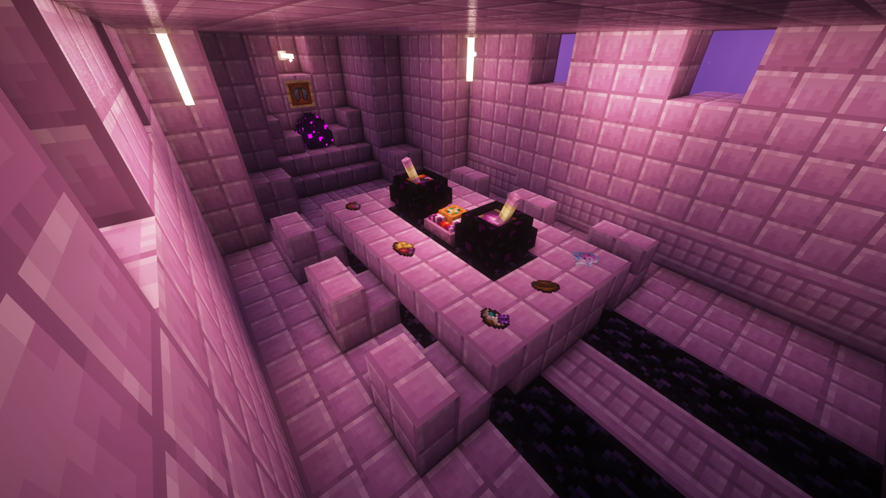

---
navigation:
  title: "End food"
  position: 8
  parent: reference.food.md
  icon: minecraft:chorus_fruit
---

# End food

## Chorus harvest

<EmiSearch query="@ends_delight" /> <EmiSearch query="@farmersdelight" />

Cooking among End materials

<ItemGrid><ItemIcon id="ends_delight:chorus_fruit_grain" /><ItemIcon id="ends_delight:chorus_fruit_milk_tea" /><ItemIcon id="ends_delight:bubble_tea" /><ItemIcon id="ends_delight:chorus_fruit_popsicle" /><ItemIcon id="ends_delight:chorus_fruit_wine" /><ItemIcon id="ends_delight:dragon_breath_and_chorus_soup" /><ItemIcon id="ends_delight:chorus_flower_tea" /><ItemIcon id="ends_delight:dried_chorus_flower" /><ItemIcon id="ends_delight:chorus_fruit_pie_slice" /><ItemIcon id="ends_delight:chorus_flower_pie" /><ItemIcon id="ends_delight:chorus_sauce" /><ItemIcon id="ends_delight:chorus_cookie" /></ItemGrid>

End's Delight turns the outer islands into a pantry. Chorus fruit is the renewable base, and one fruit cuts into four grains, so a single harvest supplies several batches of drinks and desserts.

| Ingredient | Origin | Use |
| --- | --- | --- |
| Chorus fruit | Outer island chorus plants | Cut into grains, or cooked whole into drinks |
| Chorus fruit grains | Cutting one fruit | Tea, milk tea, wine and pies |
| Chorus flower | Chorus plant top | Dried flower, flower tea and flower pie |
| Chorus sauce | Cooked chorus preparation | Savoury dishes and dragon plates |

<ItemGrid><ItemIcon id="minecraft:chorus_fruit" /><ItemIcon id="farmersdelight:milk_bottle" /><ItemIcon id="ends_delight:ender_pearl_grain" /><ItemIcon id="minecraft:ice" /><ItemIcon id="minecraft:stick" /><ItemIcon id="minecraft:sugar" /><ItemIcon id="minecraft:suspicious_stew" /><ItemIcon id="minecraft:dragon_breath" /><ItemIcon id="minecraft:ghast_tear" /><ItemIcon id="minecraft:chorus_flower" /><ItemIcon id="ends_delight:chorus_fruit_pie" /><ItemIcon id="farmersdelight:wheat_dough" /><ItemIcon id="minecraft:poppy" /><ItemIcon id="ends_delight:chorus_succulent" /><ItemIcon id="minecraft:wheat" /></ItemGrid>

<Recipe id="ends_delight:chorus_fruit_milk_tea" />

The milk tea accepts either a whole chorus fruit or a grain, so the drink is the cheapest way to test the chain before committing a stack of fruit to the cutting board.

***

## Shulker and small creatures

<ItemGrid><ItemIcon id="ends_delight:shulker_meat" /><ItemIcon id="ends_delight:shulker_meat_slice" /><ItemIcon id="ends_delight:stir_fried_shulker_meat" /><ItemIcon id="ends_delight:raw_ender_mite_meat" /><ItemIcon id="ends_delight:dried_endermite_meat" /><ItemIcon id="ends_delight:roasted_shulker_meat" /><ItemIcon id="ends_delight:roasted_shulker_meat_slice" /><ItemIcon id="ends_delight:grilled_shulker" /><ItemIcon id="ends_delight:enderman_gristle" /><ItemIcon id="ends_delight:raw_ender_sausage" /><ItemIcon id="ends_delight:ender_sausage" /><ItemIcon id="ends_delight:enderman_gristle_stew" /><ItemIcon id="ends_delight:shulker_soup" /><ItemIcon id="ends_delight:shulker_omelette_mixture" /><ItemIcon id="ends_delight:shulker_omelette" /></ItemGrid>

| Source | Knife result | Note |
| --- | --- | --- |
| Shulker | Shulker meat, then two slices per piece | Requires knife hunting, so End cities become an ingredient destination |
| Endermite | Raw ender mite meat, dried endermite meat | Separate branch, not a shulker substitute |
| Enderman | Enderman gristle and ender sausage | Third branch with its own recipes |

<ItemGrid><ItemIcon id="farmersdelight:onion" /><ItemIcon id="farmersdelight:tomato" /><ItemIcon id="minecraft:chorus_fruit" /><ItemIcon id="ends_delight:raw_dragon_meat_cuts" /><ItemIcon id="ends_delight:chorus_sauce" /><ItemIcon id="ends_delight:dried_chorus_flower" /><ItemIcon id="ends_delight:chorus_succulent" /><ItemIcon id="minecraft:egg" /></ItemGrid>

Shulker meat is the only one of the three that also carries a shell byproduct, which matters because several plates ask for a shell as the serving vessel.

***

## Dragon ingredients

<ItemGrid><ItemIcon id="ends_delight:fried_dragon_egg" /><ItemIcon id="ends_delight:dragon_breath_soda" /><ItemIcon id="ends_delight:dragon_leg" /><ItemIcon id="ends_delight:smoked_dragon_leg" /><ItemIcon id="ends_delight:liquid_dragon_egg" /><ItemIcon id="ends_delight:half_dragon_egg_shell" /><ItemIcon id="ends_delight:non_hatchable_dragon_egg" /><ItemIcon id="ends_delight:roasted_dragon_meat" /><ItemIcon id="ends_delight:raw_dragon_meat" /><ItemIcon id="ends_delight:roasted_dragon_meat_cuts" /><ItemIcon id="ends_delight:raw_dragon_meat_cuts" /><ItemIcon id="ends_delight:dragon_meat_stew" /><ItemIcon id="ends_delight:steamed_dragon_egg" /><ItemIcon id="ends_delight:roasted_dragon_steak" /><ItemIcon id="ends_delight:ender_congee" /><ItemIcon id="ends_delight:dragon_leg_with_sauce" /><ItemIcon id="ends_delight:dragon_tooth" /></ItemGrid>

| Cut | Source | Use |
| --- | --- | --- |
| Raw dragon meat and cuts | Dragon encounter | Roasted meat, steak and stew |
| Dragon leg | Dragon encounter | Smoked leg and leg with sauce |
| Dragon egg and shell | Dragon egg | Fried, steamed and liquid egg dishes |
| Dragon breath | Dragon encounter | Soda and soup |

<ItemGrid><ItemIcon id="minecraft:dragon_breath" /><ItemIcon id="minecraft:sugar" /><ItemIcon id="minecraft:obsidian" /><ItemIcon id="minecraft:end_crystal" /><ItemIcon id="ends_delight:chorus_sauce" /><ItemIcon id="farmersdelight:tomato" /><ItemIcon id="minecraft:warped_fungus" /><ItemIcon id="minecraft:crimson_fungus" /><ItemIcon id="minecraft:chorus_fruit" /><ItemIcon id="minecraft:bowl" /><ItemIcon id="farmersdelight:rice" /><ItemIcon id="ends_delight:dried_endermite_meat" /><ItemIcon id="ends_delight:ender_pearl_grain" /></ItemGrid>

These are encounter ingredients, not farmed ones. Plan the meal around a fight that has already happened rather than expecting a renewable supply. Chorus dishes stay renewable, dragon dishes do not.

***

## Mixed meals

<ItemGrid><ItemIcon id="ends_delight:ender_pearl_grain" /><ItemIcon id="ends_delight:stuffed_rice_cake" /><ItemIcon id="ends_delight:end_barbecue_stick" /><ItemIcon id="ends_delight:end_mixed_salad" /><ItemIcon id="ends_delight:assorted_salad" /><ItemIcon id="ends_delight:ender_noodle" /><ItemIcon id="ends_delight:ender_bamboo_rice" /></ItemGrid>

| Dish family | What it combines |
| --- | --- |
| Rice and noodle plates | End grains with rice, sauce and vegetables |
| Salads | End greens with Overworld cabbage and tomato |
| Skewers and cakes | Meat portions with pantry staples |

<ItemGrid><ItemIcon id="minecraft:ender_pearl" /><ItemIcon id="farmersdelight:rice" /><ItemIcon id="minecraft:sugar" /><ItemIcon id="minecraft:chorus_fruit" /><ItemIcon id="ends_delight:roasted_shulker_meat" /><ItemIcon id="ends_delight:roasted_dragon_meat_cuts" /><ItemIcon id="ends_delight:dried_endermite_meat" /><ItemIcon id="minecraft:stick" /><ItemIcon id="ends_delight:chorus_succulent" /><ItemIcon id="farmersdelight:cabbage" /><ItemIcon id="farmersdelight:tomato" /><ItemIcon id="minecraft:bowl" /><ItemIcon id="minecraft:crimson_fungus" /><ItemIcon id="minecraft:warped_fungus" /><ItemIcon id="minecraft:shulker_shell" /><ItemIcon id="ends_delight:shulker_meat" /><ItemIcon id="ends_delight:chorus_sauce" /><ItemIcon id="farmersdelight:wheat_dough" /><ItemIcon id="minecraft:bamboo" /><ItemIcon id="ends_delight:raw_dragon_meat_cuts" /><ItemIcon id="minecraft:carrot" /><ItemIcon id="farmersdelight:onion" /></ItemGrid>

End ingredients also combine with ordinary pantry items, so a stocked kitchen converts a small harvest into several distinct meals. Check the recipe browser to tell a finished serving from its raw ingredient or intermediate portion.

***

- [Food & hunger](food.hunger.md)
- [Crop ingredients](food.growing.md)
- [Cooking tools](food.utensils.md)

***

## Related mods

| Mod or content | Purpose | Item search |
| --- | --- | --- |
|  [End's Delight](food.end.md) | Adds End-themed ingredients and dishes to Farmer's Delight. | <EmiSearch query="@ends_delight" /> |
