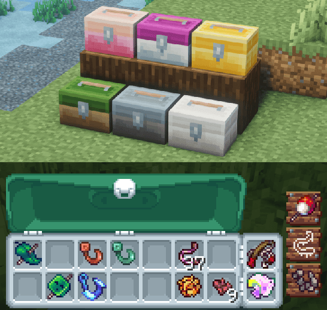
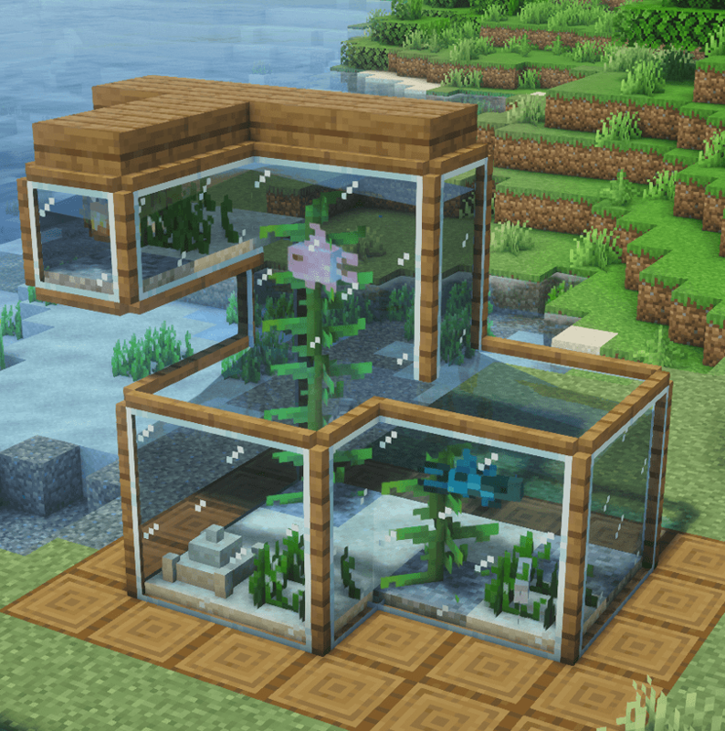

---
navigation:
  title: "Fishing"
  position: 3
  parent: reference.food.md
  icon: minecraft:cod
item_ids:
  - starcatcher:starcatcher_rod
  - starcatcher:starcatcher_guide
  - starcatcher:tackle_box_cyan
  - starcatcher:fish_radar
---

# Fishing

## Rod and tackle

<EmiSearch query="@starcatcher" />

Reeling in a Starcatcher catch

<ItemGrid><ItemIcon id="starcatcher:starcatcher_rod" /><ItemIcon id="starcatcher:starcatcher_guide" /><ItemIcon id="starcatcher:hook" /><ItemIcon id="starcatcher:bobber" /><ItemIcon id="starcatcher:tackle_box_cyan" /></ItemGrid>

Starcatcher replaces the vanilla fishing result with its own catch table, a reeling minigame and a catalogue. The mod's rod is the tool that reaches that table. A vanilla fishing rod still pulls vanilla loot from the same water.

| Item | What it does |
| --- | --- |
| <ItemLink id="starcatcher:starcatcher_rod" /> | Casts at Starcatcher entries and starts the minigame. |
| <ItemLink id="starcatcher:starcatcher_guide" /> | Opens the catch catalogue, each species condition and the minigame settings. |
| <ItemLink id="starcatcher:hook" /> | Rod attachment. Changes how a catch behaves during the fight. |
| <ItemLink id="starcatcher:bobber" /> | Rod attachment. Changes lure timing and which entries can appear. |
| <ItemLink id="starcatcher:tackle_box_cyan" /> | Stores fish and tackle and swaps attachments without a crafting table. |

***

## Craft the rod and the guide

Tackle Boxes and fishing attachments

<Recipe id="starcatcher:starcatcher_rod" />

<Recipe id="starcatcher:starcatcher_guide" />

1. Craft <ItemLink id="starcatcher:starcatcher_rod" /> and fit one hook and one bobber before the first cast.
2. Carry <ItemLink id="starcatcher:starcatcher_guide" />. It is the only place that lists every condition for a species.
3. Cast into water, wait for the bite, then reel. The minigame opens with the fish on the line.
4. Hit the highlighted zones with <KeyBind id="key.starcatcher.minigame_hit" /> until the catch meter fills.

A catch is confirmed when the fish item or its bucket form lands in the inventory and the guide adds the entry. If the line returns empty, the water qualified but the fish did not, so re-read its row in the guide rather than moving biome at random.

***

## Attachments change the fight

<ItemGrid><ItemIcon id="starcatcher:worm" /><ItemIcon id="starcatcher:cherry_bait" /><ItemIcon id="starcatcher:amethyst_hook" /><ItemIcon id="starcatcher:vanilla_hook" /><ItemIcon id="starcatcher:vanilla_bobber" /><ItemIcon id="minecraft:bucket" /></ItemGrid>

| Attachment | Effect on the catch |
| --- | --- |
| <ItemLink id="starcatcher:worm" /> | Common bait. Shortens the wait and widens the entry pool. |
| <ItemLink id="starcatcher:cherry_bait" /> | Favours cherry landscape entries over the general pool. |
| <ItemLink id="starcatcher:amethyst_hook" /> | Required for lava fishing without a netherite upgrade. |
| Vanilla-flavoured hook with vanilla-flavoured bobber | Skips the minigame, so the catch resolves as a plain pull. |
| <ItemLink id="minecraft:bucket" /> | Used as an offered item for species whose entry lists a bucket catch. |

A preferred bait raises the chance of a species appearing. A required bait is a hard condition, so the cast fails that species without it. The guide labels the difference on each entry.

***

## What decides the catch

| Condition | Check before you cast |
| --- | --- |
| Biome | The exact habitat the entry names, not the nearest similar one. |
| Fluid | Water and lava are separate tables. Lava needs the amethyst hook or the netherite rod. |
| Dimension | Nether and End entries only resolve in those dimensions. |
| Elevation and light | Surface, cave and mountain entries differ inside one biome. |
| Time and weather | Day, night, rain and thunder remain restrictions after the biome matches. |

Species entries and catch requirements

The Guide is the arbiter for all five rows. Habitat pages narrow the search. They never override a species condition.

***

## Hybrid Aquatic entries

<ItemGrid><ItemIcon id="starcatcher:starcatcher_rod" /><ItemIcon id="starcatcher:starcatcher_guide" /><ItemIcon id="starcatcher:fish_radar" /></ItemGrid>

<EmiSearch query="@hybrid_aquatic" />

The compatibility addon registers Hybrid Aquatic fish as Starcatcher entries with their own conditions and difficulty. They are catalogued, displayed and counted like native entries. A Hybrid Aquatic animal swimming beside the bobber is not evidence that the rod can catch it there, because creature spawning and rod entries are separate systems.

***

## Keep and show the catch

Living catches in aquariums

<ItemGrid><ItemIcon id="starcatcher:oak_tackle_box_boat" /><ItemIcon id="starcatcher:aquarium" /><ItemIcon id="starcatcher:oak_fish_plaque" /><ItemIcon id="starcatcher:tournament_stand" /><ItemIcon id="starcatcher:fish_radar" /></ItemGrid>

A Tackle Box Boat carries tackle while you travel by water. An Aquarium holds live bucketed catches and scales the model by the fish's recorded size. A Fish Plaque mounts one catch. A Tournament Stand runs a timed contest between players. <ItemLink id="starcatcher:fish_radar" /> reads nearby fishing possibilities and is worth crafting only after the first entries are in the guide.

***

- [Fishing habitats](fishing.habitats.md)
- [Seafood & preparation](food.seafood.md)
- [Aquatic wildlife](adventure.aquatic.md)
- [Food stacks & variety](food.hunger.md)

***

## Related mods

| Mod or content | Purpose | Item search |
| --- | --- | --- |
|  [Hybrid Aquatic + Starcatcher Compatibility](food.fishing.md) | Adds Hybrid Aquatic catches to Starcatcher fishing. | <EmiSearch query="@hybrid_aquatic" /> |
|  [Starcatcher](food.fishing.md) | Adds habitat-dependent fishing, equipment and a fishing guide. | <EmiSearch query="@starcatcher" /> |
