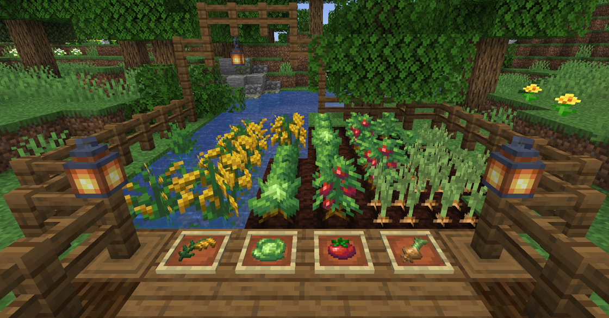
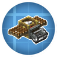
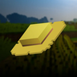

---
navigation:
  title: "Farming"
  position: 2
  parent: reference.food.md
  icon: minecraft:wheat
---

# Farming

 [English](https://www.youtube.com/results?search_query=Minecraft%201.21.1%20Farmer%27s%20Delight%20crops%20rice%20tomato%20rope%20farming%20tutorial) · [中文](https://www.youtube.com/results?search_query=Minecraft%201.21.1%20%E5%86%9C%E5%A4%AB%E4%B9%90%E4%BA%8B%20%E4%BD%9C%E7%89%A9%20%E7%A8%BB%E7%B1%B3%20%E7%95%AA%E8%8C%84%20%E7%BB%B3%E5%AD%90%20%E7%A7%8D%E6%A4%8D%20%E6%95%99%E7%A8%8B)

## Wild patches

<EmiSearch query="@farmersdelight" />

| Patch | Identify it | Break by hand | Shear it |
| --- | --- | --- | --- |
| <ItemLink id="farmersdelight:wild_cabbages" /> | <ItemGrid><ItemIcon id="farmersdelight:wild_cabbages" /></ItemGrid> | Cabbage seeds, sometimes a cabbage | Takes the block to replant elsewhere |
| <ItemLink id="farmersdelight:wild_tomatoes" /> | <ItemGrid><ItemIcon id="farmersdelight:wild_tomatoes" /></ItemGrid> | Tomato seeds, sometimes a tomato | Takes the block to replant elsewhere |
| <ItemLink id="farmersdelight:wild_onions" /> | <ItemGrid><ItemIcon id="farmersdelight:wild_onions" /></ItemGrid> | An onion | Takes the block to replant elsewhere |
| <ItemLink id="farmersdelight:wild_rice" /> | <ItemGrid><ItemIcon id="farmersdelight:wild_rice" /></ItemGrid> | Rice | Takes the block to replant elsewhere |

A patch is a one time find. Shearing moves the block, but it does not grow back on its own, so a second harvest means finding another patch or planting the seeds you collected.

***

## Plant your first crop

<ItemGrid><ItemIcon id="farmersdelight:cabbage_seeds" /><ItemIcon id="farmersdelight:tomato_seeds" /><ItemIcon id="farmersdelight:onion" /><ItemIcon id="farmersdelight:rice" /></ItemGrid>

Cabbage is the simplest first crop. Plant <ItemLink id="farmersdelight:cabbage_seeds" /> on farmland beside water and wait for the head to form. A ripe head is the leafy ingredient in soups and rolls, and one head cuts into two leaves on a board.

Tomatoes grow on farmland without help. A <ItemLink id="farmersdelight:rope" /> is optional support that lets the vine grow taller, and a tomato plant fruits without one. Onions are planted as the bulb itself.

Rice is different from the three dry crops. Plant <ItemLink id="farmersdelight:rice" /> into a one block deep bed of source water over dirt. It grows into a two block tall plant. A harvest gives <ItemLink id="farmersdelight:rice_panicle" />, and the next planting still uses rice rather than the panicle.

Success looks different per crop. A cabbage or onion is ready when the head or bulb is full, a tomato when the vine carries ripe fruit, and rice when the panicle tops are ready to cut.

***

## Harvest and process rice

| Result | How you get it | What it is for |
| --- | --- | --- |
| <ItemGrid><ItemIcon id="farmersdelight:rice_panicle" /></ItemGrid> | Cut a ripe rice plant | The raw harvest |
| <ItemGrid><ItemIcon id="farmersdelight:rice" /></ItemGrid> | Craft the panicle | Rice for pots and bowls, and seed for the next crop |
| <ItemGrid><ItemIcon id="farmersdelight:straw" /></ItemGrid> | Cut the panicle on a board with a knife | Rope, canvas and crafting |

Crafting a panicle gives rice only. Cutting it on a <ItemLink id="farmersdelight:cutting_board" /> with a knife gives rice and straw, so the board route is worth the extra step once you want rope for tomato supports.

***

## Rich soil and mushrooms

<ItemGrid><ItemIcon id="farmersdelight:organic_compost" /><ItemIcon id="farmersdelight:rich_soil" /></ItemGrid>

Craft <ItemLink id="farmersdelight:organic_compost" />, place the pile and wait. Water and neighbouring compost, rich soil, mycelium, <ItemLink id="minecraft:podzol" /> or mushrooms speed it up, and the pile becomes <ItemLink id="farmersdelight:rich_soil" />.

Hoe rich soil into rich farmland for tilled crops. This pack sets the rich soil bone meal boost chance to twenty percent.

A mushroom planted on rich soil in the dark grows into a colony of several caps. Break the colony for every cap, or shear it to move the whole colony.

***

## Field helpers

<EmiSearch query="@create_integrated_farming" />

| Helper or machine | Identify it | Operation |
| --- | --- | --- |
| <ItemLink id="minecraft:bone_meal" /> | <ItemGrid><ItemIcon id="minecraft:bone_meal" /></ItemGrid> | With Universal Bone Meal it grows sugar cane and cactus, which vanilla refuses |
| <ItemLink id="create_integrated_farming:vacuum_harvester" /> | <ItemGrid><ItemIcon id="create_integrated_farming:vacuum_harvester" /></ItemGrid> | Charges from rotation, stores the harvest internally, and is emptied from any side except the shaft |

RightClickHarvest harvests and replants a mature crop in one right click. This pack configures it to work without a hoe, so an empty hand is enough.

Smarter Farmers makes villagers replant the seed that belongs to the crop, including modded crops.

The vacuum harvester stores what it collects rather than sending it onward, so a line that expects it to push items will not work.

***

## Crop families

<EmiSearch query="@minersdelight" /> <EmiSearch query="@mynethersdelight" />

| Family | Items | Role |
| --- | --- | --- |
| Farm crops | <ItemGrid><ItemIcon id="farmersdelight:cabbage" /><ItemIcon id="farmersdelight:tomato" /><ItemIcon id="farmersdelight:onion" /><ItemIcon id="farmersdelight:rice" /></ItemGrid> | The four crops this page plants, before processing. |
| Seeds and starts | <ItemGrid><ItemIcon id="farmersdelight:cabbage_seeds" /><ItemIcon id="farmersdelight:tomato_seeds" /><ItemIcon id="farmersdelight:rice_panicle" /></ItemGrid> | What you plant or cut to start the next crop. Onions are planted as the bulb above, and rice is planted as rice. |
| Harvest parts | <ItemGrid><ItemIcon id="farmersdelight:cabbage_leaf" /><ItemIcon id="farmersdelight:straw" /><ItemIcon id="farmersdelight:rice" /></ItemGrid> | Board and harvest outputs that feed rope, cooking and crafting. |
| Vanilla garden crops | <ItemGrid><ItemIcon id="minecraft:wheat" /><ItemIcon id="minecraft:carrot" /><ItemIcon id="minecraft:potato" /><ItemIcon id="minecraft:beetroot" /></ItemGrid> | Ordinary farmland crops the kitchen also uses. |
| Regional crops | <ItemGrid><ItemIcon id="minersdelight:cave_carrot" /><ItemIcon id="mynethersdelight:bullet_pepper" /></ItemGrid> | Grown and gathered in other regions, owned by [Underground foods](food.underground.md) and [Nether foods](food.nether.md). |

- [Machine kitchens](food.machine-cooking.md) Automate slicing and fertilizer.
- [Cooking tools](food.utensils.md) Turn the harvest into meals.

***

## Related mods

| Mod or content | Purpose | Item search |
| --- | --- | --- |
|  [Create: Integrated Farming](food.growing.md) | Adds automatic crop harvesting, fishing nets and poultry production to Create. | <EmiSearch query="@create_integrated_farming" /> |
|  [Leaves Be Gone](food.growing.md) | Makes unsupported leaves decay quickly after trees are cut. | No separate item search |
|  [RightClickHarvest](food.growing.md) | Harvests mature crops with a right click instead of breaking and replanting manually. | No separate item search |
|  [Smarter Farmers (farmers replant)](food.growing.md) | Helps farmer villagers replant the correct crops, including supported modded seeds. | No separate item search |
|  [Universal Bone Meal](food.growing.md) | Extends bone meal use to plants that normally do not accept it. | No separate item search |
