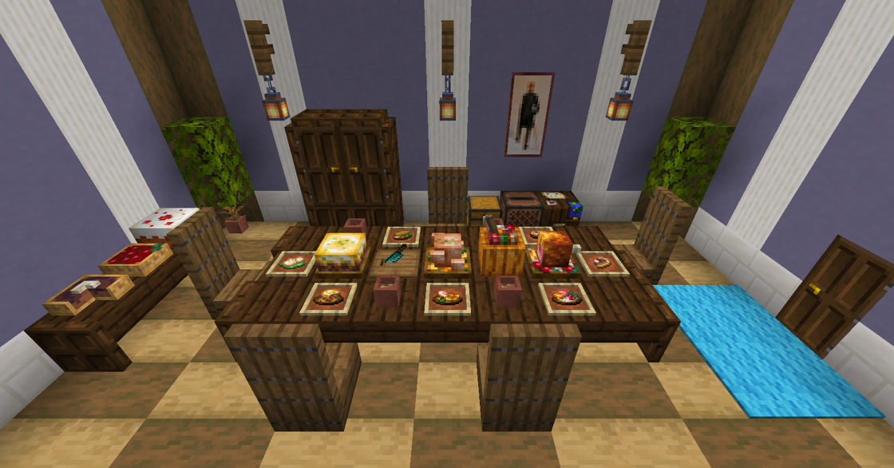
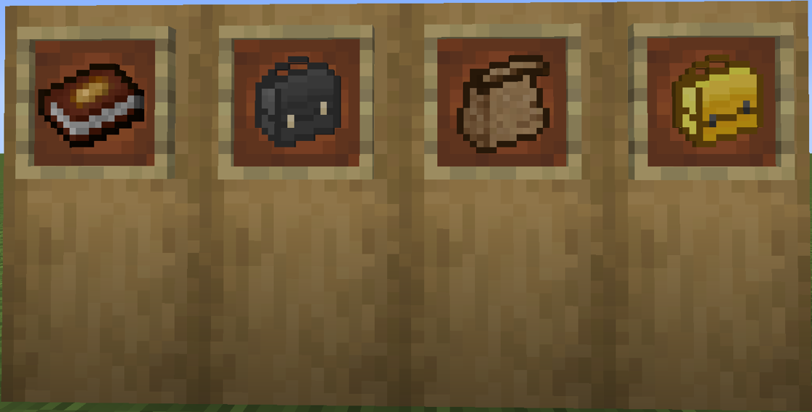

---
navigation:
  title: "Hunger & variety"
  position: 1
  parent: reference.food.md
  icon: minecraft:apple
---

# Hunger & variety

## Reading food values

Different dishes at a shared table

<ItemGrid><ItemIcon id="minecraft:apple" /><ItemIcon id="minecraft:bread" /><ItemIcon id="minecraft:cooked_beef" /></ItemGrid>

AppleSkin is installed and every food tooltip shows hunger and saturation without holding a key. Hover <ItemLink id="minecraft:bread" />, <ItemLink id="minecraft:cooked_beef" /> or <ItemLink id="minecraft:apple" /> in your inventory and read both lines before you choose what to carry.

The hunger line refills the visible bar. The saturation line is the hidden reserve spent first. A food with high saturation keeps the bar full through sprinting, jumping and fighting for longer, even when its hunger value is lower. AppleSkin also overlays saturation on the hunger bar and previews the food in your hand, so you can see the gap before you eat.

Status effects are separate from both values. A dish can restore little hunger and still grant a useful effect.

| Tooltip line | What it controls | Where you see it |
| --- | --- | --- |
| Hunger | Refills the visible bar | Food tooltip and hunger bar preview |
| Saturation | Hidden reserve spent before hunger falls | Food tooltip and saturation overlay |
| Effect | Potion icon and duration | Food tooltip and inventory |

***

## Diet variety

<EmiSearch query="@solonion" />

<ItemGrid><ItemIcon id="solonion:food_book" /><ItemIcon id="solonion:lunchbag" /><ItemIcon id="solonion:lunchbox" /><ItemIcon id="solonion:golden_lunchbox" /></ItemGrid>

This pack records your last sixteen counted meals and enables diversity decay. Each distinct food contributes its strongest remaining entry. Eating the same food again refreshes that food and does not add a second entry. Other foods age out of the record, so the reward follows your current diet rather than everything you have ever eaten.

Open the diet view from the inventory button or with <ItemLink id="solonion:food_book" />. The inventory button is enabled by default, so you do not need the book in your bag to check variety. The shipped detriment list is empty, which means a narrow diet costs you rewards but adds no penalty effect.

| Setting | Value in this pack | Effect |
| --- | --- | --- |
| Tracked meals | 16 | Only recent meals count |
| Diversity decay | Enabled | Old entries leave the record |
| Inventory diet button | Enabled | Variety is visible without the book |
| Detriment list | Empty | No penalty for repetition |

Repetition lowers variety. It does not make the same food restore less hunger.

***

## Serving form effects

<EmiSearch query="@farmersdelight" />

<ItemGrid><ItemIcon id="farmersdelight:beef_stew" /><ItemIcon id="farmersdelight:steak_and_potatoes" /><ItemIcon id="minecraft:mushroom_stew" /></ItemGrid>

Farmer's Delight ties two effects to the serving form. A bowl meal such as <ItemLink id="farmersdelight:beef_stew" /> grants Comfort, which keeps natural regeneration running even when you are too hungry to regenerate normally. A plated meal such as <ItemLink id="farmersdelight:steak_and_potatoes" /> grants Nourishment, which pauses hunger and saturation loss from sprinting, jumping and attacking.

Vanilla soups and stews also grant Nourishment in this pack, because the soup override is enabled. That makes a cheap <ItemLink id="minecraft:mushroom_stew" /> a reasonable travel food when you only need to stop hunger drain.

| Serving form | Effect | Best use |
| --- | --- | --- |
| Bowl meal | Comfort | Recover health while hungry |
| Plated meal | Nourishment | Hold the hunger bar during a fight or a long run |
| Vanilla soup | Nourishment | Cheap no-drain food early on |

***

## Packing for a trip

Food Book, Lunchbag and Lunchboxes

<ItemGrid><ItemIcon id="solonion:lunchbag" /><ItemIcon id="solonion:lunchbox" /><ItemIcon id="solonion:golden_lunchbox" /></ItemGrid>

Carry meals in a <ItemLink id="solonion:lunchbag" /> or a <ItemLink id="solonion:lunchbox" />. A <ItemLink id="solonion:golden_lunchbox" /> is a larger container, not another dish. Short Stacks limits how many edible items fit in one slot by their hunger value, so a filling meal occupies more of a slot than a snack. The container frees inventory slots but does not change the limit.

Pack two or three different meals rather than one stack. That keeps the sixteen meal record varied while you travel, and it gives you both a Comfort meal and a Nourishment meal for different moments.

- [Kitchen meals](food.utensils.md)
- [Crop ingredients](food.growing.md)
- [Fish meals](food.seafood.md)

***

## Related mods

| Mod or content | Purpose | Item search |
| --- | --- | --- |
|  [AppleSkin](food.hunger.md) | Shows food hunger restoration and saturation in tooltips and the hunger display. | No separate item search |
| <ItemImage id="minecraft:wheat" /> [Short Stacks](food.hunger.md) | Changes food stack limits to alter how much food fits in each inventory slot. | No separate item search |
|  [Spice of Life Onion](food.hunger.md) | Rewards dietary variety using a rolling history of recently eaten foods. | <EmiSearch query="@solonion" /> |
