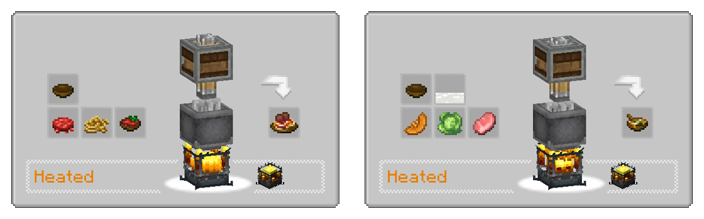

---
navigation:
  title: "Machine cooking"
  position: 10
  parent: reference.food.md
  icon: minecraft:smoker
---

# Machine cooking

## Slicer

<EmiSearch query="@farmersdelight" /> <EmiSearch query="@sliceanddice" />

Mechanical preparation beside a heated cooking pot

<ItemGrid><ItemIcon id="sliceanddice:slicer" /><ItemIcon id="farmersdelight:cutting_board" /><ItemIcon id="farmersdelight:flint_knife" /></ItemGrid>

The <ItemLink id="sliceanddice:slicer" /> automates cutting board work. It does not turn ingredients into finished meals. A knife sits inside the machine, and each processed item consumes knife durability in this pack, so plan for repairs or a supply of spare knives.

The machine needs rotational power. Give it the ingredient and the correct knife, and it produces the same portions a board would. Feed the output into the next station or a storage crate.

### Slicer craft

<Recipe id="sliceanddice:slicer" />

Place the slicer, add the knife, then connect rotation and ingredient delivery. Check the machine interface for the current tool before you build the line around it.

***

## Sprinkler and basin

<ItemGrid><ItemIcon id="sliceanddice:sprinkler" /><ItemIcon id="sliceanddice:fertilizer_bucket" /><ItemIcon id="minecraft:water_bucket" /></ItemGrid>

A <ItemLink id="sliceanddice:sprinkler" /> waters and fertilizes a field on rotation. It holds 300 millibuckets, spends 100 per use and reaches five blocks horizontally in this pack. One bucket of water fills it three times. Place it above the crop row and pipe water in, or refill it by hand.

The <ItemLink id="sliceanddice:fertilizer_bucket" /> supplies the fertilizer. Keep it separate from drinking water and from food containers.

Slice and Dice also adds heated basin cooking. A basin with a heated floor cooks Farmer's Delight pot recipes in bulk, which suits a kitchen that runs one meal at a time for a whole base.

| Setting | Value in this pack | Practical result |
| --- | --- | --- |
| Sprinkler capacity | 300 millibuckets | One water bucket gives three uses |
| Fluid per use | 100 millibuckets | Plan water delivery per harvest |
| Horizontal range | Five blocks | Covers an eleven block wide strip |
| Basin heat | Heated | Needs a heated basin floor |

***

## Central Kitchen

<EmiSearch query="@create" />

<ItemGrid><ItemIcon id="minecraft:redstone" /><ItemIcon id="farmersdelight:cooking_pot" /><ItemIcon id="farmersdelight:skillet" /><ItemIcon id="farmersdelight:stove" /></ItemGrid>

Create: Central Kitchen connects Create logistics to the Farmer's Delight stations. A mechanical arm can load and unload supported <ItemLink id="farmersdelight:cooking_pot" />, <ItemLink id="farmersdelight:skillet" />, stove and cutting board. A packager unpacks ingredient boxes straight into a pot. Boiler heaters count as cooking heat, and an active heater speeds a pot or skillet.

Central Kitchen also converts cutting board recipes into Create sawing and deploying recipes. That lets a mechanical saw cut ingredients without a knife inside a machine.

Do not assume every pot recipe has a machine equivalent. Open the target dish in the recipe browser and check its actual processing type before you build the line.

***

## Dishes and materials

These are the remaining items in this chapter, grouped by the station that makes them. Open the item tooltip for exact food values and open the recipe browser for a specific dish.

| Family | Items |
| --- | --- |
| Drinks & farm fluids | <ItemGrid><ItemIcon id="farmersdelight:hot_cocoa" /><ItemIcon id="farmersdelight:apple_cider" /></ItemGrid> |

- [Cooking tools](food.utensils.md)
- [Crop production](food.growing.md)
- [Machines & storage](reference.machines-storage.md)

***

## Related mods

| Mod or content | Purpose | Item search |
| --- | --- | --- |
|  [Create Slice & Dice](food.machine-cooking.md) | Adds Create machinery for automated Farmer's Delight food preparation. | <EmiSearch query="@sliceanddice" /> |
|  [Create: Central Kitchen](food.machine-cooking.md) | Connects other cooking mods to Create machines for automated food processing. | No separate item search |
