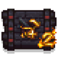

---
navigation:
  title: "Nether food"
  position: 6
  parent: reference.food.md
  icon: minecraft:crimson_fungus
---

# Nether food

 [English](https://www.youtube.com/results?search_query=Minecraft+1.21.1+My+Nether%27s+Delight+guide+English) · [中文](https://www.youtube.com/results?search_query=%E6%88%91%E7%9A%84%E4%B8%96%E7%95%8C+1.21.1+%E4%B8%8B%E7%95%8C%E7%BE%8E%E9%A3%9F+%E6%95%99%E7%A8%8B)

## Pepper first

<EmiSearch query="@mynethersdelight" />

Powdery cane grows in Crimson Forests. A ripe, lit cane can be harvested repeatedly: right-click it with a knife or shears and it drops peppers while the plant stays and resets. Cut a pepper on a cutting board with a knife for pepper powder, with a one in four chance of a second powder.

| Item | Identify it | Role |
| --- | --- | --- |
| <ItemLink id="mynethersdelight:bullet_pepper" /> | <ItemGrid><ItemIcon id="mynethersdelight:bullet_pepper" /></ItemGrid> | Pepper from ripe lit cane |
| <ItemLink id="mynethersdelight:pepper_powder" /> | <ItemGrid><ItemIcon id="mynethersdelight:pepper_powder" /></ItemGrid> | Ground pepper from the board |
| <ItemLink id="mynethersdelight:bullet_pepper_crate" /> | <ItemGrid><ItemIcon id="mynethersdelight:bullet_pepper_crate" /></ItemGrid> | Stored peppers |

| Pepper dish | Identify it | Ingredient form |
| --- | --- | --- |
| <ItemLink id="mynethersdelight:stuffed_pepper" /> | <ItemGrid><ItemIcon id="mynethersdelight:stuffed_pepper" /></ItemGrid> | Whole pepper |
| <ItemLink id="mynethersdelight:spicy_skewer" /> | <ItemGrid><ItemIcon id="mynethersdelight:spicy_skewer" /></ItemGrid> | Pepper powder |
| <ItemLink id="mynethersdelight:spicy_curry" /> | <ItemGrid><ItemIcon id="mynethersdelight:spicy_curry" /></ItemGrid> | Pepper powder |

The powder cannon is the cane crop item and not a serving dish.

<ItemGrid><ItemIcon id="mynethersdelight:powder_cannon" /></ItemGrid>

Whole pepper and powder are different ingredients. A recipe that names one will not take the other.

| Fungus colony | Identify it | Role |
| --- | --- | --- |
| <ItemLink id="mynethersdelight:crimson_fungus_colony" /> | <ItemGrid><ItemIcon id="mynethersdelight:crimson_fungus_colony" /></ItemGrid> | Crimson fungus source |
| <ItemLink id="mynethersdelight:warped_fungus_colony" /> | <ItemGrid><ItemIcon id="mynethersdelight:warped_fungus_colony" /></ItemGrid> | Warped fungus source |

***

## Hoglin and strider cuts

| Raw cut | Identify it | Source |
| --- | --- | --- |
| <ItemLink id="mynethersdelight:hoglin_loin" /> | <ItemGrid><ItemIcon id="mynethersdelight:hoglin_loin" /></ItemGrid> | Hoglin |
| <ItemLink id="mynethersdelight:hoglin_sausage" /> | <ItemGrid><ItemIcon id="mynethersdelight:hoglin_sausage" /></ItemGrid> | Board cut from a hoglin loin, two per loin |
| <ItemLink id="mynethersdelight:strider_slice" /> | <ItemGrid><ItemIcon id="mynethersdelight:strider_slice" /></ItemGrid> | Strider |
| <ItemLink id="mynethersdelight:strider_egg" /> | <ItemGrid><ItemIcon id="mynethersdelight:strider_egg" /></ItemGrid> | Put a strider rock on the cutting board and use a pickaxe to crack out the egg |

| Prepared cut | Identify it | How it is made |
| --- | --- | --- |
| <ItemLink id="mynethersdelight:cooked_loin" /> | <ItemGrid><ItemIcon id="mynethersdelight:cooked_loin" /><ItemIcon id="mynethersdelight:fried_hoglin_chop" /></ItemGrid> | Heat |
| <ItemLink id="mynethersdelight:roasted_sausage" /> | <ItemGrid><ItemIcon id="mynethersdelight:roasted_sausage" /></ItemGrid> | Heat |
| <ItemLink id="mynethersdelight:minced_strider" /> | <ItemGrid><ItemIcon id="mynethersdelight:minced_strider" /></ItemGrid> | Cutting board |
| <ItemLink id="mynethersdelight:bacon-wrapped_sausage_on_a_stick" /> | <ItemGrid><ItemIcon id="mynethersdelight:bacon-wrapped_sausage_on_a_stick" /><ItemIcon id="mynethersdelight:red_loin_on_a_stick" /></ItemGrid> | Crafted skewers |

| Hoglin meal | Identify it | Note |
| --- | --- | --- |
| <ItemLink id="mynethersdelight:hotdog" /> | <ItemGrid><ItemIcon id="mynethersdelight:hotdog" /><ItemIcon id="mynethersdelight:chilidog" /></ItemGrid> | Sausage and bread |
| <ItemLink id="mynethersdelight:hotdog_with_mixed_salad" /> | <ItemGrid><ItemIcon id="mynethersdelight:hotdog_with_mixed_salad" /><ItemIcon id="mynethersdelight:hotdog_with_nether_salad" /></ItemGrid> | Hotdog with salad |
| <ItemLink id="mynethersdelight:sausage_and_potatoes" /> | <ItemGrid><ItemIcon id="mynethersdelight:sausage_and_potatoes" /></ItemGrid> | Sausage and potato |
| <ItemLink id="mynethersdelight:blue_tenderloin_steak" /> | <ItemGrid><ItemIcon id="mynethersdelight:blue_tenderloin_steak" /><ItemIcon id="mynethersdelight:bleeding_tartar" /><ItemIcon id="mynethersdelight:roast_ear" /></ItemGrid> | Plated hoglin dishes |

| Strider meal | Identify it | Note |
| --- | --- | --- |
| <ItemLink id="mynethersdelight:strider_stew" /> | <ItemGrid><ItemIcon id="mynethersdelight:strider_stew" /></ItemGrid> | Pot stew |
| <ItemLink id="mynethersdelight:plate_of_striderloaf" /> | <ItemGrid><ItemIcon id="mynethersdelight:plate_of_striderloaf" /><ItemIcon id="mynethersdelight:plate_of_cold_striderloaf" /></ItemGrid> | Plated loaf, warm and cold |
| <ItemLink id="mynethersdelight:strider_with_grilled_fungus" /> | <ItemGrid><ItemIcon id="mynethersdelight:strider_with_grilled_fungus" /></ItemGrid> | Strider with fungus |

Hoglin hide and the hoglin trophy are not food. They leave the kitchen as hunt byproducts.

<ItemGrid><ItemIcon id="mynethersdelight:hoglin_hide" /><ItemIcon id="mynethersdelight:hoglin_trophy" /></ItemGrid>

***

## Stuffed hoglin

<EmiSearch query="@farmersdelight" />

Craft the raw stuffed hoglin using the recipe below.

<Recipe id="mynethersdelight:crafting/raw_stuffed_hoglin" />

The raw craft uses <ItemLink id="farmersdelight:ham" />. Cook it in a heated cooking pot with one hot spice ingredient, one crimson fungus and two <ItemLink id="farmersdelight:nether_salad" />. Add a bowl as the serving container to obtain the roast.

| Stage | Identify it | Note |
| --- | --- | --- |
| Raw craft | <ItemGrid><ItemIcon id="mynethersdelight:raw_stuffed_hoglin" /></ItemGrid> | Shaped from hide, ham, loin and colonies |
| Roast | <ItemGrid><ItemIcon id="mynethersdelight:roast_stuffed_hoglin" /></ItemGrid> | Pot cooked with hot spice, crimson fungus, two nether salads and a bowl |

Place the roast, use a knife on it to carve the ears, then use empty bowls on it for portions. The bowl portions come as snout first, then ham, then the remaining plates.

| Serving | Identify it | Note |
| --- | --- | --- |
| <ItemLink id="mynethersdelight:plate_of_stuffed_hoglin_snout" /> | <ItemGrid><ItemIcon id="mynethersdelight:plate_of_stuffed_hoglin_snout" /><ItemIcon id="mynethersdelight:plate_of_stuffed_hoglin_ham" /><ItemIcon id="mynethersdelight:plate_of_stuffed_hoglin" /></ItemGrid> | Bowl portions, snout then ham then plate |

***

## Ghast: drop, portion, dough

| Stage | Identify it | Operation |
| --- | --- | --- |
| Ghast drop | <ItemGrid><ItemIcon id="mynethersdelight:ghasta" /></ItemGrid> | Drops from a ghast |
| Cut portion | <ItemGrid><ItemIcon id="mynethersdelight:ghasmati" /></ItemGrid> | Cutting board with a knife |
| Dough | <ItemGrid><ItemIcon id="mynethersdelight:ghast_dough" /><ItemIcon id="mynethersdelight:ghast_sourdough" /></ItemGrid> | Crafted from the portion |

| Ghast dish | Identify it | Note |
| --- | --- | --- |
| <ItemLink id="mynethersdelight:fries_ghasta" /> | <ItemGrid><ItemIcon id="mynethersdelight:fries_ghasta" /><ItemIcon id="mynethersdelight:ghast_salad" /></ItemGrid> | Fried and salad forms |
| <ItemLink id="mynethersdelight:twisted_ghasta" /> | <ItemGrid><ItemIcon id="mynethersdelight:twisted_ghasta" /></ItemGrid> | Twisted noodle dish |
| <ItemLink id="mynethersdelight:dried_ghast_with_milk" /> | <ItemGrid><ItemIcon id="mynethersdelight:dried_ghast_with_milk" /><ItemIcon id="mynethersdelight:plate_of_ghasta_with_cream" /></ItemGrid> | Milk and cream plates |

| Sweet | Identify it | Note |
| --- | --- | --- |
| <ItemLink id="mynethersdelight:hot_cream" /> | <ItemGrid><ItemIcon id="mynethersdelight:hot_cream" /><ItemIcon id="mynethersdelight:hot_cream_cone" /></ItemGrid> | Cream base and cone |
| <ItemLink id="mynethersdelight:sizzling_pudding" /> | <ItemGrid><ItemIcon id="mynethersdelight:sizzling_pudding" /><ItemIcon id="mynethersdelight:tear_popsicle" /></ItemGrid> | Pudding and frozen treat |
| <ItemLink id="mynethersdelight:magma_cake_block" /> | <ItemGrid><ItemIcon id="mynethersdelight:magma_cake_block" /><ItemIcon id="mynethersdelight:magma_cake_slice" /></ItemGrid> | Placed cake, served as slices |

***

## Eggs and bread

| Egg ingredient | Identify it | Operation |
| --- | --- | --- |
| <ItemLink id="mynethersdelight:strider_rock" /> | <ItemGrid><ItemIcon id="mynethersdelight:strider_rock" /></ItemGrid> | Crack it on a cutting board with a pickaxe to obtain a strider egg |

| Egg dish | Identify it | Note |
| --- | --- | --- |
| <ItemLink id="mynethersdelight:boiled_egg" /> | <ItemGrid><ItemIcon id="mynethersdelight:boiled_egg" /><ItemIcon id="mynethersdelight:deviled_egg" /></ItemGrid> | Boiled and deviled |
| <ItemLink id="mynethersdelight:scotch_eggs" /> | <ItemGrid><ItemIcon id="mynethersdelight:scotch_eggs" /></ItemGrid> | Wrapped egg dish |
| <ItemLink id="mynethersdelight:golden_egg" /> | <ItemGrid><ItemIcon id="mynethersdelight:golden_egg" /><ItemIcon id="mynethersdelight:enchanted_golden_egg" /></ItemGrid> | Golden pair |

| Bread item | Identify it | Role |
| --- | --- | --- |
| <ItemLink id="mynethersdelight:toasts" /> | <ItemGrid><ItemIcon id="mynethersdelight:toasts" /><ItemIcon id="mynethersdelight:slices_of_bread" /></ItemGrid> | Bread portions |
| <ItemLink id="mynethersdelight:bread_loaf" /> | <ItemGrid><ItemIcon id="mynethersdelight:bread_loaf" /><ItemIcon id="mynethersdelight:burnt_roll" /></ItemGrid> | Loaf and baked roll |

***

## Soups, cups and savory plates

<EmiSearch query="@minersdelight" />

| Soup | Identify it | Note |
| --- | --- | --- |
| <ItemLink id="mynethersdelight:spicy_noodle_soup" /> | <ItemGrid><ItemIcon id="mynethersdelight:spicy_noodle_soup" /><ItemIcon id="mynethersdelight:egg_soup" /></ItemGrid> | Noodle and egg soups |
| <ItemLink id="mynethersdelight:rock_soup" /> | <ItemGrid><ItemIcon id="mynethersdelight:rock_soup" /></ItemGrid> | Rock soup |
| <ItemLink id="mynethersdelight:spicy_hoglin_stew" /> | <ItemGrid><ItemIcon id="mynethersdelight:spicy_hoglin_stew" /></ItemGrid> | Spicy hoglin stew |

| Cup portion | Identify it | Container |
| --- | --- | --- |
| <ItemLink id="minersdelight:spicy_hoglin_stew_cup" /> | <ItemGrid><ItemIcon id="minersdelight:spicy_hoglin_stew_cup" /><ItemIcon id="minersdelight:strider_stew_cup" /></ItemGrid> | Copper cup |
| <ItemLink id="minersdelight:egg_soup_cup" /> | <ItemGrid><ItemIcon id="minersdelight:egg_soup_cup" /><ItemIcon id="minersdelight:rock_soup_cup" /></ItemGrid> | Copper cup |
| <ItemLink id="minersdelight:spicy_noodle_soup_cup" /> | <ItemGrid><ItemIcon id="minersdelight:spicy_noodle_soup_cup" /></ItemGrid> | Copper cup |

| Savory plate | Identify it | Note |
| --- | --- | --- |
| <ItemLink id="mynethersdelight:nether_burger" /> | <ItemGrid><ItemIcon id="mynethersdelight:nether_burger" /><ItemIcon id="mynethersdelight:crimson_stroganoff" /></ItemGrid> | Burger and stroganoff |
| <ItemLink id="mynethersdelight:spicy_cotton" /> | <ItemGrid><ItemIcon id="mynethersdelight:spicy_cotton" /><ItemIcon id="mynethersdelight:giant_takoyaki" /></ItemGrid> | Spiced and baked plates |
| <ItemLink id="mynethersdelight:hot_wings" /> | <ItemGrid><ItemIcon id="mynethersdelight:hot_wings" /><ItemIcon id="mynethersdelight:hot_wings_bucket" /></ItemGrid> | Wings and bucket |
| <ItemLink id="mynethersdelight:breakfast_sampler" /> | <ItemGrid><ItemIcon id="mynethersdelight:breakfast_sampler" /></ItemGrid> | Mixed breakfast plate |

- [Cooking tools](food.utensils.md) Pot heat, board cutting and skillet use.
- [Hunger & variety](food.hunger.md) Saturation, effects and food variety.

***

## Related mods

| Mod or content | Purpose | Item search |
| --- | --- | --- |
|  [My Nether's Delight](food.nether.md) | Adds Nether crops, ingredients and cooking recipes to Farmer's Delight. | <EmiSearch query="@mynethersdelight" /> |
