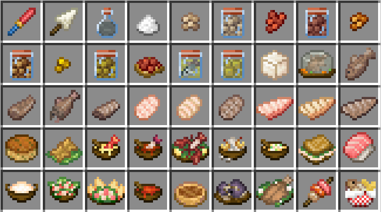
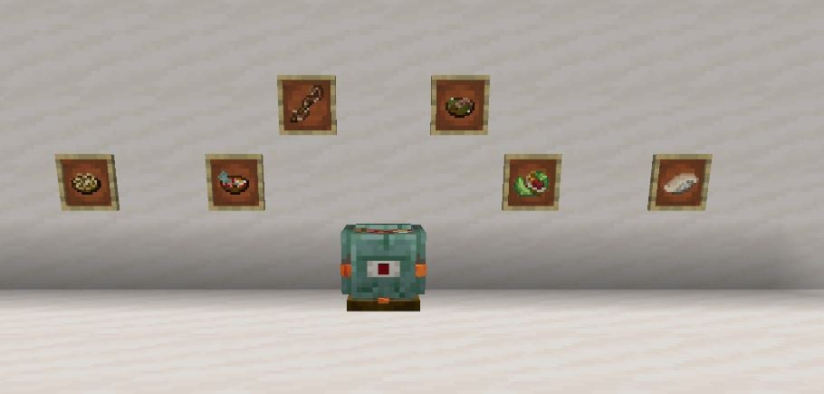

---
navigation:
  title: "Seafood"
  position: 5
  parent: reference.food.md
  icon: oceansdelight:cooked_stuffed_squid
item_ids:
  - oceansdelight:cooked_stuffed_squid
  - hybrid_delights:shrimp_fried_rice
  - starcatcher_delight:blossom_toast
---

# Seafood

## Starcatcher's Delight

<EmiSearch query="@starcatcher" />

<EmiSearch query="@starcatcher_delight" />

Starcatcher dishes and rarity-tier meals

<ItemGrid>
  <ItemIcon id="starcatcher_delight:starcaught_fillet_common" />
  <ItemIcon id="starcatcher_delight:hosomaki_common" />
  <ItemIcon id="starcatcher_delight:fish_and_chips_common" />
  <ItemIcon id="starcatcher_delight:cactifish_stew" />
  <ItemIcon id="starcatcher_delight:blossom_toast" />
  <ItemIcon id="starcatcher_delight:honey_taiyaki" />
</ItemGrid>

| Food family | Ingredients & choices |
| --- | --- |
| Starcaught fillets | Common, uncommon, rare, epic and legendary fillets preserve separate ingredient tiers. |
| Sushi & meals | Hosomaki, Nigiri, Temaki, Uramaki, Fish Salad, Healthy Fish Omelette and Fish and Chips have rarity-tier variants. |
| Habitat dishes | Cactifish Stew, Sludge Stew, Blossom Toast, Steamed Redscaled Tuna, Grilled Shroomfish, Spore Nigiri, Weather Soup and Magma Fish Balls use specific catches. |
| Taiyaki | Sweet berry, glow berry, chocolate, honey, pumpkin, watermelon and suspicious variants. |

Prepare catches through the recipes for their actual rarity and species. A generic fish icon does not imply that every fish can replace a named ingredient. Use the recipe browser for yields and substitutions.

***

## Hybrid Delights

<EmiSearch query="@hybrid_aquatic" />

<EmiSearch query="@hybrid_delights" />

Hybrid Delights ingredients and meals

<ItemGrid>
  <ItemIcon id="hybrid_aquatic:raw_fish_meat" />
  <ItemIcon id="hybrid_delights:ray_wing" />
  <ItemIcon id="hybrid_delights:carp_roe" />
  <ItemIcon id="hybrid_delights:shrimp_fried_rice" />
  <ItemIcon id="hybrid_delights:lobster_stew" />
  <ItemIcon id="hybrid_delights:caviar_toast" />
</ItemGrid>

Hybrid Delights connects Hybrid Aquatic ingredients to the shared cooking tools.

| Food family | Choices & preparation |
| --- | --- |
| Fish portions | Raw Fish Meat, steaks and Ray Wings feed fish dishes. Cutting Tuna gives steaks, while cutting Stingray gives Ray Wings. |
| Roe & preservation | Roe, cured roe, Caviar Toast, salted fish, pickled Herring and pickled Bull Kelp provide preserved ingredients and meals. |
| Fish meals | Fish Kebab, Fish N Chips, Fisherman's Pie, Fisherman's Soup, Eel Noodles, Masgouf and tuna meals. |
| Shellfish | Shrimp Fried Rice, Lobster Stew, Baked Stuffed Lobster, Crab Cake, Crab Rangoon, Bisque and Chowder. |
| Gelatin foods | Fish Gelatin supports Jelly, Jelly Toast, Jellied Carp and flavored Fishsicles. |

Cod, Salmon and Carp cutting recipes can also produce roe. These are chance-based extra outputs, not guaranteed returns. Prepared pufferfish ingredients are separate items, so do not assume raw pufferfish is safe because a cooked dish exists.

***

## Ocean's Delight

<EmiSearch query="@oceansdelight" />

Ocean ingredients and prepared dishes

<ItemGrid>
  <ItemIcon id="oceansdelight:tentacles" />
  <ItemIcon id="oceansdelight:guardian_tail" />
  <ItemIcon id="oceansdelight:elder_guardian_slab" />
  <ItemIcon id="oceansdelight:cooked_stuffed_squid" />
  <ItemIcon id="oceansdelight:elder_guardian_roll" />
  <ItemIcon id="oceansdelight:seagrass_salad" />
</ItemGrid>

| Ingredient family | Meals & sources |
| --- | --- |
| Squid | Tentacles and Cut Tentacles support Squid Rings, Stuffed Squid and Tentacle on a Stick. |
| Guardians | Guardian Tail and Elder Guardian portions support Guardian Soup, Elder Guardian Roll and Cabbage Wrapped Elder Guardian. These are creature ingredients, not ordinary rod catches. |
| Cod & pufferfish | Stuffed Cod, Kelp Encrusted Cod, Fugu Slice and Fugu Roll use their specific preparation recipes. |
| Marine plants | Seagrass Salad, Braised Sea Pickle and Honey Fried Kelp use plant ingredients. |

Guardian ingredients belong to ocean-monument encounters. Prepare for the encounter before planning a meal that requires them.

***

## Spawn fish meals

<EmiSearch query="@farmersdelight" /> <EmiSearch query="@spawn" />

<ItemGrid>
  <ItemIcon id="spawn:tuna_chunk" />
  <ItemIcon id="spawn:cooked_tuna_chunk" />
  <ItemIcon id="spawn:tuna_slice" />
  <ItemIcon id="spawn:tuna_roll" />
  <ItemIcon id="spawn:tuna_sandwich" />
  <ItemIcon id="spawn:herring" />
  <ItemIcon id="spawn:cooked_herring" />
  <ItemIcon id="spawn:herring_roll" />
  <ItemIcon id="spawn:canned_herring" />
  <ItemIcon id="spawn:bluefish" />
  <ItemIcon id="spawn:cooked_bluefish" />
  <ItemIcon id="spawn:bluefish_roll" />
</ItemGrid>

Materials & containers

<ItemGrid>
  <ItemIcon id="minecraft:dried_kelp" />
  <ItemIcon id="farmersdelight:cooked_rice" />
  <ItemIcon id="minecraft:bread" />
  <ItemIcon id="farmersdelight:cabbage" />
  <ItemIcon id="spawn:herring_slice" />
  <ItemIcon id="spawn:cooked_herring_slice" />
  <ItemIcon id="spawn:bluefish_slice" />
</ItemGrid>

Spawn adds aquatic creatures as ingredient sources. Tuna portions support rolls and sandwiches. Herring and Bluefish have their own cooked and rolled forms. Bucket capture and creature harvesting differ from rod loot, so a listed meal does not mean its raw ingredient can be fished with a rod.
***

## Shellfish & capture

<ItemGrid>
  <ItemIcon id="spawn:clam" />
  <ItemIcon id="spawn:cooked_clam" />
  <ItemIcon id="spawn:steamed_clams" />
  <ItemIcon id="spawn:clam_chowder" />
  <ItemIcon id="spawn:coastal_crab_claw" />
  <ItemIcon id="spawn:crab_boil" />
  <ItemIcon id="spawn:casting_net" />
  <ItemIcon id="spawn:herring_bucket" />
  <ItemIcon id="spawn:bluefish_bucket" />
</ItemGrid>

Materials & containers

<ItemGrid>
  <ItemIcon id="minecraft:bread" />
  <ItemIcon id="farmersdelight:cabbage" />
  <ItemIcon id="farmersdelight:tomato" />
  <ItemIcon id="farmersdelight:onion" />
  <ItemIcon id="minecraft:potato" />
  <ItemIcon id="farmersdelight:milk_bottle" />
  <ItemIcon id="minecraft:bowl" />
  <ItemIcon id="spawn:shell_fragments" />
  <ItemIcon id="minecraft:string" />
</ItemGrid>

Clams supply shellfish meals and Coastal Crab Claws supply crab dishes. Prepare <ItemLink id="spawn:clam_chowder" /> in a heated cooking pot and serve it in a bowl. Nets and fish buckets are capture equipment rather than meals.

***

## Cooking & carrying

Use the shared cutting board, stove, pot and skillet instructions in Cooking tools. Seafood adds ingredient choices rather than a second set of kitchen controls. Short Stacks also applies to edible fish and prepared dishes, so check their food values and stack limits when packing meals.

- [Cooking tools](food.utensils.md)
- [Fishing](food.fishing.md)
- [Hunger, food stacks & variety](food.hunger.md)
- [Aquatic ingredient sources](adventure.aquatic.md)

***

## Related mods

| Mod or content | Purpose | Item search |
| --- | --- | --- |
|  [Hybrid Delights](food.seafood.md) | Prepares Hybrid Aquatic ingredients with Farmer's Delight. | <EmiSearch query="@hybrid_delights" /> |
|  [Ocean's Delight](food.seafood.md) | Adds seafood dishes using ocean ingredients. | <EmiSearch query="@oceansdelight" /> |
|  [Starcatcher's Delight - Let's Do: Kaleidoscope edition](food.seafood.md) | Adds dishes and preparation for Starcatcher catches. | <EmiSearch query="@starcatcher_delight" /> |
