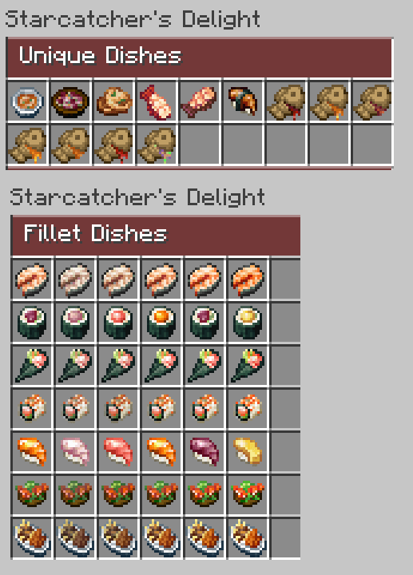

---
navigation:
  title: "Seafood"
  position: 4
  parent: reference.food.md
  icon: oceansdelight:cooked_stuffed_squid
item_ids:
  - oceansdelight:cooked_stuffed_squid
  - hybrid_delights:shrimp_fried_rice
  - starcatcher_delight:blossom_toast
---

# Seafood

 [English](https://www.youtube.com/results?search_query=Minecraft+1.21.1+Starcatcher%27s+Delight+seafood+cooking+guide+English) · [中文](https://www.youtube.com/results?search_query=%E6%88%91%E7%9A%84%E4%B8%96%E7%95%8C+1.21.1+%E6%98%9F%E9%92%93+%E6%B5%B7%E9%B2%9C+%E6%96%99%E7%90%86+%E6%95%99%E7%A8%8B)

## Fillets keep the rarity

<EmiSearch query="@farmersdelight" /> <EmiSearch query="@starcatcher" /> <EmiSearch query="@starcatcher_delight" />

Seafood cooking starts at the cutting board. A Starcatcher fish that belongs to a rarity tag cuts into one fillet of that rarity and one fish bone, so a fillet is an ingredient with a tier rather than a neutral portion.

| Tool | Identify it | Role |
| --- | --- | --- |
| <ItemLink id="farmersdelight:cutting_board" /> | <ItemGrid><ItemIcon id="farmersdelight:cutting_board" /></ItemGrid> | Holds the fish while you cut |
| <ItemLink id="farmersdelight:flint_knife" /> | <ItemGrid><ItemIcon id="farmersdelight:flint_knife" /></ItemGrid> | Cuts the fish into a fillet |

Place the board on a solid block. Use the fish on the board to place it, then hold the knife and use the board to cut it. A fillet and a bone drop beside the board.

| Rarity | Fillet | Identify it | What the tier decides |
| --- | --- | --- | --- |
| Common | <ItemLink id="starcatcher_delight:starcaught_fillet_common" /> | <ItemGrid><ItemIcon id="starcatcher_delight:starcaught_fillet_common" /></ItemGrid> | The common version of a shared dish |
| Uncommon | <ItemLink id="starcatcher_delight:starcaught_fillet_uncommon" /> | <ItemGrid><ItemIcon id="starcatcher_delight:starcaught_fillet_uncommon" /></ItemGrid> | The uncommon version of a shared dish |
| Rare | <ItemLink id="starcatcher_delight:starcaught_fillet_rare" /> | <ItemGrid><ItemIcon id="starcatcher_delight:starcaught_fillet_rare" /></ItemGrid> | The rare version of a shared dish |
| Epic | <ItemLink id="starcatcher_delight:starcaught_fillet_epic" /> | <ItemGrid><ItemIcon id="starcatcher_delight:starcaught_fillet_epic" /></ItemGrid> | The epic version of a shared dish |
| Legendary | <ItemLink id="starcatcher_delight:starcaught_fillet_legendary" /> | <ItemGrid><ItemIcon id="starcatcher_delight:starcaught_fillet_legendary" /></ItemGrid> | The legendary version, which also grants absorption hearts |

A legendary fillet cannot stand in for a common one, and a common fillet cannot make a legendary dish. Which waters hold which rarity belongs to the Starcatcher book.

- [Fishing](food.fishing.md) Rod, bait and the catch book.
- [Cooking tools](food.utensils.md) The board and knife interactions shared by every food topic.

***

## Sushi and pot dishes

Starcatcher dishes in the recipe browser

<ItemGrid><ItemIcon id="farmersdelight:cooking_pot" /></ItemGrid> cooks these dishes when a heat source sits below it. Open the pot and fill the ingredient slots. Sushi needs no container, and the finished rolls stay in the pot until you take them out.

| Dish | Identify it | Ingredients | Output |
| --- | --- | --- | --- |
| <ItemLink id="starcatcher_delight:hosomaki_common" /> | <ItemGrid><ItemIcon id="starcatcher_delight:hosomaki_common" /></ItemGrid> | 1 common fillet, 1 kelp, 2 rice | 4 rolls |
| <ItemLink id="starcatcher_delight:nigiri_common" /> | <ItemGrid><ItemIcon id="starcatcher_delight:nigiri_common" /></ItemGrid> | 1 common fillet, 2 rice | 4 pieces |
| <ItemLink id="starcatcher_delight:temaki_common" /> | <ItemGrid><ItemIcon id="starcatcher_delight:temaki_common" /></ItemGrid> | 1 common fillet, 2 kelp, 2 rice | 4 cones |
| <ItemLink id="starcatcher_delight:uramaki_common" /> | <ItemGrid><ItemIcon id="starcatcher_delight:uramaki_common" /></ItemGrid> | 1 common fillet, 1 kelp, 3 rice | 4 rolls |

Two more common dishes use a fillet without rice. They are single servings, so they do not share the batch counts above.

Some dishes use a named catch. They use a specific fish rather than a tier fillet.

| Family | Items |
| --- | --- |
| Named catch dishes | <ItemGrid><ItemIcon id="starcatcher_delight:blossom_toast" /><ItemIcon id="starcatcher_delight:cactifish_stew" /><ItemIcon id="starcatcher_delight:honey_taiyaki" /></ItemGrid> |

| Dish | Identify it | Ingredients | Output |
| --- | --- | --- | --- |
| <ItemLink id="starcatcher_delight:fish_and_chips_common" /> | <ItemGrid><ItemIcon id="starcatcher_delight:fish_and_chips_common" /></ItemGrid> | 1 common fillet, 2 potatoes | 1 serving |
| <ItemLink id="starcatcher_delight:fish_salad_common" /> | <ItemGrid><ItemIcon id="starcatcher_delight:fish_salad_common" /></ItemGrid> | 1 common fillet, leafy greens, a tomato | 1 serving |

The four sushi recipes above were checked at the common tier. The exact recipe for another tier is in the recipe browser.

***

## Hybrid Delights

<EmiSearch query="@hybrid_aquatic" /> <EmiSearch query="@hybrid_delights" />

<ItemLink id="hybrid_delights:lobster_stew" /> is the pot dish to aim for first. It takes raw lobster, a lobster tail, bread, an onion and a tomato, and it cooks in the same cooking pot as the sushi.

The mod also works from larger sea creatures. Cut a tuna at the board with a knife to get two fish steaks, plus a two in three chance of fish gelatin. Cutting cod gives two cod slices, bone meal, and a one in two chance of cod roe, so roe is a bonus rather than a guaranteed return.

| Family | Items | How you get them |
| --- | --- | --- |
| Fish portions | <ItemGrid><ItemIcon id="hybrid_aquatic:raw_fish_steak" /></ItemGrid> | Cutting tuna and stingray |
| Roe | <ItemGrid><ItemIcon id="hybrid_delights:cod_roe" /><ItemIcon id="hybrid_delights:cured_cod_roe" /></ItemGrid> | Chance output from cutting |
| Shellfish | <ItemGrid><ItemIcon id="hybrid_aquatic:raw_lobster" /><ItemIcon id="hybrid_aquatic:raw_lobster_tail" /></ItemGrid> | Raw lobster and tail, cooked into stew |
| Hybrid meals | <ItemGrid><ItemIcon id="hybrid_delights:caviar_toast" /><ItemIcon id="hybrid_delights:shrimp_fried_rice" /><ItemIcon id="hybrid_delights:fish_kebab" /><ItemIcon id="hybrid_delights:fishermans_pie" /><ItemIcon id="hybrid_delights:eel_noodles" /><ItemIcon id="hybrid_delights:bisque" /></ItemGrid> | Finished dishes from the same catch |
| Prepared parts | <ItemGrid><ItemIcon id="hybrid_aquatic:raw_fish_meat" /><ItemIcon id="hybrid_delights:ray_wing" /><ItemIcon id="hybrid_delights:carp_roe" /><ItemIcon id="hybrid_delights:fish_gelatin" /></ItemGrid> | Intermediate ingredients |

- [Cooking tools](food.utensils.md) Pot heat, slots and the container slot.

***

## Ocean's Delight

<EmiSearch query="@oceansdelight" />

Guardian cuts come from monument fights, not from a fishing rod. Squid and marine plants are the part of this book you can collect without a structure.

| Ingredient family | Ingredients | Meals |
| --- | --- | --- |
| Squid | <ItemGrid><ItemIcon id="oceansdelight:tentacles" /><ItemIcon id="oceansdelight:cut_tentacles" /></ItemGrid> | <ItemLink id="oceansdelight:squid_rings" />, <ItemLink id="oceansdelight:stuffed_squid" />, <ItemLink id="oceansdelight:cooked_stuffed_squid" /> |
| Guardians | <ItemGrid><ItemIcon id="oceansdelight:guardian_tail" /><ItemIcon id="oceansdelight:elder_guardian_slice" /></ItemGrid> | <ItemLink id="oceansdelight:guardian_soup" />, <ItemLink id="oceansdelight:elder_guardian_roll" />, <ItemLink id="oceansdelight:elder_guardian_slab" /> |
| Cod and pufferfish | <ItemGrid><ItemIcon id="minecraft:cod" /><ItemIcon id="minecraft:pufferfish" /></ItemGrid> | <ItemLink id="oceansdelight:stuffed_cod" />, <ItemLink id="oceansdelight:fugu_roll" /> |
| Marine plants | <ItemGrid><ItemIcon id="minecraft:seagrass" /><ItemIcon id="minecraft:sea_pickle" /></ItemGrid> | <ItemLink id="oceansdelight:seagrass_salad" />, <ItemLink id="oceansdelight:honey_fried_kelp" /> |

Prepared pufferfish is not interchangeable with raw pufferfish, so read the ingredient name in the recipe browser before you commit a catch.

***

## Catching what you cook

<EmiSearch query="@spawn" />

The Spawn fish are creatures, not rod loot. A casting net or a bucket captures them alive, and harvesting a caught creature gives the raw portion.

| Creature | Raw portion | First dish |
| --- | --- | --- |
| Tuna | <ItemGrid><ItemIcon id="spawn:tuna_chunk" /></ItemGrid> | Tuna roll, tuna sandwich |
| Herring | <ItemGrid><ItemIcon id="spawn:herring" /></ItemGrid> | Herring roll, canned herring |
| Bluefish | <ItemGrid><ItemIcon id="spawn:bluefish" /></ItemGrid> | Bluefish roll |
| Clam | <ItemGrid><ItemIcon id="spawn:clam" /></ItemGrid> | Steamed clams, clam chowder |
| Coastal crab | <ItemGrid><ItemIcon id="spawn:coastal_crab_claw" /></ItemGrid> | Crab boil |

| Spawn family | Items |
| --- | --- |
| Prepared fish | <ItemGrid><ItemIcon id="spawn:tuna_slice" /><ItemIcon id="spawn:tuna_chunk" /><ItemIcon id="spawn:herring_slice" /><ItemIcon id="spawn:bluefish_slice" /></ItemGrid> |
| Cooked fish | <ItemGrid><ItemIcon id="spawn:cooked_tuna_chunk" /><ItemIcon id="spawn:cooked_herring" /><ItemIcon id="spawn:cooked_herring_slice" /><ItemIcon id="spawn:cooked_bluefish" /><ItemIcon id="spawn:cooked_clam" /></ItemGrid> |
| Finished meals | <ItemGrid><ItemIcon id="spawn:tuna_roll" /><ItemIcon id="spawn:tuna_sandwich" /><ItemIcon id="spawn:herring_roll" /><ItemIcon id="spawn:bluefish_roll" /><ItemIcon id="spawn:canned_herring" /><ItemIcon id="spawn:clam_chowder" /></ItemGrid> |
| Shellfish meals | <ItemGrid><ItemIcon id="spawn:steamed_clams" /><ItemIcon id="spawn:crab_boil" /></ItemGrid> |
| Non-food byproduct | <ItemGrid><ItemIcon id="spawn:shell_fragments" /></ItemGrid> |
| Capture | <ItemGrid><ItemIcon id="spawn:bluefish_bucket" /></ItemGrid> |

<ItemGrid><ItemIcon id="spawn:casting_net" /><ItemIcon id="spawn:herring_bucket" /></ItemGrid> are capture tools, not food. A bucket keeps a fish alive for transport, while the net lets you take a creature that a rod cannot reach.

- [Aquatic wildlife](adventure.aquatic.md) Where these creatures live.
- [Hunger & variety](food.hunger.md) Saturation, effects and food variety.

***

## Related mods

| Mod or content | Purpose | Item search |
| --- | --- | --- |
|  [Hybrid Delights](food.seafood.md) | Prepares Hybrid Aquatic ingredients with Farmer's Delight. | <EmiSearch query="@hybrid_delights" /> |
|  [Ocean's Delight](food.seafood.md) | Adds seafood dishes using ocean ingredients. | <EmiSearch query="@oceansdelight" /> |
|  [Starcatcher's Delight - Let's Do: Kaleidoscope edition](food.seafood.md) | Adds dishes and preparation for Starcatcher catches. | <EmiSearch query="@starcatcher_delight" /> |
