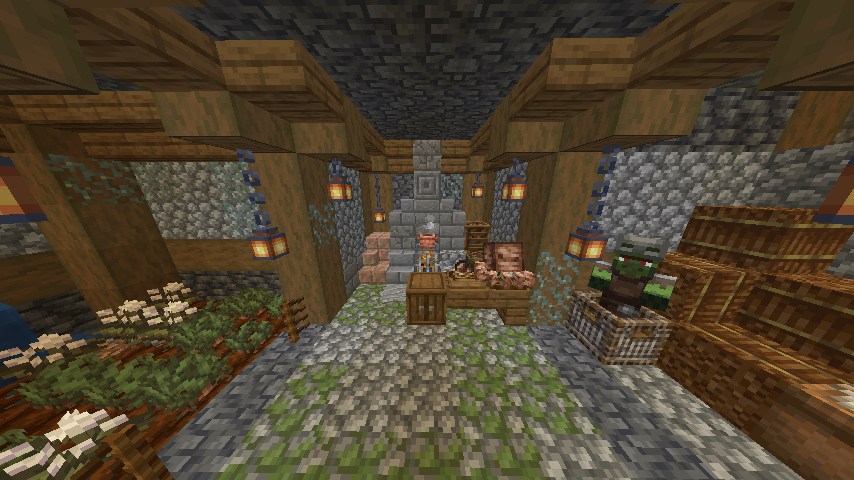
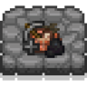

---
navigation:
  title: "Underground food"
  position: 5
  parent: reference.food.md
  icon: minecraft:brown_mushroom
---

# Underground food

 [English](https://www.youtube.com/results?search_query=Minecraft%201.21.1%20Miner%27s%20Delight%20cave%20carrot%20copper%20pot%20gossypium%20tutorial) · [中文](https://www.youtube.com/results?search_query=Minecraft%201.21.1%20Miner%27s%20Delight%20%E6%B4%9E%E7%A9%B4%E8%83%A1%E8%90%9D%E5%8D%9C%20%E9%93%9C%E9%94%85%20%E6%A3%89%E8%8A%B1%20%E6%95%99%E7%A8%8B)

## Cave carrots

<EmiSearch query="@farmersdelight" /> <EmiSearch query="@minersdelight" />

| Stage | View | How you get it |
| --- | --- | --- |
| <ItemLink id="minersdelight:wild_cave_carrots" /> | <ItemGrid><ItemIcon id="minersdelight:wild_cave_carrots" /></ItemGrid> | Break a wild patch in a cave, or shear it to move the patch |
| <ItemLink id="minersdelight:cave_carrot" /> | <ItemGrid><ItemIcon id="minersdelight:cave_carrot" /></ItemGrid> | Harvest the patch, then replant the carrot itself |
| <ItemLink id="minersdelight:gossypium" /> | <ItemGrid><ItemIcon id="minersdelight:gossypium" /></ItemGrid> | Grows beside wild carrots on rich soil, not from a planted seed |

Plant a <ItemLink id="minersdelight:cave_carrot" /> on farmland to start a row, and harvest the carrots that grow. A wild patch placed on <ItemLink id="farmersdelight:rich_soil" /> spreads: its random growth can copy the patch or place <ItemLink id="minersdelight:gossypium" /> in a nearby empty spot. That makes a rich soil patch the way to farm gossypium, and one gossypium crafts into two string.

The first cooked result is simple. Bake a <ItemLink id="minersdelight:cave_carrot" /> in a furnace, or use the campfire and smoker variants, and eat it as it is. <ItemLink id="minersdelight:baked_cave_carrot" /> is the item that comes out.

<Recipe id="minersdelight:baked_cave_carrot" />

Cave carrot is a pot ingredient for <ItemLink id="minersdelight:cave_soup" />. <ItemLink id="minersdelight:copper_carrot" /> is a separate prepared item, not a cooked carrot.

***

## Copper pot

<Recipe id="minersdelight:copper_pot" />

<Recipe id="minersdelight:copper_cup" />

The <ItemLink id="minersdelight:copper_pot" /> is its own station. It takes four ingredient slots and one container slot, it cooks Farmer's Delight pot recipes, and it only cooks while the block below it is a heat source, the same heat rule as the iron pot.

1. Put a heat source under the pot and place the pot on top.
2. Put up to four ingredients in the ingredient slots.
3. Put a <ItemLink id="minersdelight:copper_cup" /> in the designated container slot. The pot shows the finished dish in one slot and puts the takeable result in another, so take from the output rather than the display.
4. Wait for the cook to finish, then take the result from the output.

Four ingredient slots means a six ingredient iron pot recipe will not fit here. A dish that fits and has a cup form is <ItemLink id="minersdelight:vegetable_soup_cup" />: put a carrot, a potato, a beetroot and a leafy green in the four slots with a copper cup in the container slot, and the pot serves the soup as a cup.

A cup result depends on the dish. The container decides what the pot serves into, while the dish itself decides whether a cup form exists. Dishes without that form still have no cup.

Use copper cups to collect cup servings. <ItemLink id="minersdelight:water_cup" /> and <ItemLink id="minersdelight:milk_cup" /> are filled containers, not cooked dishes, and <ItemLink id="minersdelight:powder_snow_cup" /> is a cold drink.

***

## Underground proteins

Spiders, cave arthropods, bats and silverfish supply the meat side of this menu. These are loot and knife results, not farm crops.

| Ingredient | View | Where it comes from |
| --- | --- | --- |
| <ItemLink id="minersdelight:arthropod" /> | <ItemGrid><ItemIcon id="minersdelight:arthropod" /></ItemGrid> | Bees, silverfish and endermites killed with a knife in the main hand, while the target is not burning |
| <ItemLink id="minersdelight:spider_leg" /> | <ItemGrid><ItemIcon id="minersdelight:spider_leg" /></ItemGrid> | Spiders killed with a knife in the main hand, while the target is not burning, and only by chance |
| <ItemLink id="minersdelight:bat_wing" /> | <ItemGrid><ItemIcon id="minersdelight:bat_wing" /></ItemGrid> | Bats killed with a knife while not burning give two, and a kill without a knife can give one by chance |
| <ItemLink id="minersdelight:silverfish_eggs" /> | <ItemGrid><ItemIcon id="minersdelight:silverfish_eggs" /></ItemGrid> | Breaking infested blocks with a pickaxe by chance, or killing a silverfish with a knife while it is not burning, also by chance |

| Cooked portion | View | How it is cooked |
| --- | --- | --- |
| <ItemLink id="minersdelight:cooked_arthropod" /> | <ItemGrid><ItemIcon id="minersdelight:cooked_arthropod" /></ItemGrid> | Furnace or campfire |
| <ItemLink id="minersdelight:baked_spider_leg" /> | <ItemGrid><ItemIcon id="minersdelight:baked_spider_leg" /></ItemGrid> | Furnace, campfire or smoker |
| <ItemLink id="minersdelight:smoked_bat_wing" /> | <ItemGrid><ItemIcon id="minersdelight:smoked_bat_wing" /></ItemGrid> | Furnace, campfire or smoker |
| <ItemLink id="minersdelight:baked_squid" /> | <ItemGrid><ItemIcon id="minersdelight:baked_squid" /></ItemGrid> | Furnace, campfire or smoker |
| <ItemLink id="minersdelight:baked_tentacles" /> | <ItemGrid><ItemIcon id="minersdelight:baked_tentacles" /></ItemGrid> | Furnace, campfire or smoker |

***

## Protein meals

| Family | View | Use |
| --- | --- | --- |
| Pot meals | <ItemGrid><ItemIcon id="minersdelight:insect_stew" /><ItemIcon id="minersdelight:bat_soup" /><ItemIcon id="minersdelight:bat_rolls" /></ItemGrid> | Stews and rolls made in the heated cooking pot. |
| Sandwiches and wraps | <ItemGrid><ItemIcon id="minersdelight:insect_sandwich" /><ItemIcon id="minersdelight:insect_wrap" /></ItemGrid> | Handheld insect meals. |
| Cave hamburger | <ItemGrid><ItemIcon id="minersdelight:cave_hamburger" /></ItemGrid> | Craft bread, a crunchy bar or vegan patty, a smoked bat wing and two baked-tentacle or brown-mushroom ingredients. |
| Cave skewer | <ItemGrid><ItemIcon id="minersdelight:improvised_barbecue_stick" /></ItemGrid> | Craft a baked cave carrot, brown mushroom, smoked bat wing and wooden rod. |
| Seasoned arthropods | <ItemGrid><ItemIcon id="minersdelight:seasoned_arthropods" /></ItemGrid> | Prepared arthropod dish. |
| Caviar | <ItemGrid><ItemIcon id="minersdelight:weird_caviar" /></ItemGrid> | An egg dish made from silverfish eggs. |
| Glazed arachnid plate | <ItemGrid><ItemIcon id="minersdelight:plate_of_glazed_arachnid_limbs" /></ItemGrid> | Plated arachnid serving. |
| Bat cookie | <ItemGrid><ItemIcon id="minersdelight:bat_cookie" /></ItemGrid> | A sweet made with bat wing. |

***

## Squid and plant meals

| Family | View | Use |
| --- | --- | --- |
| Whole squid | <ItemGrid><ItemIcon id="minersdelight:squid" /><ItemIcon id="minersdelight:glow_squid" /></ItemGrid> | Distinct raw squid ingredients. |
| Tentacles | <ItemGrid><ItemIcon id="minersdelight:tentacles" /></ItemGrid> | Raw portion for cooking. |
| Squid meals | <ItemGrid><ItemIcon id="minersdelight:bowl_of_stuffed_squid" /><ItemIcon id="minersdelight:takoyaki" /><ItemIcon id="minersdelight:squid_sandwich" /><ItemIcon id="minersdelight:tentacles_on_a_stick" /></ItemGrid> | Stuffed bowl, takoyaki, sandwich and skewer. |

<ItemLink id="minersdelight:vegan_patty" /> is the raw intermediate. Three finished dishes are built on it. Veggieball pasta also accepts either a baked cave carrot or vegan patty. Glow ink pasta instead uses fish, pasta, glow berries and glow ink.

| Kitchen family | View | Role |
| --- | --- | --- |
| Raw patty | <ItemGrid><ItemIcon id="minersdelight:vegan_patty" /></ItemGrid> | Prepared patty used by the finished dishes below |
| Patty meals | <ItemGrid><ItemIcon id="minersdelight:vegan_hamburger" /><ItemIcon id="minersdelight:vegan_wrap" /><ItemIcon id="minersdelight:vegan_steak_and_potatoes" /></ItemGrid> | Finished dishes built on the patty |
| Cave pasta | <ItemGrid><ItemIcon id="minersdelight:pasta_with_veggieballs" /><ItemIcon id="minersdelight:glow_ink_pasta" /></ItemGrid> | Pot pasta, one from baked cave carrot or vegan patty, pasta and tomato sauce, one from fish, pasta, glow berries and glow ink |
| Plant plate | <ItemGrid><ItemIcon id="minersdelight:fake_meatloaf" /><ItemIcon id="minersdelight:plate_of_fake_meatloaf" /></ItemGrid> | Pot cooked meatloaf and its plated serving |

***

## Cups and bars

| Cup | View | What is inside |
| --- | --- | --- |
| <ItemLink id="minersdelight:water_cup" /> | <ItemGrid><ItemIcon id="minersdelight:water_cup" /></ItemGrid> | Water |
| <ItemLink id="minersdelight:milk_cup" /> | <ItemGrid><ItemIcon id="minersdelight:milk_cup" /></ItemGrid> | Milk |
| <ItemLink id="minersdelight:powder_snow_cup" /> | <ItemGrid><ItemIcon id="minersdelight:powder_snow_cup" /></ItemGrid> | Powder snow |
| <ItemLink id="minersdelight:cave_soup_cup" /> | <ItemGrid><ItemIcon id="minersdelight:cave_soup_cup" /></ItemGrid> | Cave soup |
| <ItemLink id="minersdelight:bat_soup_cup" /> | <ItemGrid><ItemIcon id="minersdelight:bat_soup_cup" /></ItemGrid> | Bat soup |
| <ItemLink id="minersdelight:insect_stew_cup" /> | <ItemGrid><ItemIcon id="minersdelight:insect_stew_cup" /></ItemGrid> | Insect stew |

Cup forms also exist for the Farmer's Delight soups and stews, which is why a copper pot can serve those dishes in a cup.

| Cup family | View | What is inside |
| --- | --- | --- |
| Vegetable and mushroom soups | <ItemGrid><ItemIcon id="minersdelight:beetroot_soup_cup" /><ItemIcon id="minersdelight:mushroom_stew_cup" /><ItemIcon id="minersdelight:onion_soup_cup" /><ItemIcon id="minersdelight:pumpkin_soup_cup" /><ItemIcon id="minersdelight:vegetable_soup_cup" /></ItemGrid> | Vegetable based soups and stews in cup form |
| Fish and poultry soups | <ItemGrid><ItemIcon id="minersdelight:baked_cod_stew_cup" /><ItemIcon id="minersdelight:chicken_soup_cup" /><ItemIcon id="minersdelight:fish_stew_cup" /><ItemIcon id="minersdelight:noodle_soup_cup" /></ItemGrid> | Fish, chicken and noodle soups in cup form |
| Meat stews | <ItemGrid><ItemIcon id="minersdelight:beef_stew_cup" /><ItemIcon id="minersdelight:rabbit_stew_cup" /><ItemIcon id="minersdelight:bone_broth_cup" /></ItemGrid> | Beef, rabbit and bone based stews in cup form |

| Bar | View | Role |
| --- | --- | --- |
| <ItemLink id="minersdelight:crunchy_bar" /> | <ItemGrid><ItemIcon id="minersdelight:crunchy_bar" /></ItemGrid> | Crafted from cooked arthropods and silverfish eggs, four bars at a time |
| <ItemLink id="minersdelight:nutritional_bar" /> | <ItemGrid><ItemIcon id="minersdelight:nutritional_bar" /></ItemGrid> | Crafted from four crunchy bars, wheat and honey |
| <ItemLink id="minersdelight:golden_nutritional_bar" /> | <ItemGrid><ItemIcon id="minersdelight:golden_nutritional_bar" /></ItemGrid> | A nutritional bar surrounded by gold nuggets |

- [Cooking tools](food.utensils.md) The iron pot, board and skillet.
- [Crop ingredients](food.growing.md) Surface crops beside the cave row.
- [Hunger & variety](food.hunger.md) Food values and the diet record.

***

## Related mods

| Mod or content | Purpose | Item search |
| --- | --- | --- |
|  [Miner's Delight](food.underground.md) | Adds mining-themed food and cooking tools to Farmer's Delight. | <EmiSearch query="@minersdelight" /> |
