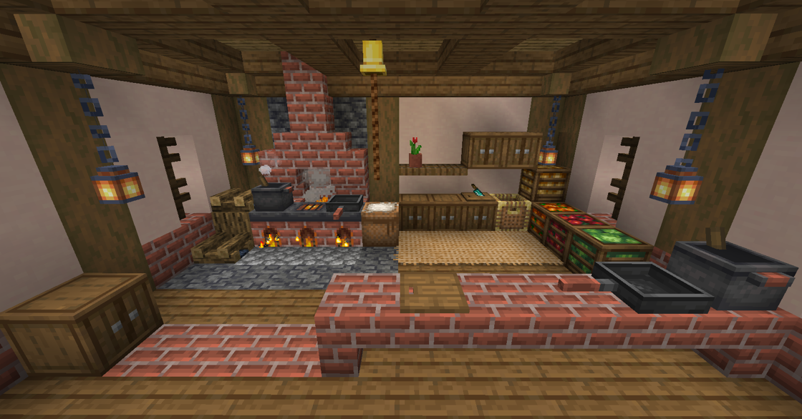
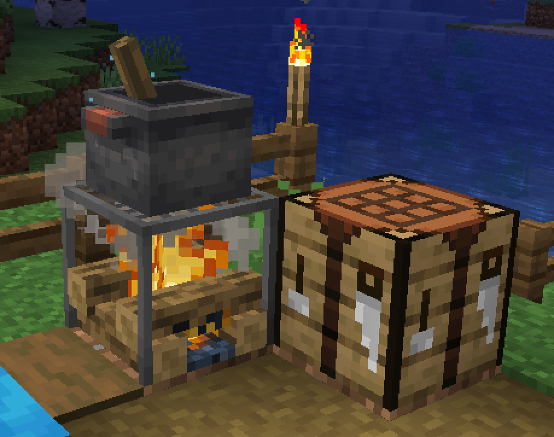
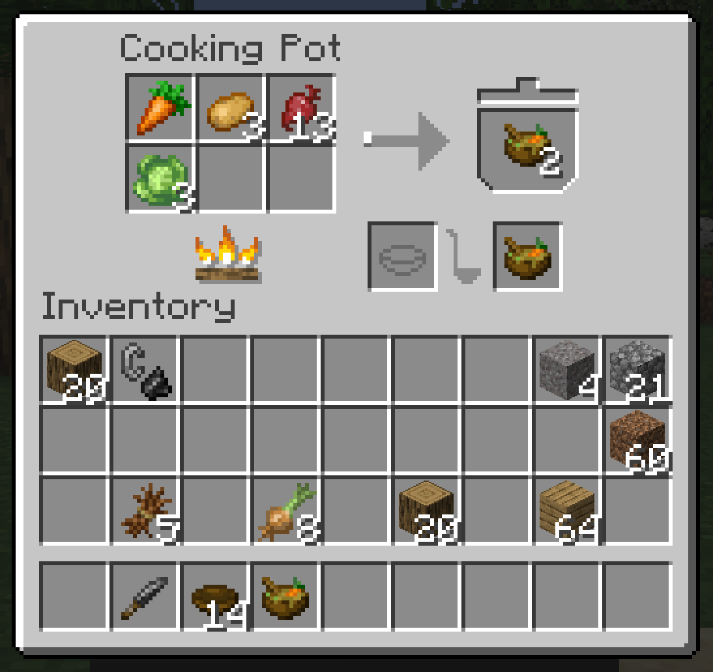

---
navigation:
  title: "Cooking tools"
  position: 0
  parent: reference.food.md
  icon: farmersdelight:cooking_pot
item_ids:
  - farmersdelight:cooking_pot
  - farmersdelight:cutting_board
  - farmersdelight:skillet
  - farmersdelight:stove
---

# Cooking tools

## Cutting board

<EmiSearch query="@farmersdelight" />

A kitchen with cooking tools and serving space

<ItemGrid><ItemIcon id="farmersdelight:cutting_board" /><ItemIcon id="farmersdelight:flint_knife" /></ItemGrid>

Place a <ItemLink id="farmersdelight:cutting_board" /> and use an ingredient on it. Hold the matching tool in your main hand and hold use. The board prefers items offered from your off hand, so you can carry the ingredient there and work the knife with the main hand. Outputs fly away from the board handle, which lets a hopper or basket on the far side collect them.

The tool loses one durability for each item processed. A knife cuts meat, fish and dough into portions. Other tools have their own board jobs.

| Tool | Board job | Result |
| --- | --- | --- |
| Knife | Portion food and open rice panicles | Slices, minced meat, bacon, pasta |
| Pickaxe | Split brick blocks | Individual bricks |
| Axe | Strip logs | Bark |
| Shovel | Break down clay blocks | Clay balls |
| Shears | Salvage leather armor | Leather |

A board also accepts a displayed tool. Sneak and use a tool on the board to mount it as decoration. The display does not change the board function.

***

## Cooking pot

<ItemGrid><ItemIcon id="farmersdelight:cooking_pot" /><ItemIcon id="minecraft:campfire" /><ItemIcon id="farmersdelight:stove" /><ItemIcon id="minecraft:bowl" /></ItemGrid>

The pot only cooks while the block below it provides heat. Fire, soul fire, lava, magma blocks, campfires and a <ItemLink id="farmersdelight:stove" /> all work. A cold pot keeps its contents and does nothing.

Open the pot and you get six ingredient slots and one container slot. The pot shows boiling bubbles and a campfire icon when it is heated. Drop a valid recipe in, add the serving container, and wait. Most meals finish in about ten seconds, and simple rice takes about five.

The pot stores finished servings until you take them out. A hopper or basket under the pot collects overflow. You can break a loaded pot and place it again without losing the meals inside, which makes it a portable pantry for a long trip. Every other slot drops when you break the pot, so empty the ingredients first.

Use the recipe book button in the pot interface to see the meals this pack can make. The book is enabled in this pack.

***

## Skillet and stove

<ItemGrid><ItemIcon id="farmersdelight:skillet" /><ItemIcon id="farmersdelight:stove" /><ItemIcon id="minecraft:flint_and_steel" /><ItemIcon id="minecraft:iron_ingot" /></ItemGrid>

A <ItemLink id="farmersdelight:skillet" /> cooks campfire recipes fast. Stand near a heat source with the skillet in one hand and the food in the other, then hold use. Each item takes about six seconds, roughly one fifth of the campfire time. The same skillet placed above a heat source cooks a whole stack and drops the results on its right side, so put a hopper or basket there.

Fire Aspect on the skillet shortens cooking time. The enchantment works in both the hand and the placed form.

A lit <ItemLink id="farmersdelight:stove" /> needs no fuel. It holds six items, cooks campfire recipes in about thirty seconds, and pops finished food above the grill instead of throwing it. The stove also heats a cooking pot placed on it. A block over the middle of the grill flings the food away, so keep the top face clear. Put the stove out with a shovel or a water bucket and relight it with flint and steel.

| Station | Heat needed | Holds | Typical job |
| --- | --- | --- | --- |
| Skillet in hand | Stand near fire, lava or a lit stove | One item at a time | Cook a few pieces on the move |
| Placed skillet | Heat block underneath | One stack | Cook a batch and collect it |
| Stove | None after lighting | Six items | Fuel-free campfire cooking |
| Cooking pot | Heat block underneath | Six ingredients plus containers | Combined meals and stews |

***

## Serving forms

<ItemGrid><ItemIcon id="minecraft:bowl" /><ItemIcon id="farmersdelight:roast_chicken" /><ItemIcon id="farmersdelight:stuffed_pumpkin" /><ItemIcon id="farmersdelight:honey_glazed_ham" /><ItemIcon id="farmersdelight:shepherds_pie" /></ItemGrid>

A bowl meal leaves the pot as a single serving. A feast such as <ItemLink id="farmersdelight:roast_chicken" /> is not edible in item form. Place it, then use a bowl on it to take a portion. A placed feast gives four servings and leaves a dirty plate. Use or break the plate to recover the bowl and any bones or scraps.

Feasts suit a group or a return trip. Carry bowl meals and a stack of bowls for solo work, and place a feast at a base or camp where several players eat together. Pack bowls before you leave, because a finished meal without a container stays in the pot.

***

## Dishes and materials

These are the remaining items in this chapter, grouped by the station that makes them. Open the item tooltip for exact food values and open the recipe browser for a specific dish.

| Family | Items |
| --- | --- |
| Kitchen tools | <ItemGrid><ItemIcon id="minecraft:brick" /><ItemIcon id="minecraft:wooden_shovel" /><ItemIcon id="minecraft:water_bucket" /><ItemIcon id="minecraft:stick" /><ItemIcon id="minecraft:oak_planks" /><ItemIcon id="minecraft:bricks" /><ItemIcon id="minecraft:flint" /></ItemGrid> |
| Sandwiches & rolls | <ItemGrid><ItemIcon id="farmersdelight:egg_sandwich" /><ItemIcon id="farmersdelight:chicken_sandwich" /><ItemIcon id="farmersdelight:hamburger" /><ItemIcon id="farmersdelight:bacon_sandwich" /><ItemIcon id="farmersdelight:mutton_wrap" /><ItemIcon id="farmersdelight:dumplings" /><ItemIcon id="farmersdelight:cabbage_rolls" /><ItemIcon id="farmersdelight:salmon_roll" /><ItemIcon id="farmersdelight:cod_roll" /><ItemIcon id="farmersdelight:kelp_roll" /><ItemIcon id="minecraft:bread" /><ItemIcon id="farmersdelight:fried_egg" /><ItemIcon id="minecraft:cooked_chicken" /><ItemIcon id="farmersdelight:cabbage" /><ItemIcon id="minecraft:carrot" /><ItemIcon id="farmersdelight:beef_patty" /><ItemIcon id="farmersdelight:tomato" /><ItemIcon id="farmersdelight:onion" /><ItemIcon id="farmersdelight:cooked_bacon" /><ItemIcon id="minecraft:cooked_mutton" /><ItemIcon id="farmersdelight:wheat_dough" /><ItemIcon id="minecraft:chicken" /><ItemIcon id="farmersdelight:salmon_slice" /><ItemIcon id="farmersdelight:cooked_rice" /><ItemIcon id="farmersdelight:cod_slice" /><ItemIcon id="minecraft:dried_kelp" /></ItemGrid> |
| Soups & rice | <ItemGrid><ItemIcon id="farmersdelight:beef_stew" /><ItemIcon id="farmersdelight:chicken_soup" /><ItemIcon id="farmersdelight:vegetable_soup" /><ItemIcon id="farmersdelight:fish_stew" /><ItemIcon id="farmersdelight:pumpkin_soup" /><ItemIcon id="farmersdelight:baked_cod_stew" /><ItemIcon id="farmersdelight:noodle_soup" /><ItemIcon id="farmersdelight:onion_soup" /><ItemIcon id="farmersdelight:bone_broth" /><ItemIcon id="farmersdelight:fried_rice" /><ItemIcon id="farmersdelight:mushroom_rice" /><ItemIcon id="minecraft:beef" /><ItemIcon id="minecraft:potato" /><ItemIcon id="minecraft:melon_slice" /><ItemIcon id="minecraft:beetroot" /><ItemIcon id="minecraft:cod" /><ItemIcon id="farmersdelight:tomato_sauce" /><ItemIcon id="farmersdelight:pumpkin_slice" /><ItemIcon id="minecraft:porkchop" /><ItemIcon id="farmersdelight:milk_bottle" /><ItemIcon id="minecraft:egg" /><ItemIcon id="farmersdelight:raw_pasta" /><ItemIcon id="minecraft:bone" /><ItemIcon id="minecraft:glow_berries" /><ItemIcon id="farmersdelight:rice" /><ItemIcon id="minecraft:brown_mushroom" /><ItemIcon id="minecraft:red_mushroom" /></ItemGrid> |
| Plates & feasts | <ItemGrid><ItemIcon id="farmersdelight:bacon_and_eggs" /><ItemIcon id="farmersdelight:pasta_with_meatballs" /><ItemIcon id="farmersdelight:pasta_with_mutton_chop" /><ItemIcon id="farmersdelight:roasted_mutton_chops" /><ItemIcon id="farmersdelight:steak_and_potatoes" /><ItemIcon id="farmersdelight:vegetable_noodles" /><ItemIcon id="farmersdelight:ratatouille" /><ItemIcon id="farmersdelight:squid_ink_pasta" /><ItemIcon id="farmersdelight:grilled_salmon" /><ItemIcon id="farmersdelight:gleaming_salad" /><ItemIcon id="farmersdelight:minced_beef" /><ItemIcon id="minecraft:mutton" /><ItemIcon id="farmersdelight:cooked_mutton_chops" /><ItemIcon id="minecraft:baked_potato" /><ItemIcon id="minecraft:cooked_beef" /><ItemIcon id="minecraft:ink_sac" /><ItemIcon id="minecraft:cooked_salmon" /><ItemIcon id="minecraft:sweet_berries" /></ItemGrid> |
| Desserts & drinks | <ItemGrid><ItemIcon id="farmersdelight:apple_pie_slice" /><ItemIcon id="farmersdelight:sweet_berry_cheesecake_slice" /><ItemIcon id="farmersdelight:chocolate_pie_slice" /><ItemIcon id="farmersdelight:pumpkin_pie_slice" /><ItemIcon id="farmersdelight:fruit_salad" /><ItemIcon id="farmersdelight:sweet_berry_cookie" /><ItemIcon id="farmersdelight:honey_cookie" /><ItemIcon id="farmersdelight:melon_popsicle" /><ItemIcon id="farmersdelight:glow_berry_custard" /><ItemIcon id="farmersdelight:hot_cocoa" /><ItemIcon id="farmersdelight:apple_cider" /><ItemIcon id="farmersdelight:melon_juice" /><ItemIcon id="farmersdelight:apple_pie" /><ItemIcon id="farmersdelight:sweet_berry_cheesecake" /><ItemIcon id="farmersdelight:chocolate_pie" /><ItemIcon id="minecraft:pumpkin_pie" /><ItemIcon id="minecraft:apple" /><ItemIcon id="minecraft:wheat" /><ItemIcon id="minecraft:honey_bottle" /><ItemIcon id="minecraft:ice" /><ItemIcon id="minecraft:sugar" /><ItemIcon id="minecraft:cocoa_beans" /><ItemIcon id="minecraft:glass_bottle" /></ItemGrid> |

- [Hunger and variety](food.hunger.md)
- [Crop ingredients](food.growing.md)
- [Machine kitchens](food.machine-cooking.md)

***

## Related mods

| Mod or content | Purpose | Item search |
| --- | --- | --- |
|  [Farmer's Delight](food.utensils.md) | Adds crops, cooking utensils and meal preparation with cutting boards and cooking pots. | <EmiSearch query="@farmersdelight" /> |
