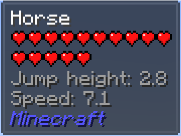
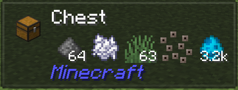
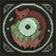

---
navigation:
  title: "Block & mob info"
  position: 0
  parent: reference.utilities.md
  icon: minecraft:debug_stick
---

# Block & mob info

## Ship inspection

Jade horse information overlay

Jade chest contents overlay

Jade Sable Compat adapts Jade inspection to Sable ships. Look at the ship's block through the same Jade overlay rather than a separate ship-information screen. Available details still depend on the targeted block and its integration.

***

## Inspect your target

Jade shows information about the block or creature you are looking at. Use it to identify a machine before opening its interface. Available details depend on the target and its integration, the overlay is not a full recipe list.

| Action | Your key |
| --- | --- |
| Show overlay | <KeyBind id="key.jade.show_overlay" /> |
| Open settings | <KeyBind id="key.jade.config" /> |
| Show details | <KeyBind id="key.jade.show_details" /> |

If the overlay covers another interface element, adjust its position or scale in Jade settings. Jade Addons supplies additional information for supported mods, it does not add a second inspection system.

***

## Villager names

Villager Names gives villagers recognizable names. A name identifies the villager, it does not describe its trade level or promise a particular trade. Inspect its profession and trading interface separately.

***

## Related topics

- [Browse recipe](help.search.md) Ingredients and uses.
- [Trading](machines.trading.md) Trading equipment and automation.

***

## Related mods

| Mod or content | Purpose | Item search |
| --- | --- | --- |
|  [Jade Addons (Neo/Forge)](help.inspect.md) | Adds mod-specific information support to Jade's inspection overlay. | No separate item search |
|  [Jade Sable Compat](help.inspect.md) | Adapts Jade inspection to Sable ships. | No separate item search |
|  [Jade 🔍](help.inspect.md) | Shows information about the block or creature being looked at. | No separate item search |
|  [Villager Names](help.inspect.md) | Gives villagers default or custom names. | No separate item search |
