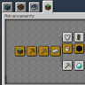

---
navigation:
  title: "Advancements"
  position: 1
  parent: reference.technical.md
  icon: minecraft:book
---

# Advancements

## Read advancements

Better Advancements improves the advancement screen. Open it to browse goals and their conditions. Minecraft and content-mod advancements remain unchanged. This is not a separate quest book, and the pack does not require a compulsory reading or completion order.

Use an advancement as a clue about its activity. Equipment choices, class abilities and machine assembly belong in their handbook topics or native mod help, not in an assumed advancement tutorial.

***

## Related topics

- [Combat & classes](reference.skills.md)
- [Machines & storage](reference.machines-storage.md)

***

## Related mods

| Mod or content | Purpose | Item search |
| --- | --- | --- |
|  [Better Advancements](help.reference.md) | Improves the advancement screen without adding progression requirements. | No separate item search |
