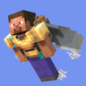

---
navigation:
  title: "Workshop tools"
  position: 7
  parent: reference.machines-storage.md
  icon: create:wrench
---

# Workshop tools

## Tools that save the walk home

<EmiSearch query="@create_sa" /> <EmiSearch query="@create" />

Create Stuff 'N Additions adds hand tools that run on rotation stored in the item rather than on a workstation. They are the reason a small base can mine and build without running a shaft everywhere.

<ItemGrid><ItemIcon id="create_sa:portable_drill" /><ItemIcon id="create_sa:copper_magnet" /><ItemIcon id="create_sa:block_picker" /><ItemIcon id="create_sa:grapplin_whisk" /></ItemGrid>

| Tool | What it replaces |
| --- | --- |
| <ItemLink id="create_sa:portable_drill" /> | A pickaxe, and it breaks blocks at machine speed |
| <ItemLink id="create_sa:copper_magnet" /> | Walking to pick up drops, it pulls them to you |
| <ItemLink id="create_sa:block_picker" /> | Carrying a block around to place many of them |
| <ItemLink id="create_sa:grapplin_whisk" /> | Climbing, it pulls you toward a surface |

Each tool holds its own charge and is refilled from a tank. The pack gives gadgets 1600 units of capacity, so one filling lasts a working session rather than a whole project.

***

## Tanks and portable engines

<ItemGrid><ItemIcon id="create_sa:small_filling_tank" /><ItemIcon id="create_sa:medium_filling_tank" /><ItemIcon id="create_sa:large_filling_tank" /><ItemIcon id="create_sa:steam_engine" /></ItemGrid>

| Item | Capacity in this pack |
| --- | --- |
| <ItemLink id="create_sa:small_filling_tank" /> | 800 |
| <ItemLink id="create_sa:medium_filling_tank" /> | 1600 |
| <ItemLink id="create_sa:large_filling_tank" /> | 3200 |
| <ItemLink id="create_sa:steam_engine" />, <ItemLink id="create_sa:hydraulic_engine" />, <ItemLink id="create_sa:heat_engine" /> | Portable steam, hydraulic and heat engines |

The filling tanks are the refill station for tools and jetpacks. Place one, fill it, and hold the tool against it. A large tank refills four small tanks worth of gadgets before it needs attention.

The portable steam engine in this mod is not Create's placed <ItemLink id="create:steam_engine" />. It is a handheld or mounted component for gadgets, and it does not feed a stress network.

***

## The drone

<ItemGrid><ItemIcon id="create_sa:brass_drone_item" /><ItemIcon id="create_sa:drone_controller" /><ItemIcon id="create_sa:fan_component" /><ItemIcon id="create_sa:vault_component" /></ItemGrid>

| Part | Job |
| --- | --- |
| <ItemLink id="create_sa:brass_drone_item" /> | The drone itself, deployed from the item |
| <ItemLink id="create_sa:drone_controller" /> | Sets where the drone flies and what it does |
| <ItemLink id="create_sa:fan_component" /> | Pushes items or entities |
| <ItemLink id="create_sa:vault_component" /> | Holds what the drone collects |

This pack enables the drill, fan, magnet and vault modules for drones. Three of those modules have their own items here, and the vault module is the one that makes a collection run worth flying.

Start with one drone, one module and a short route. A drone that does nothing is usually out of charge or outside the controller's set area.

***

## Shortcuts this pack adds

<ItemGrid><ItemIcon id="minecraft:phantom_membrane" /><ItemIcon id="minecraft:feather" /><ItemIcon id="minecraft:brown_mushroom" /><ItemIcon id="minecraft:red_mushroom" /><ItemIcon id="minecraft:brown_mushroom_block" /><ItemIcon id="minecraft:red_mushroom_block" /><ItemIcon id="minecraft:prismarine_shard" /><ItemIcon id="minecraft:blue_dye" /></ItemGrid>

| Shortcut | Input | Output |
| --- | --- | --- |
| Haunting a feather | One feather | One phantom membrane |
| Compacting mushrooms | Four matching mushrooms | One mushroom block of that color |
| Blasting a shard | One prismarine shard | One blue dye |

<Recipe id="stam1ocreatetweaks:blasting/blue_dye" />

The feather recipe removes the need to wait for phantoms, which matters for anything that asks for membranes. The mushroom block recipe is the cheap way to store a harvest. The blue dye recipe turns ocean salvage into a dye without a flower farm.

Next step is power for the machines these tools support. [Rotational power](machines.rotation.md) owns the drive line.

***

## Related mods

| Mod or content | Purpose | Item search |
| --- | --- | --- |
|  [Create Stuff 'N Additions](machines.miscellaneous.md) | Adds Create-themed powered equipment and wearable tools. | <EmiSearch query="@create_sa" /> |
|  [Create: Stam1o Tweaks](machines.miscellaneous.md) | Adjusts Create recipes and lets diving boots counter levitation. | No separate item search |
