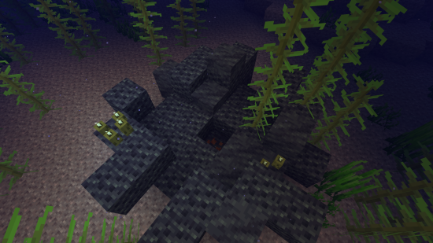

---
navigation:
  title: "Molten vents"
  position: 9
  parent: reference.machines-storage.md
  icon: create:mechanical_drill
---

# Molten vents

 [English](https://www.youtube.com/results?search_query=Minecraft+1.21.1+Molten+Vents+activate+underwater+vent+orestone+lava+tutorial) · [中文](https://www.youtube.com/results?search_query=Minecraft+1.21.1+Molten+Vents+%E6%B5%B7%E5%BA%95%E7%86%94%E5%B2%A9%E6%B3%89+%E6%BF%80%E6%B4%BB+%E7%9F%BF%E7%9F%B3+%E5%B2%A9%E6%B5%86+%E6%95%99%E7%A8%8B)

## Vents under the sea

<EmiSearch query="@molten_vents" /> <EmiSearch query="@create" />

In this pack, Molten Vents generate underwater. The dormant vent is an orestone formation with a magma-marked core inside. After activation, placing lava on the active core consumes that lava source and turns its location into the matching orestone. The vent does not create lava, and each conversion needs another lava source.

| Vent | View | What it makes |
| --- | --- | --- |
| <ItemLink id="molten_vents:active_molten_asurine" /> | <ItemGrid><ItemIcon id="molten_vents:active_molten_asurine" /></ItemGrid> | Asurine orestone |
| <ItemLink id="molten_vents:active_molten_veridium" /> | <ItemGrid><ItemIcon id="molten_vents:active_molten_veridium" /></ItemGrid> | Veridium orestone |
| <ItemLink id="molten_vents:active_molten_crimsite" /> | <ItemGrid><ItemIcon id="molten_vents:active_molten_crimsite" /></ItemGrid> | Crimsite orestone |
| <ItemLink id="molten_vents:active_molten_ochrum" /> | <ItemGrid><ItemIcon id="molten_vents:active_molten_ochrum" /></ItemGrid> | Ochrum orestone |
| <ItemLink id="molten_vents:active_molten_scorchia" /> | <ItemGrid><ItemIcon id="molten_vents:active_molten_scorchia" /></ItemGrid> | Scorchia orestone |
| <ItemLink id="molten_vents:active_molten_scoria" /> | <ItemGrid><ItemIcon id="molten_vents:active_molten_scoria" /></ItemGrid> | Scoria orestone |

Each family has a dormant and an active block. The dormant form sits in the vent shell and does nothing, and the active form is the one that converts lava into stone.

***

## Wake a vent

1. Clear the inside of the vent until you reach the block that matches the surrounding orestone but carries magma.
2. Detonate TNT beside the magma-marked core so the blast reaches it.
3. Watch the magma brighten. The block is now active.

<GameScene zoom="3" interactive={true}>
<Block id="molten_vents:dormant_molten_asurine" />
<Block x="2" id="molten_vents:active_molten_asurine" />
</GameScene>

The dark core is dormant. The brighter core is active.

<ItemLink id="molten_vents:dormant_molten_asurine" />

Activation and supply: <ItemLink id="minecraft:tnt" /> and <ItemLink id="minecraft:lava_bucket" />.

| What you see | Cause |
| --- | --- |
| The blast does nothing | The block was plain orestone, not the magma core |
| The vent stays dark | The blast did not reach the core |
| Lava sits on a cold vent | The core was never activated |

Work with room to swim and a way to breathe, because the vents are underwater here.

***

## Lava in, stone out

<ItemGrid><ItemIcon id="create:hose_pulley" /><ItemIcon id="create:fluid_pipe" /><ItemIcon id="create:mechanical_pump" /></ItemGrid>

Lava dropped onto an active vent is consumed and replaced by that vent's orestone, so a vent converts lava into building and crushing material rather than generating anything on its own.

| Supply | When it fits |
| --- | --- |
| Buckets by hand | Proving the vent works |
| <ItemLink id="create:hose_pulley" /> over a lava lake | A lava supply that must be replenished unless its body meets the hose pulley’s infinite-source rules |
| Pumped from a tank | You already move lava for fuel or casting |

After a successful conversion, collect the resulting orestone and replenish the lava source before repeating. Use a bucket to confirm the conversion before automating.

- [Material processing](machines.ore-processing.md) Crushing and washing the orestone.
- [Item and fluid routing](machines.logistics.md) Belts that carry the stone away.
- [Process heat](power.burners.md) Heat users that may want the lava instead.

***

## Related mods

| Mod or content | Purpose | Item search |
| --- | --- | --- |
|  [Create: Molten Vents](machines.renewables.md) | Provides renewable Create ore-bearing stones through molten vents. | <EmiSearch query="@molten_vents" /> |
