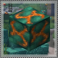

---
navigation:
  title: "Renewable resources"
  position: 6
  parent: reference.machines-storage.md
  icon: create:mechanical_drill
---

# Renewable resources

## Vents are under water here

<EmiSearch query="@molten_vents" /> <EmiSearch query="@create" />

A molten vent is a renewable source of Create orestone. In this pack the land vents are switched off and the underwater vents are switched on, so the surface search is a waste of time. Look along the seabed.

<ItemGrid><ItemIcon id="molten_vents:dormant_molten_asurine" /><ItemIcon id="molten_vents:active_molten_asurine" /><ItemIcon id="molten_vents:active_molten_veridium" /><ItemIcon id="molten_vents:active_molten_crimsite" /><ItemIcon id="molten_vents:active_molten_ochrum" /><ItemIcon id="molten_vents:active_molten_scorchia" /><ItemIcon id="molten_vents:active_molten_scoria" /></ItemGrid>

| Block | State |
| --- | --- |
| Dormant vent block | Found inside the vent shell, inert |
| Active vent block | Produces its stone when lava lands on it |
| Orestone | The building and crushing material the vent makes |

Six families exist, Asurine, Veridium, Crimsite, Ochrum, Scorchia and Scoria. Each has a dormant and an active form. The block you want is the one with magma on it, not the plain orestone around it.

***

## Wake a vent in three steps

1. Clear the blocks inside the vent until you reach the block that matches the surrounding orestone but carries magma.
2. Break that dormant core with an explosion. A single block of dynamite or a charged creeper is enough to set it off.
3. Watch the magma brighten. That block is now active.

<ItemGrid><ItemIcon id="minecraft:tnt" /><ItemIcon id="molten_vents:active_molten_ochrum" /><ItemIcon id="minecraft:lava_bucket" /></ItemGrid>

| Step | Failure to expect | Cause |
| --- | --- | --- |
| Explosion does nothing | Wrong block | The plain orestone looks similar, the core has magma |
| Vent stays dark | Explosion too far | The blast must touch the core block |
| Lava sits on top | Vent still dormant | Activation happens before any lava |

Do this in open water with room to swim. The vent is under the sea in this pack, so bring a way to breathe and a light source.

***

## Lava in, stone out

Lava dropped onto an active vent turns into the vent's orestone. The lava is consumed and replaced by stone, which makes the vent a converter rather than a generator.

<ItemGrid><ItemIcon id="minecraft:lava_bucket" /><ItemIcon id="create:hose_pulley" /><ItemIcon id="create:mechanical_pump" /><ItemIcon id="create:fluid_pipe" /></ItemGrid>

| Supply method | When it fits |
| --- | --- |
| Buckets by hand | Proving the vent works, a few stacks at a time |
| <ItemLink id="create:hose_pulley" /> on a lava lake | The lake is large enough to count as infinite |
| Pumped from a tank | You already move lava for fuel or casting |

The hose pulley treats a body of 10000 or more source blocks as infinite in this pack, so a lava lake under the world is worth more than a lava pool in a cave. The pulley also reaches 128 blocks, which is usually enough to stand it above the vent and let stone collect below.

The vent produces stone that then follows the normal ore route. [Ore processing](machines.ore-processing.md) covers crushing and washing it, and [Material routing](machines.logistics.md) covers the belts that carry it away.

***

## Related mods

| Mod or content | Purpose | Item search |
| --- | --- | --- |
|  [Create: Molten Vents](machines.renewables.md) | Provides renewable Create ore-bearing stones through molten vents. | <EmiSearch query="@molten_vents" /> |
