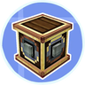

---
navigation:
  title: "Rotational power"
  position: 3
  parent: reference.machines-storage.md
  icon: create:cogwheel
---

# Rotational power

 [English](https://www.youtube.com/results?search_query=Minecraft+1.21.1+Create+6+water+wheel+stress+stressometer+gearbox+gearshift+millstone+tutorial) · [中文](https://www.youtube.com/results?search_query=Minecraft+1.21.1+Create+6+%E6%B0%B4%E8%BD%A6+%E5%BA%94%E5%8A%9B+%E5%BA%94%E5%8A%9B%E8%A1%A8+%E9%BD%BF%E8%BD%AE%E7%AE%B1+%E5%8F%98%E9%80%9F%E5%99%A8+%E7%9F%B3%E7%A3%A8+%E6%95%99%E7%A8%8B)

## What a network needs

<EmiSearch query="@create" />

A rotating network has capacity from its sources and stress from the machines on it. While stress stays under capacity everything turns. When stress passes capacity the network stalls until the load drops.

| Source | View | Speed in place | Capacity at that speed |
| --- | --- | --- | --- |
| <ItemLink id="create:water_wheel" /> | <ItemGrid><ItemIcon id="create:water_wheel" /></ItemGrid> | Eight revolutions per minute | 256 stress units |
| <ItemLink id="create:large_water_wheel" /> | <ItemGrid><ItemIcon id="create:large_water_wheel" /></ItemGrid> | Four revolutions per minute | 512 stress units |
| <ItemLink id="create:windmill_bearing" /> | <ItemGrid><ItemIcon id="create:windmill_bearing" /></ItemGrid> | Set by sail assembly | Compare with a stressometer |
| <ItemLink id="create:steam_engine" /> | <ItemGrid><ItemIcon id="create:steam_engine" /></ItemGrid> | Set by boiler and engine | Compare with a stressometer |

Capacity follows the source's speed, so those two wheel figures are running output. Both wheels take force from adjacent water currents, and covering more sides does not add output.

| Gauge | View | What it reports |
| --- | --- | --- |
| <ItemLink id="create:stressometer" /> | <ItemGrid><ItemIcon id="create:stressometer" /></ItemGrid> | Stress capacity of the attached network |
| <ItemLink id="create:speedometer" /> | <ItemGrid><ItemIcon id="create:speedometer" /></ItemGrid> | Speed of attached components |

Both gauges are placed blocks that report the network they attach to. Wearing <ItemLink id="create:goggles" /> shows more detail on either gauge, and a comparator can read them.

***

## First drive

<Recipe id="create:crafting/kinetics/water_wheel" />

<Recipe id="create:crafting/kinetics/shaft" />

<Recipe id="create:crafting/kinetics/vertical_gearbox" />

The Millstone help entry is Processing Items in the Millstone.

<ItemGrid><ItemIcon id="create:millstone" /></ItemGrid>

1. Put a <ItemLink id="create:water_wheel" /> in flowing water and extend a horizontal <ItemLink id="create:shaft" /> from its axle.
2. Place a <ItemLink id="create:vertical_gearbox" /> at the shaft end. Its horizontal opening must face the shaft and a vertical opening must face up. Use the wrench to orient it if needed.
3. Put an upright shaft in that upper opening, with a <ItemLink id="create:millstone" /> directly on top. The shaft enters the millstone from below.
4. Drop wheat into the millstone from above. After grinding finishes, right click the millstone with an empty hand to collect the output.

The drive works when the millstone turns and grinding completes. A shaft that meets the millstone from a face it does not drive will not transfer force, which looks like a stalled network without being an overload.

Items can also be inserted and extracted by automation. The top accepts input, and the output is available from the block.

***

## Ratio, axis and reversal

<EmiSearch query="@create_connected" />

| Part | View | What it does to the drive |
| --- | --- | --- |
| <ItemLink id="create:shaft" /> | <ItemGrid><ItemIcon id="create:shaft" /></ItemGrid> | Passes rotation along the same axis |
| <ItemLink id="create:cogwheel" /> | <ItemGrid><ItemIcon id="create:cogwheel" /></ItemGrid> | Meshing equal-sized gears keep the same speed and reverse rotation |
| <ItemLink id="create:large_cogwheel" /> | <ItemGrid><ItemIcon id="create:large_cogwheel" /></ItemGrid> | Meshing with a small cog doubles speed from large to small and halves it from small to large |
| <ItemLink id="create:gearbox" /> and <ItemLink id="create:vertical_gearbox" /> | <ItemGrid><ItemIcon id="create:gearbox" /><ItemIcon id="create:vertical_gearbox" /></ItemGrid> | Relays around corners, and straight connections come out reversed |
| <ItemLink id="create:gearshift" /> | <ItemGrid><ItemIcon id="create:gearshift" /></ItemGrid> | Straight relay that reverses while powered by redstone |
| <ItemLink id="create:wrench" /> | <ItemGrid><ItemIcon id="create:wrench" /></ItemGrid> | Rotates and configures placed kinetic blocks |

An ordinary gearbox mirrors the shafts around a corner, while a parallel gearbox turns them the same way. Both reverse a straight connection.

Create: Connected adds parts for specific routing cases.

| Part | View | Difference |
| --- | --- | --- |
| <ItemLink id="create_connected:cross_connector" /> | <ItemGrid><ItemIcon id="create_connected:cross_connector" /></ItemGrid> | Relays rotation across without the lines meeting |
| <ItemLink id="create_connected:parallel_gearbox" /> | <ItemGrid><ItemIcon id="create_connected:parallel_gearbox" /></ItemGrid> | Corner shafts same direction, straight connections reversed |
| <ItemLink id="create_connected:six_way_gearbox" /> | <ItemGrid><ItemIcon id="create_connected:six_way_gearbox" /></ItemGrid> | Takes shafts on all six sides |
| <ItemLink id="create_connected:brass_gearbox" /> | <ItemGrid><ItemIcon id="create_connected:brass_gearbox" /></ItemGrid> | Each face is set with a wrench |
| <ItemLink id="create_connected:encased_chain_cogwheel" /> | <ItemGrid><ItemIcon id="create_connected:encased_chain_cogwheel" /></ItemGrid> | Chain drive that also takes a cogwheel |
| <ItemLink id="create_connected:kinetic_bridge" /> | <ItemGrid><ItemIcon id="create_connected:kinetic_bridge" /></ItemGrid> | Transfers a set amount of capacity between two separate networks, adjustable on its value panel |

***

## Switches that protect a line

| Part | View | Use |
| --- | --- | --- |
| <ItemLink id="create:clutch" /> | <ItemGrid><ItemIcon id="create:clutch" /></ItemGrid> | Redstone cuts the branch while the source keeps turning |
| <ItemLink id="create_connected:inverted_clutch" /> | <ItemGrid><ItemIcon id="create_connected:inverted_clutch" /></ItemGrid> | Relays only while powered |
| <ItemLink id="create_connected:inverted_gearshift" /> | <ItemGrid><ItemIcon id="create_connected:inverted_gearshift" /></ItemGrid> | Reverses by default, and passes unchanged while powered |
| <ItemLink id="create_connected:freewheel_clutch" /> | <ItemGrid><ItemIcon id="create_connected:freewheel_clutch" /></ItemGrid> | Transmits only when input rotation matches its configured direction |
| <ItemLink id="create_connected:centrifugal_clutch" /> | <ItemGrid><ItemIcon id="create_connected:centrifugal_clutch" /></ItemGrid> | Couples according to the configured input-speed threshold |
| <ItemLink id="create_connected:shear_pin" /> | <ItemGrid><ItemIcon id="create_connected:shear_pin" /></ItemGrid> | Single-use connector, breaks when the network is overstressed |
| <ItemLink id="create_connected:overstress_clutch" /> | <ItemGrid><ItemIcon id="create_connected:overstress_clutch" /></ItemGrid> | Disconnects after its overload delay, fix the load then reset with a wrench or redstone pulse |
| <ItemLink id="create_connected:brake" /> | <ItemGrid><ItemIcon id="create_connected:brake" /></ItemGrid> | Applies a heavy stress load when powered by redstone |

***

## Manual and larger sources

| Source | View | What it needs |
| --- | --- | --- |
| <ItemLink id="create_connected:crank_wheel" /> | <ItemGrid><ItemIcon id="create_connected:crank_wheel" /></ItemGrid> | A placed wheel turned by hand. Hold right click on it to turn counter clockwise, and sneak while holding right click to turn clockwise |
| <ItemLink id="create:windmill_bearing" /> | <ItemGrid><ItemIcon id="create:windmill_bearing" /></ItemGrid> | A sail assembly on the bearing |
| <ItemLink id="create:steam_engine" /> | <ItemGrid><ItemIcon id="create:steam_engine" /></ItemGrid> | A boiler supplying steam with the piston free to move |

Open the windmill bearing and steam engine Ponder lessons for their generator assembly layouts. Milling and ore work belong to [Material processing](machines.ore-processing.md).

- [Stored rotation](power.stored-rotation.md) Holding rotation for later use.
- [Machines & storage](reference.machines-storage.md) The section this topic belongs to.
- [Item and fluid routing](machines.logistics.md) Belts, funnels and item routing.

***

## Related mods

| Mod or content | Purpose | Item search |
| --- | --- | --- |
|  [Create: Connected](machines.rotation.md) | Adds Create transmission components and flexible storage arrangements. | <EmiSearch query="@create_connected" /> |
